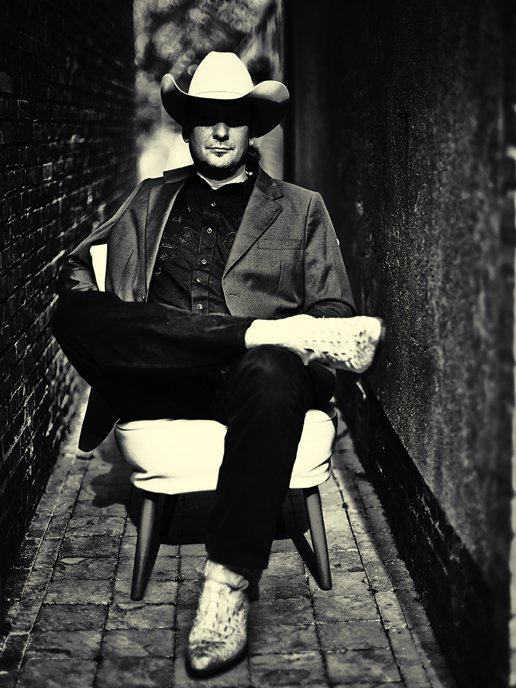

Herman Brock Jr. naar Kultuurfabriek Kooiaap

,Als je niets te zeggen hebt kun je beter je mond houden’

Door Harry de Jong

De uit Zeeuws -Vlaanderen afkomstige Herman Brock Jr. is een bluegrassmuzikant die zijn sporen in de muziek ruimschoots verdiend heeft. Maar hij blijft zich vernieuwen. Op z’n recente album The Old World legt hij de link tussen Zeeland en Amerika.

Brock zingt over de grond waarop hij groeide en over zijn dromen op een manier waarop menig Amerikaanse bluegrassmuzikant jaloers mag zijn. Zelfs de legende van de Vliegende Hollander brengt hij tot leven in onvervalste bluegrass klanken. Brock wordt daarbij niet alleen geassisteerd door z’n eigen begeleidingsband the Brockettes, maar ook door The Blue Grass Boogiemen. De noten vliegen je soms in duizelingwekkend tempo om de oren, maar dat gaat nergens ten koste van de emotie. Toch mooi dat uitgerekend een Zeeuw moet bewijzen dat Amerikaanse bluegrass nog lang geen doodgespeeld genre is.

Dat Brock Jr. ook buiten countrykringen steeds meer bijval krijgt, bewijst zijn succesvolle optreden op de meest recente editie van Lowlands. Samen met zijn Brockettes maakte hij er een gedenkwaardig feestje van.

Herman heeft het niet van een vreemde, want zijn pa was een groot countryliefhebber en hij heeft zijn zoon met dat virus besmet. In zijn woning in het Zeeuwse Hoek drinkt Herman thee uit een mok met de afbeelding van the Carter Family en dat geeft wel aan hoe diep de liefde zit. ,,Ik heb countrymuziek gehoord zolang ik me kan herinneren,’’ lacht Herman. ,,Het is me dan ook in de genen gaan zitten. Als peuter blèrde ik al liedjes van Hank Williams en Jimmie Rodgers mee.’’

Op z’n dertiende leerde Herman gitaarspelen en vanaf dat moment wist hij dat hij als muzikant verder door het leven wilde. Aan optredens was meteen al geen gebrek, want pa lijfde zoonlief als sologitarist in bij diens countryband. ,,De materie voor mijn eindexamen van de Havo heb ik in de bandbus geleerd,’’ vertelt Herman. ,,Ik wilde alleen maar muziek maken, maar het was wel handig dat ik daarnaast een schooldiploma op zak had.’’

Hij zou tot z’n 23ste deel uit maken van de band van Brock senior. Daarna was het tijd om op eigen benen te staan. ,,Ik heb ontzettend veel van pa opgestoken,’’ zegt Herman achteraf. ,,Hij zorgde ervoor dat ik met muziek echt de diepte in ging. Geen oppervlakkig geneuzel. Maar toen ik bij hem stopte, wilde ik even een paar jaar iets anders.’’ En dus begon de muzikant in Terneuzen een eigen café. Daarnaast begon hij met het geven van gitaarles. Een van z’n eerste leerlingen was Lizz Spangers en met haar zou hij korte tijd later een duo vormen. Al snel voegde zangeres Geertje van den Berg zich bij hen en toen zij ook nog de mandoline onder de knie kreeg, waren the Brockettes geboren. Een vrouwelijke bluegrassformatie waarmee Herman tot op de dag van vandaag furore maakt.

De afgelopen jaren maakte de groep vijf albums en toerde regelmatig door het land van Uncle Sam. Herman: ,,Na een jaar of twee heb ik het café van de hand gedaan en sindsdien staat mijn leven helemaal in het teken van muziek. Naast mijn muzikantenbestaan geef ik alleen nog gitaarles.’’ In Amerika trad Brock Jr. regelmatig op met Jesse Dayton. ,,Toen die drie vliegtuigen zich op 11 september 2001 in het WTC in New York boorden, speelden wij net in een redneckkroeg in Texas. Wat een sfeertje. Iedereen stond met de rug naar ons toe om de gebeurtenissen op de televisie te volgen.’’

In al die jaren heeft Herman nauwelijks covers opgenomen. ,,Eigen werk, dat is belangrijk,’’ vindt hij. ,,In mijn liedjes wil ik wat vertellen. De verhalen van mijn opa en oma doorgeven die van Zeeuws Vlaanderen naar Amerika trokken om een nieuw leven op te bouwen. Daar heb ik mijn hele laatste album aan opgehangen. Dat vind ik mooi om te doen. Dan heb ik het gevoel dat ik wat te zeggen heb. Want als je niets te zeggen hebt, kun je beter je mond houden.’’
