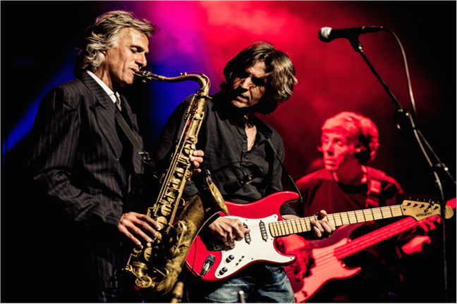

DOMBURG – In maart 2016 komt The Dire Straits Experience naar ons land voor drie concerten. De groep bestaat o.a. uit de voormalige leden Chris Wite en Chris Witten. De concerten zullen plaatsvinden op 10 maart in Tivoli/ Vredenburg Utrecht; 12 maart in de Music Club Kampen en 13 maart in 013 in Tilburg. De voorverkoop begint komende week.

Voor de enorme schare trouwe fans leek het einde van de wereld toen The Dire Straits in 1995 hun optredens staakten. Maar dankzij diezelfde bevlogen liefhebbers is de muziek van de razend populaire rockformatie meer levend dan ooit tevoren.  
Want de roep om songs uit het muzikaal universum dat The Dire Straits nalieten, is onverminderd groot, ook bij de jongere generaties. ‘The Dire Straits Experience’ geeft gehoor aan die roep.  
Dit is niet zomaar een tribute band, want twee van de voormalige leden van ‘The Dire Straits’, Chris White en Chris Whitten, maken deel uit van de selectie artiesten die de parels uit het oorspronkelijke repertoire ten gehore brengen zoals o.a. Sultans of swing, Money for nothing, Private investigations.

The Dire Straits Experience wordt verder gevormd door, Terence Reis, Richard Cottle, Paddy Milner, Tim Walters en Michael Féat. Deze muzikanten werkten samen met grote namen als Paul McCartney, Eric Clapton, David Bowie, Mick Jagger, Tina Turner en Mike Oldfield.  
De band weet de ongeëvenaarde muzikale klasse van The Dire Straits op uiterst authentieke manier te laten herleven. Zo meent Chris White dat bandlid Terence Reis de enige is die de vocale en instrumentale kwaliteiten van oud-Straits voorman Mark Knopfler kan evenaren.

