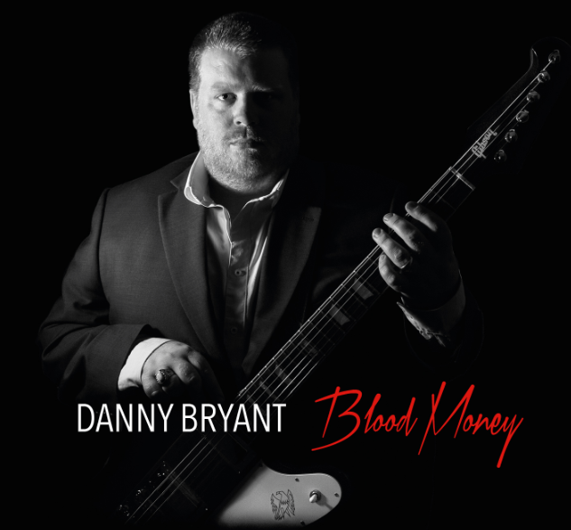

**“Working with Bernie Marsden and Walter Trout on this album has been a career highlight for me.”**

Met veel plezier kondigt Danny Bryant zijn nieuwe studioalbum ‘Blood Money’ aan, die op 29 Januari 2016 zal verschijnen via Jazzhaus Records/Coast to Coast. Bryant’s derde album is geproduceerd door Richard Hammertoe, en is de opvolger van ‘Temperature Rising’ uit 2014 en ‘Hurricane’ uit 2013. Gastmuzikanten op ‘Blood Money’ zijn Walter Trout en Bernie Marsden.

Danny Bryant: “I wanted to make this album ever since I began my musical journey 20 years ago as a 15 year old boy who fell in love with his parent’s record collection.”

Op Blood Money keert Bryant terug naar zijn roots en zijn liefde voor de blues door een hommage te brengen aan, zoals hij zelf zegt, “all the different influences and flavors of this wonderful music that I have loved for many years.” Zo is de song ‘On the Rocks’ een hommage aan Albert Collins, ‘Holding All The Cards’ een ode aan Jimmy Reed, terwijl ‘Unchained’ teruggrijpt naar vintage Albert King Stax recordings.

De titel track, ‘Blood Money’, is een nummer waar Bryant al een paar jaar op zat te broeden. Het wachten was op de juiste timing en een goede samenwerking om dit nummer tot leven te brengen. Hij schreef de track met Walter Trout in gedachten; de twee ontmoetten elkaar tijdens een concert toen Danny nog maar 14 jaar oud was, waarna Trout zijn gitaarleraar werd. “I wanted us to share the song with Walter,” zegt Bryant. “I am really thrilled that he agreed to play guitar on the track. I think his contribution is truly stunning.”

Een ander hoogtepunt tijdens de opnames van ‘Blood Money’ was de samenwerking met Bernie Marsden, een van Bryant’s favoriete gitaristen en singer-songwriters. Bryant nodigde Marsden uit om met hem een speciale ballad, getiteld ’Just Won’t Burn’, op te nemen. Ze namen het nummer slechts in een middag op, en Bryant mocht zelfs op Marsden’s beroemde Les Paul The Beast uit 1959 spelen.

