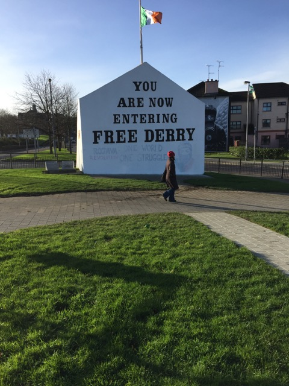
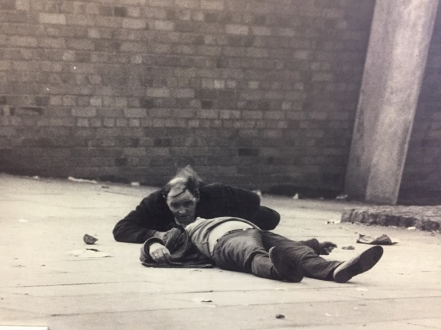
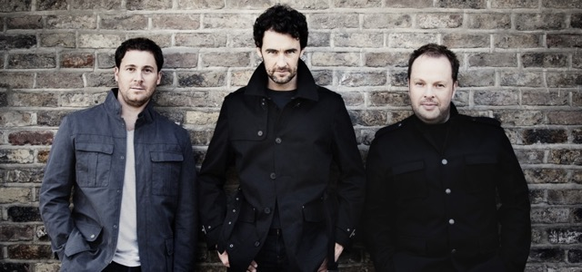

LONDONDERRY – Met z’n kleine en kleurige winkelstraatjes maakt Londonderry (90 duizend inwoners) in Noord-Ierland een vrij hippe indruk. De stad bruist het hele jaar door van muziek. Begin februari is er bijvoorbeeld het Imbolc Festival: een weeklang doen fameuze folkartiesten uit binnen- en buitenland de Noord-Ierse stad aan. Daarnaast vinden bijna elke avond wel popconcerten plaats in Nerve Center, een bruisend jongerencentrum aan The Magazine, waar Brian Fisher de scepter zwaait. Aan de muren hangen posters van the Undertones, de punkgroep die ooit Derry op de muzikale kaart zette en die nog steeds bestaat. De vijftigers zetten nog altijd een puike punkrockshow neer waar de vonken bijna vanaf vliegen. Met hun dunner wordende haren zien ze er allerminst meer uit als een stelletje rebellen, maar muzikaal zijn ze nog net zo bevlogen als in hun hoogtijdagen toen ze werden grijsgedraaid door dj John Peel en hun elpees Hypnotised, Positive Touch en The Sin Of Pride de winkels uitvlogen.

En Derry eert z’n helden. The Undertones scoorden hun eerste internationale hit met Teenage Kicks. En dat is ook de naam van een speciaal bier dat in deze stad ter ere van the Undertones gebrouwen wordt.

Als ik door de stad loop, raak ik onwillekeurig weer onder de indruk van de herinneringen aan de bloedige burgeroorlog die hier net zo heftig woedde als in Belfast. Ik passeer onder andere de plaats waar op 30 januari 1972 een vreedzame demonstratie uit de hand liep en het Engelse leger in koelen bloede dertien demonstranten doodschoot. Nog altijd staat die dag bekend als Bloody Sunday. Het drama werd verfilmd met James Nesbitt in de hoofdrol.

Die gedenkwaardige dag bereikte de spanning in Derry een hoogtepunt toen de katholieken besloten een politieke mars te organiseren door de stad. Een groep jongeren probeerde daarbij het centrum van de stad te bereiken, maar werd onderweg tegengehouden door het Britse leger. Er brak een gevecht uit en de jongeren begonnen stenen te gooien, waarop de soldaten reageerden met traangas en rubberen kogels. De situatie liep vervolgens volledig uit de hand toen het Britse hoofdkwartier melding kreeg van de aanwezigheid van een sluipschutter van de IRA in de regio.

Soldaten van het Britse parachutistenregiment kregen opdracht waar nodig het vuur te openen. Wat volgde was een massale eenzijdige schietpartij waarbij de Britse soldaten meer dan honderd kogels afvuurden op een grotendeels vluchtende menigte. Het eerste dodelijke slachtoffer van die dag was John Duddy, die in zijn rug geschoten werd terwijl hij rende voor zijn leven. Later zouden er nog twaalf anderen volgen. Tevens vielen er veertien zwaargewonden, waarvan er twee waren overreden door een Brits pantservoertuig.

De herinneringen aan die bloedige dag blijven voor altijd bewaard in het museum Free Derry, dat onlangs verhuisde vanuit de binnenstad naar de locatie waar de confrontatie zich afspeelde. Het bijzondere is dat er alleen personeel werkt dat iemand heeft verloren op Bloody Sunday. Bij mijn binnenkomst word ik door de jongen aan de balie onmiddellijk meegetroond naar de foto van een man die bloedend op straat ligt. ,,Dat is mijn opa. De kogel van een geweer ging dwars door zijn linkeroog.’’ Hij wijst op de foto van een militair die er naast hangt. ,,En dat is de Britse soldaat die het gedaan heeft. Hij is niet veroordeeld, maar onderscheiden. Mijn familie en ik zijn nog steeds bezig hem veroordeeld te krijgen. En op een dag gaat ons dat lukken.’’

De strijdbijl is maar ten dele begraven, zo blijkt. Toch is er veel veranderd. Er kan dan ook rustig worden gesproken van een Nieuw Ierland. En daar heeft muziek veel aan bijgedragen.

Twee protestanten en een katholiek uit het noorden en zuiden van Ierland die als een hecht trio op het podium staan. De befaamde drie tenoren the Celtic Tenors vertegenwoordigen het Nieuwe Ierland. Want volgens Daryl Simpson, Matthew Gilsenan en James Nelson zouden Ieren met een achtergrond als de hunne elkaar veertig jaar geleden de hersens in hebben geslagen. Maar de tijden zijn veranderd. De bloedige aanslagen van de IRA en de dagen dat protestanten en katholieken met het mes tussen de tanden tegenover elkaar stonden, zijn alleen nog maar een donkere schaduw van het verleden. Toch is de ,,geestelijke wederopbouw’’ van hun land echter nog lang niet voltooid, weten the Tenors.

Simpson: ,,We zijn alle drie opgegroeid in moeilijke tijden en daar hebben we blijvende littekens aan over gehouden. Ik kom uit een protestants gezin in Noord-Ierland en was getuige van een bomaanslag in mijn woonplaats Omagh, het grootste drama van de oorlog in 35 jaar. De datum 15 augustus 1998 staat voor altijd in mijn geheugen gegrift. Er was een autobom geplaatst in de winkelstraat en daarbij kwamen 29 mensen om het leven, terwijl er honderden gewonden vielen. Ik liep net over straat toen het gebeurde. Rook en vlammen, schreeuwende mensen, dode lichamen op straat, het leek allemaal zo onwerkelijk, het was alsof ik naar een oorlogsfilm zat te kijken. Die aanslag was gepleegd door een splintergroep van de IRA op een moment dat bijna iedereen de wapens had neergelegd. Ik heb altijd gebeden dat er een eind zou komen aan dat zinloze gemoord in ons land, ik heb de motieven van de IRA nooit begrepen. Mijn ouders hebben me geleerd om elk levend wezen met respect te behandelen. Ook al gingen protestanten en katholieken naar verschillende scholen, ik heb nooit een lijn tussen die verschillende geloven getrokken. Na die aanslag in Omagh heb ik een jeugdkoor opgericht waarin ik probeerde protestantse en katholieke jongeren bijeen te brengen door samen te zingen. Dat was mijn persoonlijke antwoord op dat geweld.’’

Harry de Jong

Foto 1: de plaats waar Bloody Sunday zic afspeelde

Foto 2: Een schokkende foto uit het museum Free Derry

Foto 3: de Celtic Tenors met links Daryl Simpson
