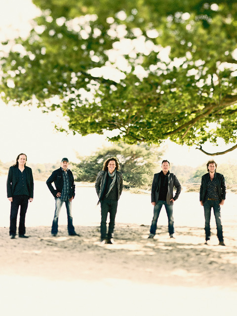

Op zaterdag 14 december a.s. viert de Friese popgroep De Kast in originele bezetting haar 30-jarig jubileum in de AFAS Live. 1989 was het jaar dat De Kast werd opgericht en was destijds de eerste Nederlandstalige band die in de AFAS Live voorheen Heineken Music Hall een concert gaf voor een uitverkochte zaal.

De band verkreeg grote populariteit door krakers als: In Nije Dei, Hart van mijn Gevoel, Eltse Grins Foarby, Woorden Zonder Woorden, In de Wolken en Raak. In totaal heeft de groep ongeveer 14 top-40 hits gehad in haar carrière.

Photo © Henk Bleeker
