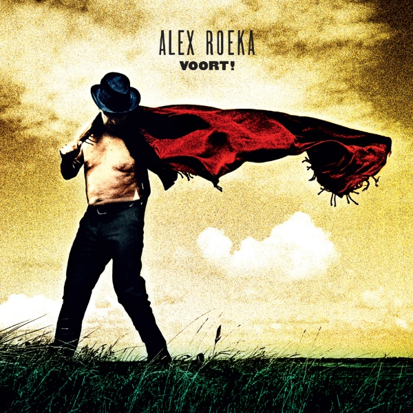

Alex Roeka komt op 16 oktober terug met een nieuw album. Eigenlijk had Alex een sabbatical voorgenomen, maar er kwam weinig van terecht, met wellicht zijn beste album als resultaat.

Het eerste nummer van Voort! was al kort na aanvang van de voorgenomen pauze geschreven. “Ik kwam in een roes terecht en schreef het ene na het andere nummer. Al snel had ik er een stuk of twintig. Toen ben ik met producer Reyer Zwart in een kelder gaan zitten en hebben we de liedjes uitgewerkt en in demo opgenomen. Later hebben we het in de studio nog een dunnetjes over gedaan.”

Voort! is zijn tiende album. In de lijn van zijn vorige platen, maar toch een andere toon. Alex: “Ik kan dat zelf moeilijk beoordelen, maar mensen die het weten kunnen, zeggen dat er meer lucht in de liedjes zit, dat ze meer ademen, dat ze lichter zijn dan in het verleden.”

“Het lijkt wel alsof het zwarte en soms zware vitalisme van Roeka’s vroegere werk geleidelijk plaatsmaakt voor een lichtere, optimistischer toon, schreef Bert Wagendorp. “Alsof hij, naarmate hij het leven beter begrijpt, er ook meer van geniet. ‘De wereld is oud en versleten/ maar het leven nog jeugdig en sterk’ (Vrolijk Ochtendlied). Hij kan toe met kleinere woorden, zijn pen is milder geworden.”

Of zoals Erik de Jong (Spinvis) aan Alex schreef na het horen van Voort!: “Alle liedjes zijn mooi. Allemaal. De woorden zorgvuldig gekozen en trefzeker in de melodie geplaatst. Liedjes die de tijd nemen en verdienen. Ik geloof echt dat je nu een richting en een land hebt gevonden waar je rustig tot je honderdste in rond kunt reizen. Dit zou zomaar een klassieker kunnen worden.”

Er bleek onbedoeld een verhaal in de songs te zitten en dat heeft tot het theaterprogramma geleid. Hoe je je al schrijvend bewust wordt van jezelf, je verleden en de wereld om je heen en daardoor je evenwicht terugvindt.

De release van het album, inmiddels zijn derde op Excelsior Recordings, is op 16 oktober. Op 26 oktober gaat het gelijknamige theaterprogramma in premiere in de Kleine Komedie in Amsterdam, waarop een tour volgt die loopt tot april volgend jaar.

<iframe src="https://www.youtube-nocookie.com/embed/q08ht5c8-e0" title="Video" loading="lazy" allowfullscreen=""></iframe>

