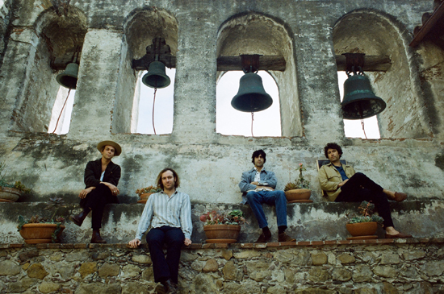

Allah-Las brengt op 9 september het nieuwe album Calico Review uit en geeft nu alvast een eerste voorproefje met de video voor Famous Phone Figure, geregisseerd door Robbie Simon. Met haar delicate strijkerpartijen en minutieus drumthema schommelt Famous Phone Figure heen en weer tussen karakters en laat de video het fantoom verdriet van de onbekende vrouw zien. Het nummer is illustratief voor de gave van Allah-Las om je in de stemming te brengen waarin zij verkeren. Voorafgaand aan de release van Calico Review komt Allah-Las in juli naar Nederland voor twee shows. Op 4 juli staat de groep in Tivoli/Vredenburg in Utrecht en op 16 juli op het KlikoFest in het Patronaat in Haarlem.

Calico Review, de opvolger van Worship The Sun uit 2014 en het gelijknamige debuut uit 2012, is een resultaat van en bouwt verder op de lessen die de groep tot dusver heeft geleerd en is het meest diverse werk van Allah-Las tot nu toe. Het album is opgenomen in de historische Valentine Recording Studio in Los Angeles dat sinds 1979 een slapend bestaan leidde. De heropening in juli 2015 stelde band in staat de klassieke apparatuur te gebruiken waaronder een Universal Audio 610 soundboard uit 1964, hetzelfde board waarmee The Beach Boys het legendarische album Pet Sounds opnam. Voor Calico Review heeft Allah-Las geëxperimenteerd met nieuwe instrumenten en heeft viola, harpsichord, Mellotron en theremin aan haar muzikale palet toegevoegd. Waar de specifieke invloeden en voorliefde voor bepaalde stijlen op de voorgaande albums duidelijk naar vormen kwamen, heeft de groep ditmaal meer gevoelens van vrijheid, puurheid en melancholie in haar muziek verwerkt.

Allah-Las bestaat uit Pedrum Siadatian (vocals, lead gitaar), Miles Michaud (vocals, rhythm gitaar), Matthew Correia (vocals, drums) en Spencer Dunham (vocals, bass). De band werd in 2008 opgericht op het moment dat drie leden bij befaamde platenzaak Amoeba Music werkten. Matthew Correia: “We were all music fans before we were musicians. We’ve spent a lot of time listening to music, and understanding what works for us and what doesn’t.”

<iframe src="https://www.youtube-nocookie.com/embed/snI7GGNXqnw" title="Video" loading="lazy" allowfullscreen=""></iframe>

