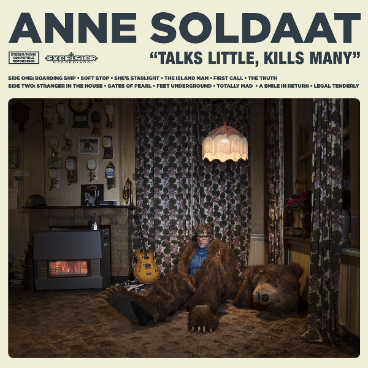

Anne Soldaat, die zijn vijftigste verjaardag vierde met de release van zijn album Talks Little, Kills Many, zal op dinsdag 22 december een intiem en bijzonder concert geven met zijn band en speciale gasten.

De show wordt georganiseerd door Sugarfactory en de Waalse Kerk. De kaartverkoop is begonnen via www.sugarfactory.nl Vandaag verscheen in de Metro een interview met Barend Toet, initiator vanuit de Waalse Kerk als nieuwe locatie voor popconcerten. Lees het interview hier.

De afgelopen jaren speelde Soldaat met de bands van Tim Knol en Freek de Jonge, ging hij op pad met Clean Pete en schrijfster Maartje Wortel en keerde zijn band Daryll-Ann een jaar lang terug op de podia met hun reünie-tour.

Vorig jaar nam Soldaat twaalf nieuwe liedjes op, met een andere aanpak dan op z’n vorige twee platen. Want voor de albums In Another Life (2009) en Anne Soldaat (2012) toog de zanger en gitarist nog naar Los Angeles om zijn werk op te nemen met Jason Falkner (Beck, Air, Daniel Johnston). Voor zijn derde plaat bleef hij dicht bij huis. Opgenomen in Amsterdam (Volkshotel en Studio Sound Enterprise Noord) en ingetogener en akoestischer dan men van hem gewend is.

Soldaat speelde vrijwel alle instrumenten zelf. Hier en daar begeleid door harp en strijkkwartet met arrangementen van Reyer Zwart. Een plaat die herinnert aan werk van Loudon Wainwright III of Randy Newman, maar ook Golden Earrings Back Home herroept op het nummer The Island Man, waarvoor hij Barry Hay durfde te vragen om de dwarsfluit nog een keer te spelen.
