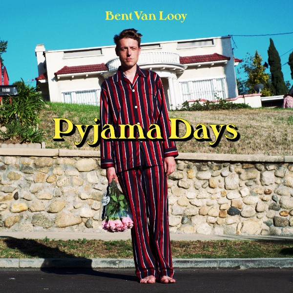

Bent Van Looy komt op 6 mei met zijn tweede soloplaat Pyjama Days via Excelsior Recordings. Het multitalent Van Looy heeft zichzelf voor dit album de volledige vrijheid gegeven. Soms wist hij ’s ochtends nog niet wat er ’s avonds op tape zou staan. Nooit eerder heeft hij zichzelf en de luisteraar zo vertrouwd. Er waait een aangename wind door de tracks, ook nu weer geproduceerd door zijn held Jason Falkner.

Het gevolg is een album dat gaat over vrijheid. Pyjama Days is het verhaal van iemand die na vele omzwervingen thuis is gekomen om de mensen te vertellen wat er in de wereld te vinden is. Liefde, verdriet, eenzaamheid, kracht, alles, als je maar goed kijkt. Hij overhandigt ons zijn bloemen en zegt: ‘Heb de moed om de deur uit te gaan en een tram te nemen die je nog nooit hebt genomen.’

Bent Van Looy speelt werk van de nieuwe plaat voor het eerst met band live spelen op Here Comes The Summer, de voorjaarseditie van Into The Great Wide Open op Vlieland. Op 10 juni presenteert Van Looy het album in TivoliVredenburg, Utrecht.

Soms lijkt het op dit album alsof de zanger jaren heeft besteed aan vluchten. ‘For so long I have been running around in circles, trying to get the better of my shadow.’ (uit Wind is Blowing.) ‘A dog chasing its tail.’ (uit 1000 Deaths.) Jaren van ‘cutting corners’ (Today and Forever), van ‘closing your eyes and playing it cool’ (Little Star) zijn voorbij. Aan het woord is een Bent van Looy die veel heeft afgeschud, maar het belangrijkste heeft behouden. We horen iemand die de behoefte alles te controleren heeft opgegeven, iemand die zich niet meer hoeft te bewijzen. Alle pose, alle geldingsdrang is verdwenen. Bent van Looy staat in zijn pyjama voor u, op blote voeten, met een bosje bloemen.

Bent Van Looy (1976) groeide op in een boshut ten noorden van Antwerpen. Toen op een dag de fanfare voorbij trok werd duidelijk dat hij muzikant zou worden. Op zestienjarige leeftijd verlaat Bent het ouderlijke huis en trekt naar Gent, waar hij met drie klasgenoten Things To Come opricht, de band die, onder de naam Das Pop, in 1998 Humo’s Rock Rally zal winnen. Het komende decennium maakt Das Pop 4 zeer gesmaakte platen en toert de groep onvermoeibaar door het vaderland, de rest van Europa en Japan.

Bent Van Looy heeft het moeilijk zich te concentreren op één ding en laat zich in met de schilderkunst, TV-werk en zelfs een eigen radioprogramma met levende dieren op Studio Brussel. Bent is betrokken bij het prestigieuze Franse mode-label Le Mont St Michel met zijn eigen label The Jante Law. Verder ontwerpt hij het etiket voor de wijn Cuvée BVL. Hij werkt muzikaal samen met de Zweed Peter Von Poehl, het Franse Chateau Marmont en hij blijft ook actief als drummer bij zijn jeugdvrienden Soulwax.

In 2005 verhuist Van Looy naar Parijs en schrijft daar songs die terecht zullen komen op zijn eerste soloplaat Round The Bend (2013). Bent Van Looy blijft ook ondertussen niet stil zitten. Hij wordt coach bij The Voice van Vlaanderen (2014 én 2016) en neemt de tv-kijker mee op zijn wandelingen in verschillende steden tijdens de rubriek De Wandelaar voor Café Corsari. Ook de Belgische versie van beertje Paddington krijgt de stem van Bent Van Looy. Voor Klara verdiept hij zich in de twee recentste edities van The Original Soundtrack in Franse & Engelse filmmuziek. Daarnaast is Van Looy regelmatig te gast in tv-show De Wereld Draait Door (NL) en gaat in het programma ‘Bent Spreekt Nederland’ op zoek naar de verschillende dialecten in Nederland.
