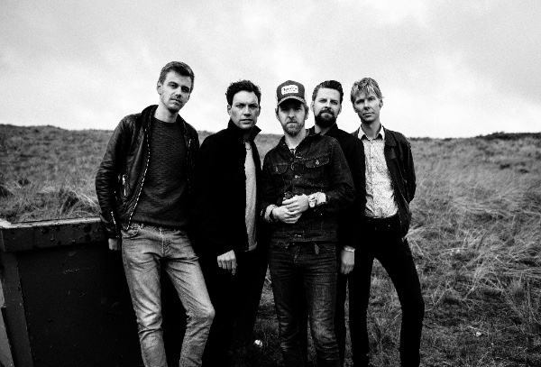

**Bewilder is voortvarend van start gegaan na de doop van het debuutalbum Dear Island op Into The Great Wide Open. Waar anders dan Vlieland kon de campagne beginnen voor de nieuwe band rond Maurits Westerik.**

De band werd gekozen tot Radio 2 Talent voor de maanden september en oktober met de single The Unknown. Het album werd album van de week bij 3VOOR12 en kreeg lovende recensie in landelijke dagbladen als de Volkskrant en Trouw en haalde de eerste plaats in de Vinyl Top 50 en verkocht al snel de eerste persing van het vinyl uit. De band speelde vervolgens bij o.a. De Wereld Draait Door, 3VOOR12 Radio, GIEL, Muziekcafe, De Staat van Stasse en BNN That’s Live. De Utrechtse band kwam live op stoom in het voorprogramma van de Nederlandse tour van Saybia.

Bewilder begint op 29 oktober in Paradiso Amsterdam met een tour langs de clubs en is inmiddels bevestigd voor het Crossing Border festival in Den Haag. Ondertussen zijn er al data voor 2016 aan het tourschema toegevoegd. Zie onder voor de volledige lijst.

Bewilder duidt op het woord ‘wildernis’, een toestand waar zanger Maurits Westerik zo’n twee jaar geleden in verkeert. Hij heeft bergen ideeën en stapels liedjes. Vrienden aan wie hij het laat horen, stellen direct voor om er als band mee aan de slag te gaan. De band vertrekt naar Excelsior’s buitenverblijf op Vlieland, waar de band met producer Henk Jonkers (Hallo Venray) eerst demo’s opneemt en later werkt aan een volledig album. Bewilder de band. Dear Island de plaat.

Dear Island staat vol onverwachte wendingen, je weet vooraf nooit hoe het afloopt. Dat past ook goed bij de Twin Peaks tic die alle bandleden met elkaar delen, en die zich muzikaal uit bij de soms zacht glooiende synthesizerpartijen van Arjen de Bock. Alsof soundtrack componist Angelo Badalamenti mee gluurt over zijn schouders. De andere bandleden, drummer Bram Hakkens, bassist Jeroen Overman en gitarist Arjan Kamphuis voegen de elementen swing en rock toe aan de intrigerende spanningsboog.

**Live data Bewilder:**

do 29 okt: Amsterdam – Paradiso (albumpresentatie)  
vr 13 nov: Den Haag – Crossing Border Festival  
za 14 nov: Rotterdam – 6e Nacht van NRC  
do 19 nov: Kampen – Music Club (support Racoon)  
vr 20 nov: Eindhoven – Altstadt  
vr 27 nov: Leeuwarden – Asteriks  
vr 18 dec: Utrecht – Ekko

vr 29 jan: Eindhoven – Effenaar  
do 04 feb: Arnhem – Luxor Live  
vr 05 feb: Amersfoort – Fluor  
vr 19 feb: Nijmegen – Merleyn  
vr 04 mrt: Emmen – Apollo  
do 10 mrt: Den Haag – Paard van Troje  
zo 20 mrt: Rotterdam – Rotown

**Bewilder:**

Maurits S. Westerik zang, gitaar  
Arjan Kamphuis gitaar  
Bram Hakkens drums, zang  
Jeroen Overman bas  
Arjen De Bock toetsen, zang

<iframe src="https://www.youtube-nocookie.com/embed/DGSlhIin6Dc" title="Video" loading="lazy" allowfullscreen=""></iframe>

