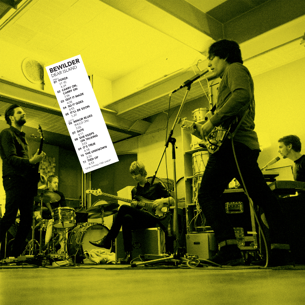

Bewilder duidt op het woord ‘wildernis’, een toestand waar zanger Maurits Westerik zo’n twee jaar geleden in verkeert. Hij heeft bergen ideeën en stapels liedjes. Vrienden aan wie hij het laat horen, stellen direct voor om er als band mee aan de slag te gaan. De band vertrekt naar Excelsior’s buitenverblijf op Vlieland, waar de band met producer Henk Jonkers (Hallo Venray) eerst demo’s opneemt en later werkt aan een volledig album. Bewilder de band. Dear Island de plaat.

Dear Island staat vol onverwachte wendingen, je weet vooraf nooit hoe het afloopt. Dat past ook goed bij de Twin Peaks tic die alle bandleden met elkaar delen, en die zich muzikaal uit bij de soms zacht glooiende synthesizerpartijen van Arjen de Bock. Alsof soundtrack componist Angelo Badalamenti mee gluurt over zijn schouders. De andere bandleden, drummer Bram Hakkens, bassist Jeroen Overman en gitarist Arjan Kamphuis voegen de elementen swing en rock toe aan de intrigerende spanningsboog.

Bewilder songs zijn van een groovy, meeslepende indie snit. Voor het countryachtigeShe Keeps on Talking slaan ze een rustig duinweggetje in. De liedjes eindigen nooit zoals ze zijn begonnen. ‘Ze zijn zo onheilspellend als de eerste slok van je favoriete cocktail. Het voelt vertrouwd, maar het loopt alleen net even anders af,’ licht Westerik toe. ’Tot op heden hebben we nog niet één optreden hetzelfde gedaan.’ Het blijft altijd enerverend. En anders zorgt producer Jonkers daar wel voor. Voor de folky prachtballad So It Goes stuurt hij Westerik de studio uit, om het nummer in te zingen in een andere ruimte om aldus oogcontact met de band te vermijden. Dat zorgt hoorbaar voor extra opwinding. Een keer, op de track Tied Up, speelt hij zelfs de bas. De vaste bassist kan er niet mee zitten, want op dat moment kent hij het nog onvoldoende. Om het te kunnen, spelen, moet je weten hoe het afloopt, en dat weet je dus nooit bij Bewilder. Van die dingen!

De muziek van Bewilder laat zich ook mooi in beelden vangen. In 2014 wordt de op een funky gitaarriff gebouwde track Safe al losgelaten op het publiek als krachtige achtergrondmuziek bij een korte documentaire over het duurzame transport over zee naar het Into The Great Wide Open festival op Vlieland. In maart van 2015 is daar ineens de sfeervolle video bij So It Goes, gevolgd door een door Westerik zelf geschoten video bij Carry On, Carry On in juni 2015.

In het verleden behaalde resultaten bieden wel degelijk een garantie voor de toekomst. Zeker als dat vooruitzicht ligt in Bewilder, een nieuwe band met bekende gezichten. Afzonderlijk van elkaar maakten ze de afgelopen jaren al vele kilometers. Maar goed, we kijken naar voren. Op 28 augustus verschijnt Dear Island op Excelsior Recordings. Bewilder doopt het album, toepasselijk genoeg, op Into The Great Wide Open op Vlieland.

Voorlopige live data Bewilder:  
5 juli: Hoogtevrees Festival, Deventer  
19 augustus: De Bolder, Vlieland  
30 augustus: Spoel Festival, Culemborg  
4/5 september: Into The Great Wide Open, Vlieland  
29 oktober: Paradiso, Amsterdam  
20 november: Altstadt, Eindhoven  
27 november: Asteriks, Leeuwarden

Bewilder:

Maurits S. Westerik zang, gitaar  
Arjan Kamphuis gitaar  
Bram Hakkens drums, zang  
Jeroen Overman bas  
Arjen De Bock toetsen, zang

<iframe src="https://www.youtube-nocookie.com/embed/A09_9Tww-qM" title="Video" loading="lazy" allowfullscreen=""></iframe>

