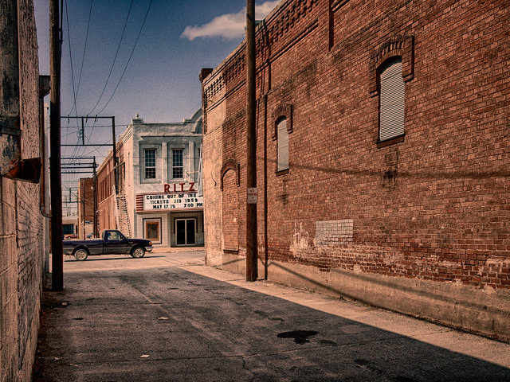
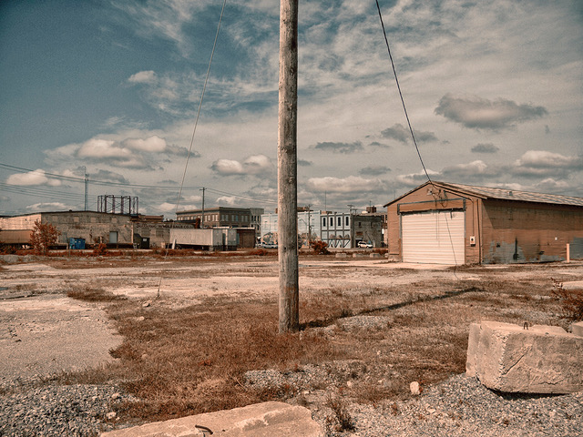

## Buckle Up Ya’ll, it’s the law!

Door Herman van der Horst

Buckle Up Ya’ll, it’s the law! staat er op de lichtgevende borden boven de highways. Om ons eraan te herinneren dat we nog steeds Down South zijn. That ole Hillbilly Highway goes on and on…Op weg naar het derde punt in de muziekdriehoek: de Music City zelf. Tennessee is prachtig. Frisgroene, met ronde hooischelven versierde graslanden glooien aan weerszijden van de weg. Afgebiest met hekken die zo wit zijn dat ze bijna licht geven. Alles aan dit landschap oogt, ruikt en proeft als oma’s zelfgebakken appeltaart.

Alleen van de soundtrack die de radio ons aanbied, worden wij niet vrolijk. Grofweg bestaat het aanbod uit slechts twee soorden muziekzenders. De zogenaamde ‘classic rock’ stations, die ieder uur dezelfde tien rocktracks uit de jaren zeventig draaien, alleen dan steeds in een andere volgorde. Daarnaast heb je zenders die continu een anoniem en wezenloos soort popmuziek uitbraken. Deze gelikte pop moet schijnbaar voor hedendaagse country doorgaan en wordt geproduceerd in Nashville. Geen wonder dat er zoveel misvattingen over deze stad bestaan.  
Bij aankomst duiken we onmiddellijk in de Whiskey Bent Saloon, waar een akoestisch duo juist een vlekkeloze vertolking inzet van Merle Haggard’s Sing Me Back Home. Voor de goede orde: dit is de honky tonk row op Lower Broadway, pal naast de Ernest Tubb Record Shop, de Conway Twitty Gift Shop, western kleding winkels en nog veel meer honky tnks. Dit is het oude Nashville waar alle toeristen onder de neonlichten struinen. Dit is wat inwoners bedoelen als ze het hebben over Nashvegas. Maar zelfs hier is de levende muziek die rond de klok tegen fooien in alle etablissementen en op straat wordt gepresenteert, van een opmerkelijk niveau. De lat ligt hoog in Guitar Town, van oudsher de stek van de beste pickers en steelgitaarbreiers ter wereld.

Schuin aan de overkant ligt Tootsie’s Orchid Lounge, het sjovele café waar Willie Nelson na een optreden zijn eerste songschrijvers opdrachtkreeg. Tootsie was Hattie Louise Bess, een omvangrijke en moederlijke vrouw – ooit heette haar tent Mom’s – die bereid was om krediet te verlenen aan een songschrijver die al een tijdje geen hit meer had gebakken. Ze was ook royaal in het gebruik van een scherpe hoedenpen of haar politieknuppel als iemand bij sluitingstijd niet snel genoeg vertrok. Op een avond, toen een beroemde muzikant zijn geslachtsdeel op de bar kwakte, koos ze voor de politieknuppel, om voor altijd een eind te maken aan die manier van betalen.

Terwijl het reguliere publiek beneden dronk, kwamen op de tweede verdieping de songschrijvers bijelkaar om onder het genot van een hapje en een drankje songs uit te wisselen. Tot de eerste vaste klanten behoorden Mel Tillis, Patsy Cline en Kris Kristofferson. Vanuit Tootsie’s achteruitgang hoefden zij slechts een smal steegje over te steken naar de backstage van het Ryman Auditorium. De ‘Mother Church of Country Music’, van waaruit tussen 1943 en 1974 de legendarische live radio show Grand Ole’ Opry werd uitgezonden. Hiet stonden Hank Williams en Patsy Cline en trapte Johnny Cash alle vloerlichten uit. Voor iedere artiest – hoe alternatief of tegendraads ook – is het een eer om op het podium van dit schitterende historische theater te staan.

Net buiten downtown vinden we de boosdoener; de bron van al die bloedeloze countrypop die onophoudelijk uit de autoradio stroomt. Het is de befaamde Music Row, waar alle muziekuitgeverijen, studio’s en grote platenfirma’s gevestigd zijn. Niet alleen is de Row opmerkelijk klein, het ziet er helemaal niet uit als een miljoenen business. De tien blokken met lieflijke vilaatjes, gerenoveerde één tot drie verdiepingen huizen en veel bomen wekken eerder de indruk van een universiteit campus. De knappe, videovriendelijke jongemannen met hun strakke jeans, laarzen en onvermijdelijke Stetsons, vandaar aangeduid als ‘de hat-acts’ en de zingende barbiepoppen die hier gelanceerd worden, mogen dan de countryradio en –hitlijsten domineren – ze definiëren deze stad allang niet meer. Nashville’s levendige muziekscene wordt getekent door country met hart en ziel, americana en uiteenlopende singer-songwriters. En ze blijven komen uit alle windstreken. Iedereen die we spreken, bevestigt het: Nashville is booming.

Hoe weet je wanneer je in East Nashville bent? Gewoon de baarden volgen, aldus een lokale grap. East Nashville ligt aan de andere kant van de Cumberland River en is de plek waar alle hipsters wonen. Een alternatieve enclave, die in de persoon van singer-songwriter Todd Snider zelfs zijn eigen onofficiële burgemeester heeft. In de Amerikaanse pers wordt veel over East Nashville geschreven. De New York Times bejubelde de talloze trendy boutiques, galleries en restaurants. Rolling Stone riep de muziekscene uit tot de beste van de V.S. Typerend is dat de inwoners zelf geen ene moer om die hype geven.

‘Het punt met Nashville is dat wij heel nonchalante mensen zijn’, zegt zangeres Caitlin Rose. ‘Wij zijn geen schouderkloppers, in de zin dat we alles fan-tas-tisch vinden. In andere mediasteden krijg je dat soort overbodige aanmoedegingen. Nashville laat je gewoon je ding doen en zegt: bekijk het maar. Zodra je met iets komt wat echt de moeite waard is, komen we wel kijken. Daarom kon ik hier mijn ‘ambacht’ ontwikkelen. In Nashville kon ik een podium opklimmen, mijn valse giraar spelen, flauwe grappen vertellen en de mensen toch amuseren.’  
Caitlin Rose is de nieuwe Koningin van Nashville, al heeft haar muziek niets met Music Rowe te maken. Ze wordt vergeleken met haar helden Patsy Cline en Loretta Lynn, maar dat vindt ze zelf niet van toepassing.

Deze avond treedt ze op in The 5 Spot, een muzikantencafé in East Nashville. In het kader van de ‘Country & Western Wednesdays’, een wekelijkse serie in dit café, waarbij verschillende artiesten afwisselend of samen country klassiekers vertolken. Waaronder grote, aanstormende talenten als Robert Ellis, Jason Isbell en Stugill Simpson, die zich vanuit respectievelijk Houston, Texas, Muscle Shouls, Alabama en Lexington, Kentucky min of meer recentelijk in Nashville hebben gevestigd. Ditmaal vult Caitlin de avond samen met een vijftal zangeressen. Opvallend aan deze ongedwongen revue is dat er geen spoortje nostalgie of onderlinge competitie aan kleeft. Het is een girl’s night out van een stel vriendinnen die hun biertjes en hun liefde voor klassieke country delen.

In de kern is Nashville kleinsteeds, een groen uitspansel van zachthellende heuvels, waar je, op slechts een paar blokken van downtown, possums en herten door de voortuinen kunt zien glippen. Het combineert de levenskwaliteit van een metropool met de vriendelijkheid van een provinciestad. Geen wonder dat het zoveel getalenteerde muzikanten uit andere muziekcentra en genres aantrekt. Tot de prominenten die de stad recentelijk tot hun permanente domicilli herbben gekozen, behoren de rockgroep Kings Of Leon, Black Keys’ gitarist Dan Auerbach, die er zijn Eagle Eye studio heeft, waar hij onder meer Dr. John’s plaat Locked Down heeft opgenomen. Alsmede Jack White die er ook een studio en een platenlabel (Third Man Records) drijft.

‘Nashville is een van de weinige steden waar de muziekbusiness nog intact is’, verklaart Chris Wood. Met zijn broer Oliver groeide hij op in Boulder, Colorado, waarop hun wegen scheiden. Oliver vertrok naar Atlanta, waar hij bij bluesrocker Tinsley Ellis ging spelen. Chris studeerde jazz basgitaar en verhuisde naar New York, waar hij Medeski Martin & Wood oprichtte. Zes jaar geleden besloten ze om weer samen te spelen en debuteerden ze als The Wood Brothers op het Blue Note label. Maar pas op hun recente plaat The Muse, opgenomen onder de bezielde leiding van Buddy Miller in Nashville’s Southern Ground studio – waar we de broers ontmoeten – komt hun unieke hybride van blues, gospel, funk, country en folk tot volle wasdom. Twee jaar geleden hebben de broers zich permanent in Nashville gevestigd.

‘In de V.S. wordt de muzikant niet geaccepteerd als deel van de werkende stand’, zegt Oliver. ‘Als je iemand vertelt dat je muziek maakt voor de kost, kijken ze je raar aan en zeggen: ja, maar wat doe je écht..? In Nashville zijn zoveel professionele muzikanten, dat je hier jezelf nooit hoeft uit te leggen en dat je het gevoel hebt er echt bij te horen.’ ‘Alleen al het feit dat John Prine hier woont, vind ik ongelofelijk’, vult Chris aan. ‘Zelfs al zullen we hem nooit ontmoeten, het voelt goed om onder zoveel geweldige artiesten te zijn.’

Het is een hardnekkig misverstand dat countrymuziek puur blanke, zuidelijke en plattelandelijke oorsprongen heeft. Van meet af aan was het een hybride van talloze populaire en religieuze muziekstijlen. De meest baanbrekende en invloedrijke figuren uit de countryhistorie, A.P. Carter, Bill Monroe, Bob Wills, Hank Williams, Johnny Cash, Brenda Lee en Buck Owens, om er maar een paar te noemen – allemaal hadden ze zwarte muziek mentors. Gedurende het grootste deel van de vorige eeuw claimde de wekelijkse zaterdagavond radiouitzending van de Grand Ole Opry variété show de hoogste luisterdichtheid ter wereld. In de late jaren dertig bevond zich onder de talloze Afro-Amerikanen die geen enkele uitzending mistten, een jochie uit Greenville, Florida, die op zou groeien om Modern Sounds in Country and Western Music te maken, een briljante serie r&b interpretaties van klassieke country songs: Ray Charles.

Als er momenteel iemand is wiens oeuvre laat horen dat country ook soul is en andersom, dan is het Buddy Miller. ‘Voor mij is dat allemaal één ding’, zegt hij. ‘Toevallig sprak ik gisteravond met mijn vrouw over muziek; iets wat we overigens zelden doen. Ze zei: Er bestaat helemaal niet zoiets als countrymuziek. Er zijn alleen mensen en muziek. De mensen die de muziek verkopen, plakken er namen op. Zodra er geld bij te pas komt, wordt het gecategoriseerd.’ We zitten temidden van een indrukwekkende verzameling antieke gitaren in Miller’s huisstudio, nota bene op spuugafstand van Music Row. In deze zonverlichte ruimte bracht hij de gitaristen Greg Leisz, Bill Frissell en Marc Ribot bijelkaar voor zijn The Majestic Silver Strings album. Hier tuurde Richard Thompson door de muurhoge ramen naar de vogels in Miller’s tuin, om vervolgens fluitend de volgende briljante solo uit zijn mouw te schudden.

Buddy en zijn vrouw Julie Miller wonen al 22 jaar in Nashville. Ze kwamen hier niet naartoe om een droom na te jagen. Na de nodige omzwervingen raakten ze in Californië volledig aan de grond. Ze hadden geen geld, maar wel een woonplek nodig. Nashville was de allerlaatste optie, want daar kwam naar hun mening alle slechte muziek vandaan. Nadat Buddy in de stad arriveerde als vaste begeleider van de alternatieve countryzanger Jim Lauderdale, dacht hij: ‘We zijn platzak, maar ze houden hier van muzikanten. In Nashville worden muzikanten bijna als mensen beschouwd. Misschien kunnen we hier een huis ritselen. En dat lukte.’  
Ook lukte het hem om een liedje van zijn vrouw toe te spelen aan Emmylou Harris, die het tot hun stomme verbazing opnam. Waarop Buddy soliciteerde naar de vacature als gitarist in haar begeleidingsgroep. Sindsdien geldt voor Harris het adagium: ‘All a girl needs is a Buddy.’

De bescheiden muzikant weet zich op te werken tot een speerpunt van de americana. Alles waar hij zijn naam aan verbind, is van een uitzonderlijke klasse. Recentelijk is hij aangesteld als producer van de populaire t.v. show Nashville, die wordt uitgezonden door het nationale network ABC. Hij heeft het stokje overgenomen van T-Bone Burnette, wiens vrouw Calli Khouri (Oscar voor Thelma & Louise) de bedenkster en maakster van deze muzikale soapserie. Iedere aflevering bevat nieuwe en originele songs en die kiest Buddy uit. Daarvoor schakelt hij namen in als Patty Griffin, Lucinda Williams en Gillian Welch en struint hij alle muziekuitgeverijen in de stad af. ‘Een groot deel van de wereld, zelfs in de States, weet niet wat hier in Nashville werkelijk gebeurt. En dat kunnen we rechtzetten op de nationale televisie. Wij schotelen ze de goeie songs voor.’

Buddy Miller heeft deze stad de laatste jaren ingrijpend zien veranderen. Een stad waar je niet verbaasd moet staan wanneer je serveerster, behanger, loodgieter of postbode een songschrijver blijkt te zijn. Een stad die nu ook talloze singer-songschrijvers aantrekt, die niet noodzakelijkerwijs coutry zijn. Een ontwikkeling die paralel loopt met de komst van goede restaurants. Twintig jaar geleden, legt Buddy uit, was Nashville een culinaire ramp. Het een zou iets met het ander te maken kunnen hebben, overweegt hij. ‘Een goeie muzieksmaak leidt tot een goeie voedselsmaak. Hier woont op ieder blok een geweldige muzikant en er heerst een sterke onderlinge cameraderie. Het is een goeie stad, ik hou ervan.’

‘Oh, mag ik iets over een vriend van mij laten zien?’, zegt hij en diept een exemplaar op van de krant Nashville Tennesean. From Streetsinger To Global Superstar, luidt de kop van het verhaal. Recentelijk was de Zweedse country ster Jill Johnson in Nashville om een documentaire te maken voor de Zweedse televisie. Daarvoor interviewde ze straatmuzikanten. Voor een voedselbank vlakbij de Lower Broadway trof ze een muzikant, Doug Seegers, die al zeventien jaar dakloos door Nashville zwierf. Hij vroeg haar of hij een van zijn eigen songs mocht spelen. Johnson stond versteld en kon haar tranen niet bedwingen. De volgende dag nam ze Seegers mee naar de Cash Cabin, de privé studio van Johnny en June Carter Cash in Hendersonville, waar ze de song als duet opnamen. Het werd een nummeréén radio en download hit in Zweden. Drie maanden toerde Seegers langs grote festivals met Neil Young.

Toen Buddy bernaderd werd voor een langspeler, bleek Seegers een oude vriend van hem te zijn. Medio jaren zeventig had hij met Miller in een band gespeeld in Austin, waar hij bij Buddy en Julie inwoonde. Destijds noemde hij zich Duke the Drifter. Door zijn drukke werk voor de t.v. show moest Miller de produktie van Seegers’ plaat overlaten aan Will Kimbrough. Maar hij nam wel een duet met Seegers op en heeft Emmylou Harris overgehaald om op zijn plaat te zingen. ‘Tot voor kort sliep hij onder een brug. Ongelofelijk. Dát’, besluit Buddy Miller met een brede grijns, ‘is nou een echt Nashville verhaal.’

Noem me naïef’, zegt Ann McCrary, ‘maar mijn hele leven ben ik ervan overtuigd geweest dat Nashville een hoofdkwartier van de gospel was. Van kleinsaf was dat alles wat ik hoorde.’ We ziten met Ann’s zussen Regina, Alfreda en Deborah rond de keukentafel van hun ouders’ huis ten zuiden van downtown. Dat huis is het eigendom van alle acht McCrary kinderen en mag, indrachtig hun vaders’ testament, nooit verkocht worden. De zussen repeteren voor hun nieuwe plaat, die geproduceerd wordt door Buddy Miller. ‘Don’t let nobody turn you around’, zet Regina in met een brandende kracht die het vertrek ineen doet krimpen. Het is een song die lang geleden is opgenomen door The Fairfield Four, het fameuze gospelkwartet van hun vader, de in 1991 overleden Reverend Sam McCrary, een vroeg idool van B.B. King.

Naïef is Ann allerminst. Nashville is al een gospel hoofdstad sinds het begin van de 20ste eeuw. Vanaf 1871 ondersteunen de rondreizende Fisk Jubilee Singers de zwarte Fisk University in Nashville. En in de jaren dertig sluit een jonge Samuel McCrary zich aan bij The Fairfield Four, die zich via platen en radio optredens ontpoppen als baanbrekers en in 2000 hun tijdloze geluid verlenen aan de Coen Brothers soundtrack Oh Brother, Where Art Thou.

Tegen de tijd dat de zussen werden geboren, was Rev. McCrary predikant van de St. Marks Missionary Baptist kerk in Nashville’s zwarte wijk Germantown, maar muziek bleef een prioriteit. Hij boekte en promote lokale shows en bleef toeren met The Fairfield Four. Zijn dochters stonden hun slaapkamers regelmatig af aan de grootste gospel namen. The Staple Singers, James Cleveland en Shirley Ceasar behoorden tot hun huisgasten. De meeste gospel acts logeerden niet in hotels, leggen ze uit. Ann, de oudste McCrary dochter, zong al op haar tweede en reisde met haar vader over de gospel highway tot ze naar de kleuterschool ging. ‘Alle kinderen zongen’, zegt ze. ‘Voor mij was het vreemd om iemand te horen die niet kon zingen. Ik dacht dat er iets mis met hun was.’

Rev. McCrary’s grootste droom voor zijn kinderen was dat ze een groep zouden vormen. Met vier jongens en vier meisjes had hij twee kwartetten onder zijn dak. Maar kort na de familiegroep dreven de zussen uit elkaar. Ann trouwde op haar negentiende met een man die bij de luchtmacht zat, haar verbood te zingen en haar van de familie wegvoerde, eerst naar Texas en dan Italië. Ze kreeg een zenuwinzinking, want zingen was haar leven. Uiteindelijk eindigde ze in Nashville als een gescheiden vrouw met drie kinderen.

Ondertussen was Regina op haar zestiende zwanger geraakt van haar broer’s beste vriend. Haar muziekdromen leken, net als die van Ann, voorbij. Maar een paar jaar later kreeg ze via een vriendin een auditie bij Stevie Wonder. Regina werkte zes maanden met hem en kort daarop, in december 1978, belde diezelfde vriendin weer. Bob Dylan had een achtergrondzangeres nodig. Ze slaagde met glans voor de auditie. Voordat ze de baan kon nemen, moest Rev. McCrary haar nieuwe baas ontmoeten. Ze nam haar ouders backstage om Bob Dylan te ontmoeten na een concert in Nashville. ‘Mijn vader liep naar Bob Dylan toe en zei: Dus jij neemt mijn kleine meisje mee op tournee? Ja, meneer, zei Dylan. En mijn vader zei: Maak haar gelukkig. Maak haar niet aan het huilen. Ja, dat beloof ik, zei Dylan.  
Daarop keek mijn moeder hem aan en zei: Ik moet je één ding vragen. Wat zing je in Godsnaam? Ik kan geen woord verstaan van wat uit je mond komt. Hij moest zo hard lachen. Dat was mijn moeder.’

Gedurende de daaropvolgende acht jaar speelde Regina een voorname rol in Dylan’s plaatopnamen en concerten. Naast duetten zong ze op zijn gospeltrilogie Slow Train Coming, Shot Of Love en Saved.  
Toen ze naar Nashville terug keerden, nodigden Regina’s ouders Dylan uit voor het zondagse diner. Dat ze de ‘stem van een generatie’ in haar huis had, bracht Mamie McCrary allerminst van streek. ‘Ze zei tegen hem: Breng dat kippekontje van je in deze keuken. Je bent mager, we moeten je wat gewicht bezorgen. Hij begon te lachen en zij zei tegen zijn bodyguard: Jij bent buiten dienst. In mijn huis hebben we geen bodyguard nodig. Mijn moeder bracht Bob naar de keuken en maakte een groot bord klaar – gerookte kalkoen, rijst, groene bonen, zoete aardappels, macaroni en kaas. Hij at alles schoon op en toen hij vertrok, gaf ze hem nog een flinke portie mee.’

In 1986 eindigde Dylan zijn gospelfase en hief zijn band op. Regina belandde in Nashville als een alleenstaande moeder zonder baan. Depressief en met een cocaïne verslaving die ze had opgelopen tijdens de tour periode. Uiteindelijk kickte ze af en werd predikant. In 2000 werd haar 24-jarige zoon Tony in de rug geschoten en bloedde dood. Niet lang daarna zag Buddy Miller de zussen op een steenworp van zijn huis, in het Belcourt theater, waar ze optraden met Isaac Freeman, de baszanger van The Fairfield Four. Sindsdien zongen ze op bijna al zijn platen, alsmede op de albums die hij produceerde voor onder anderen Patty Griffin en Solomon Burke. Hierdoor kregen Ann en Regina meer sessie werk en recruteerden Alfreda, die een schoolbus bestuurde, en Deborah, die haar leven lang verpleegster was. Miller begon ze aan te kondigen als The McCrary Sisters en in die hoedanigheid maakten ze sinds 2010 twee platen en tourden ze internationaal.  
Na de nodige vertraging en omwegen zijn The McCrary Sisters precies op de plek waar ze willen zijn. ‘Dóóóón’t..!’heft Regina aan met een kracht die de keuken doet trillen…’let nobody turn you around’, vallen haar zussen bij. ‘Nu hebben we eindelijk de droom van onze vader vervuld’, concluderen ze met een gelukzalige glimlach. ‘Wis en waarachtig.’ En ook dat is een Nashville verhaal.
