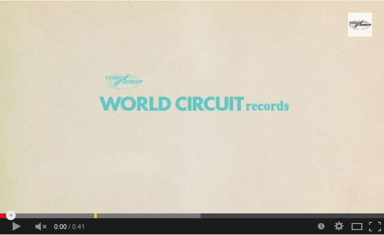

Bijna twintig jaar na de release van het album Buena Vista Social Club, dat een Grammy Award won en met meer dan negen miljoen verkochte exemplaren wereldwijd geldt als het meest succesvolle en best verkochte wereldmuziek album ooit, verschijnt nu Lost & Found. Dit album bevat nooit eerder uitgebracht materiaal deels opgenomen tijdens de oorspronkelijke Havana sessies met Nick Gold en Ry Cooder in 1996, en deels afkomstig uit latere opnames.

“Over the years we were often asked what unreleased material was left in the vaults,” aldus Nick Gold van World Circuit, één van de oorspronkelijke producers. “We knew of some gems, favourites amongst the musicians, but we were always too busy working on the next project to go back and see what else we had. When we eventually found the time, we were astonished at how much wonderful music there was.”

Het originele Buena Vista Social Club album werd in zeven dagen opgenomen met een aantal van de grootste namen uit de Cubaanse muziekgeschiedenis. Op Lost & Found zijn o.a. Ibrahim Ferrer, Omara Portuando, Eliades Ochoa, Compay Segundo en Ruben Gonzalez te horen. De Orquesta Buena Vista Social Club is momenteel bezig aan een Farewell World Tour. Lost & Found is gemastered door het originele team bestaande uit Nick Gold, Ry Cooder en Jerry Boys.

