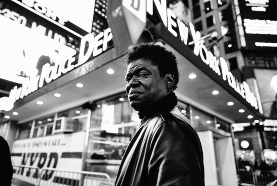

Charles Bradley, ook bekend als The screaming eagle of soul, heeft met zijn raspende soul stem, innemende persoonlijkheid en onvermoeibare podiumpresentatie al de harten van velen weten te veroveren. Op 1 april 2016 verschijnt zijn nieuwe album Changes via V2 Records. Aansluitend komt Charles Bradley voor twee shows naar Nederland. Op zondag 3 april treedt hij samen met zijn band op in TivoliVredenburg in Utrecht en op woensdag 6 april in Paradiso in Amsterdam.

Op advies van de medeoprichter van het befaamde Daptone label (Sharon Jones & the Dap-Kings) en producer Gabriel Roth verruilt Charles Bradley in 2002 zijn James Brown-imitatie voor zelfgeschreven liedjes. De originele songs in combinatie met het warme jaren zestig geluid van de huismuzikanten van Daptone blijken een gouden combinatie en in 2011 verschijnt het debuutalbum No Time For Dreaming. Het debuut krijgt twee jaar later een vervolg met Victim Of Love dat wordt overladen met positieve kritieken en ervoor zorgt dat de carrière van laatbloeier Charles Bradley in een stroomversnelling komt. Tijdens zijn tournee doet hij alle grote festivals en podia aan en geeft hij in Nederland een memorabel optreden in een uitverkocht Paradiso.

Changes, het titelnummer van het derde album, is een zinderende deep soul versie van het origineel van Black Sabbath. Bekijk de video hier:

<iframe src="https://www.youtube-nocookie.com/embed/xi49yirJiEA" title="Video" loading="lazy" allowfullscreen=""></iframe>

