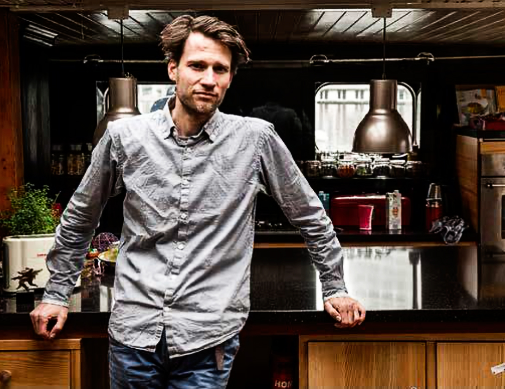
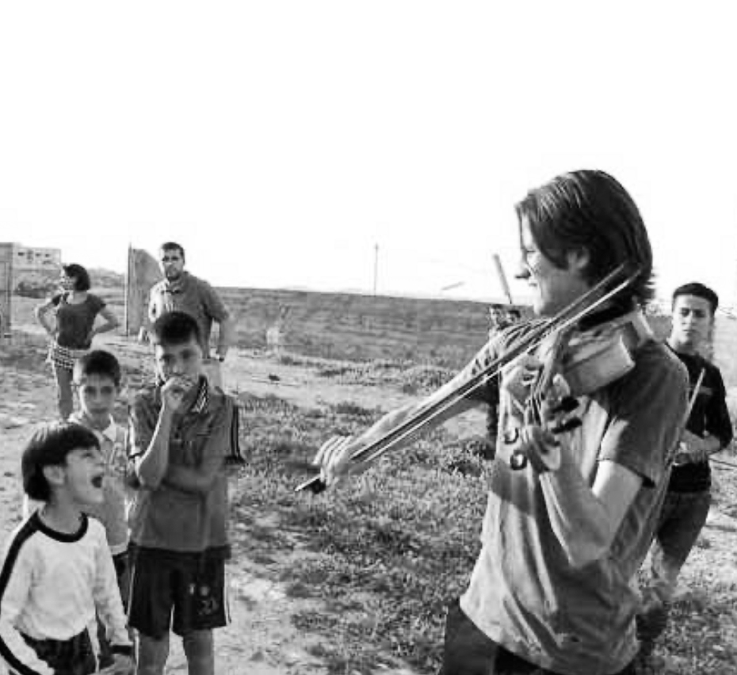

Door Patricia Wessels

*Hij gaf klassieke concerten in de duinen, concerten op een scheepswerf, op de daken aan weerszijden van de bufferzone in het al decennia verscheurde Cyprus. Kunst verbonden met het leven: dat is de weg die hem aanspreekt. ‘Met muziek verbindingen leggen – tussen kunstdisciplines en vooral tussen mensen.’ Hij is doordrongen van de noodzaak van een mentaliteitsverandering. En ook van de cruciale rol daarin van kunstenaars met hun verbeeldingskracht, creativiteit en gevoel voor schoonheid. ‘Wie de schoonheid van de wereld en het leven ziet, wil die beschermen.’*

Het is een warme lentedag in mei als ik hem ontmoet. Amsterdam was weken coronastil, maar deze dag zijn mensen uit hun huizen gekomen en zitten – nog voorzichtig en ver uit elkaar – te picknicken op het gras van de half verborgen Hoftuin Dignita, midden in het centrum van Amsterdam. Hoog boven deze stadsoase, op een gigantische zolder aan de Nieuwe Keizersgracht, tref ik hem; muzikant-componist-dirigent, idealist-activist-verbinder, denker-doener-duizendpoot Merlijn Twaalfhoven (1976). Hij blijkt midden in een video-conferentie te zitten als ik op de deur klop en na geen gehoor toch maar binnenstap. ‘Wat brengt u hier,’ vraagt hij verwonderd. ‘Onze interviewafspraak.’ ‘Oh, eh, die had ik even niet meer voor ogen. Ik dacht dat ik de rest van de middag vrij was, daarom is mijn zoontje hier. Mijn vrouw bracht hem net; ze is huisarts en moest onverwacht extra werken.’ Het jongetje, een jaar of zeven – niet naar school vanwege de pandemie – vermaakt zichzelf bij het raam, maar fleurt zichtbaar op bij het voorstel van zijn vader om hem naar zijn vriendje in Amsterdam Noord te brengen. Daar is dan nog wel twee keer een half uur fietsen voor nodig. En eerst moet de video-conferentie nog worden afgerond. Zo beland ik even later met een koffie in de hoftuin beneden en krijg ik anderhalf uur cadeau om me de vredige rust in de stad gewaar te worden, nu er niet elke paar minuten vliegtuigen boven mijn hoofd denderen. De lucht is streepvrij, de aarde kan ademhalen. Gek eigenlijk, dat we het geluidsgeweld in de lucht en de enorme vervuiling al bijna normaal zijn gaan vinden. Het doet me denken aan het verhaal over kikkers in een pan water. Zet je ze in heet water, dan springen ze er onmiddellijk uit. Maar voer je de temperatuur langzaam op, dan hebben ze de temperatuurstijging niet in de gaten en gaan ze er uiteindelijk aan kapot. Die opwarming van de aarde zit Merlijn Twaalf-hoven enorm hoog. In 2017 componeerde hij een muziekstuk waarin de opwarming te horen was. Zijn culturele bijdrage aan een VN-conferentie rondom duurzaamheid. De wereldwijde temperatuurstijging hoorbaar gemaakt door meetresultaten van de laatste 137 jaar om te zetten in klanken. Naar de uitvoering in de New Yorkse concertzaal Carnegie Hall wilde hij alleen komen op voorwaarde dat zijn vliegticket geheel gecompenseerd zou worden. Inmiddels wil hij helemaal niet meer vliegen. De huidige luchtvaartstilte zal hem goed doen.

#### Drenthe

‘Welke rol speelt stilte eigenlijk in jouw leven’, vraag ik, als we ten slotte tegenover elkaar zitten onder de imposante zolderbalken. ‘Ik groeide op in Drenthe, op het platteland. Mijn ouders hadden daar een boerderijtje gekocht, omdat ze behoefte hadden aan een rustige plek. Mijn moeder gaf dwarsfluitles, mijn vader was fluitenbouwer en zelf zat ik op vioolles. Er was eigenlijk altijd muziek in huis. De stilte op het platteland is natuurlijk een relatieve stilte; het geluid van landbouwvoertuigen en straaljagers is nooit ver weg. En toch is er met zoveel natuur om je heen wel meer mentale stilte. ‘Als kind vond ik het heerlijk om het bos in te gaan en eindeloos in de natuur te spelen. We hadden een enorme bloemen- en moestuin, waardoor ik een natuurlijke verbinding had met de seizoenen en alles wat daarin groeide. Nu moet ik mijn kinderen soms uitleggen dat ik geen sperzieboontjes wil kopen in december, omdat het geen seizoengroente is en de boontjes helemaal uit Argentinië komen.’ ‘Het is wel eens lastig om de stilte te vinden in mijn eigen leven. Door mijn betrokkenheid bij vele projecten, voel ik ook veel verantwoordelijkheid, waardoor ik niet zo toe kom aan rust nemen. Op mijn twaalfde wist ik al dat ik meer wil dan ik tijd heb. Ik heb die grenzen meer dan eens ervaren. Dat merk je al als je een instrument leert bespelen. Ik wilde graag een heel goede violist worden. Dan moet je focussen en andere dingen laten. Maar kiezen wilde ik niet. Ik had zoveel interesses die ik wilde onderzoeken.’ Het verbaast dan ook niet dat Merlijn op het conservatorium zowel compositie als altviool deed èn zich verdiepte in etnomusicologie èn hedendaagse muziek. ‘Ik bloei juist op als ik verbindingen kan leggen – tussen verschillende kunstdisciplines, maar vooral tussen mensen.’

#### Jordaanoever

Op het conservatorium had hij het gevoel dat muziek te vaak bestemd was voor een kleine groep fijnproevers. ‘Ik wilde het minder elitair maken, de muziekbeleving van zijn voetstuk halen en ik zocht naar manieren om de ervaring van muziek te delen met andere groepen in de samenleving.’ In die tijd probeerde hij van alles uit. Hij haalde muzikanten van het podium af om ze tussen de luisteraars te zetten of hij bevrijdde het publiek uit zijn passieve rol door het mee te laten zingen met professionele koren. Ten slotte trok hij de wereld in, naar plekken waar de nood hoog was – conflictgebieden, vluchtelingenkampen en kindergevangenissen – om mensen daar kennis te laten maken met de helende werking van muziek. Eigenlijk is zijn hele carrière een doorlopend onderzoek naar de helende en sociale werking van muziek. De kiem daarvoor is gelegd tijdens een bijzondere ervaring op zijn twintigste. Vlak na de burgeroorlog reisde hij als altviolist met het Ricciotti Ensemble door Bosnië, om muziek te brengen naar weeskinderen die kort daarvoor nog de hel van de oorlog hadden meegemaakt. Merlijn: ‘Hier ontdekte ik dat muziek een levenskracht kan zijn.’ Daarna werd de wereld zijn werkterrein. In 2008 reisde hij met een groep musici naar de Westelijke Jordaan-oever om met Israëlische en Palestijnse jongeren een muziekproject te ontwikkelen dat de scheidslijn tussen beide groepen kon doorbreken. ‘Dan kan ik zo snel geen Arabisch leren spreken, maar ik kan me wel verdiepen in de Palestijnse cultuur en goed naar hun verhalen luisteren. ‘Door onbevangen te luisteren openen mensen zich. Als je begrijpt waar mensen van houden, leren ze elkaar kennen en vervolgens kun je gaan creëren. Muziek is als een gemeenschappelijke taal – een verbindende manier om met elkaar te communiceren, dat hebben die Palestijnse en Israëlische jongeren laten zien in een verrassend concert in Bethlehem.’ In 2011 won Merlijn de Unesco Award, voor zijn verdiensten in de interculturele dialoog tussen de Arabische en de Westerse wereld. Een betekenisvolle ontmoeting gaat voor hem voor een vlekkeloze uitvoering. ‘Het niet perfecte is bovendien vol verhaal,’ zegt hij. ‘There’s a crack in everything, that’s how the light comes in (Leonard Cohen, red.).’ Dat bleek ook weer tijdens het muziekproject Long distance call (2005) op het al decennia lang verscheurde Cyprus. Aan weerszijden van de bufferzone tussen Turks en Grieks Cyprus stonden mensen op de daken en balkons, aangevuld met kinderkoren in de straten, een uur lang samen muziek te maken. CNN was erbij om vast te leggen hoe muziek in staat is dwars door zo’n afscheiding heen te breken en de bewoners van het eiland door alle prikkeldraad heen met elkaar te verbinden. Merlijn: ‘Op een belangrijk moment vergat een solist in te zetten. Er ontstond een stilte waarin het dagelijks leven van de Cyprioten plotseling hoorbaar werd. Toen begon er een vogel te zingen. Dat was zo ontroerend. De samenkomst van al deze mensen was nog veel mooier dan het kunstwerk zelf.’

#### Spanningsveld

Even later zegt hij: ‘Ik denk dat we in een belangrijke tijd leven, en dat het nu mogelijk moet zijn om van een economisch gedreven wereld over te stappen naar een wereld waarin wezenlijker waarden centraal komen te staan. De economisch gedreven samenleving met zijn rampzalige uitwerking als klimaatopwarming, uitstervende diersoorten en ongelijke verdeling is eenvoudig niet meer houdbaar. ‘Lang heb ik gedacht dat een met aandacht gemaakt muziekstuk kan helpen om de wereld een stukje mooier te maken. Maar daarmee ben je er niet! Ik kan nog zo goed voor mijn eigen tuintje zorgen, maar als in mijn buurt bossen gekapt worden, heb ik toch de plicht op te staan en te zeggen: Dat mag niet!’ Zo’n zelfde spanningsveld ervaart hij in de opvoeding van zijn kinderen. \`Je wilt dat ze goed eten en genoeg kleren hebben. Als je het eten in de supermarkt haalt en de kleding bij de Hema of Primark, ben je goedkoop uit en houd je zelfs geld over voor een leuk uitje. Maar buiten het zicht wordt enorme schade toegebracht. ‘Veel voedsel uit de supermarkt is geteeld met landbouwgif. En voor dat goedkope T-shirtje van drie euro betaalt iemand met zijn gezondheid in Bangladesh – waar arbeiders in de textielindustrie rond hun veertigste doodgaan aan kanker door de toxische verfstoffen. De vraag is dan: ‘Hoe goed zorg je eigenlijk voor je kind als je eraan bijdraagt dat de wereld waarin het moet opgroeien steeds zieker wordt?’ ‘Zoals we ooit zijn gaan twijfelen aan de kerk, die ons precies vertelde wat wel en niet waar was, denk ik dat het tijd wordt om te gaan twijfelen aan de waarheid van de welvaartsreligie. Het is zeker waar dat mensen in grote armoede sneller ziek worden en doodgaan, maar die curve vlakt af als er voldoende middelen zijn. ‘Hoe rijker, hoe gezonder’, of ‘hoe rijker, hoe gelukkiger’, gaat dan eenvoudig niet meer op. ‘Zelfs musici doen hun wedstrijdje; wie is het beste? Wie kan het stuk het meest perfect uitvoeren? Kunst is een product geworden waarop je beoordeeld wordt in recensies, en waarvoor je prijzen kunt krijgen als erkenning en beloning. Succes wordt bepaald doordat je iets heel goed kan. Ik zeg: Kunst is geen product waarbij alleen het eindresultaat telt, maar een mindset, een manier van kijken die ons verder kan brengen. In plaats van ons te richten op hoe we meer, sneller, beter kunnen produceren en presteren, is de vraag die eigenlijk gesteld moet worden, zowel individueel als voor de hele samen-leving: Wat is een waardevol leven?’

#### Corona-experiment

In die zin is de coronacrisis voor Merlijn Twaalfhoven een ongelooflijk en interessant experiment. ‘We waren als maatschappij op hol geslagen. En dan wordt ineens de pauzeknop ingedrukt. Een minuscuul wezentje dwingt de hele wereld tot stilstand, iets wat onszelf niet lukte. Allerlei dingen moesten, mochten, hoefden ineens niet meer. Er werd nauwelijks meer gevlogen, we vierden vakantie in eigen land, we shopten minder; vergaderingen gingen niet door of werden vanuit huis gehouden. Er was minder reistijd, er waren minder files en de luchtkwaliteit werd merkbaar beter. ‘Is het dan bijvoorbeeld niet mogelijk om te zeggen: ‘Ik ga niet meer alleen werken voor geld, maar kies een spoor in mijn leven waarin ik echt waarde en betekenis zoek?’ Dat je bijvoorbeeld één dag per week volledig besteedt aan wat jij werkelijk belangrijk vindt? Met de focus op: ‘waar zit mijn passie? Wat is voor mij een goede wereld? Waarvoor wil ik zorgen? ‘De coronacrisis heeft zichtbaar gemaakt dat er veel goeds in mensen zit – veel zorgzaamheid en solidariteit. De enorme stress die velen de afgelopen jaren hebben ervaren, zegt wellicht meer over ons economische en prestatiegerichte systeem dan over de mens zelf. ‘Als je mensen vraagt wat ze nu echt belangrijk vinden en wat ze absoluut willen behoeden in deze tijd, dan antwoorden ook diegenen die voor veertig euro naar Spanje vliegen niet: ‘dat de T-shirts goedkoop zijn’, maar: ‘dat ik contact kan hebben met mijn vrienden en dierbaren.’ Of: ‘dat ik in de natuur kan zijn.’ En op de vraag wat we moeten beschermen met de beperkte middelen die er zijn, antwoordt iedereen: ‘de zorg, het onderwijs en het midden- en kleinbedrijf.’ Niet: ‘de multinationals’. ‘De corona-pauze is een kans voor een radicale reset, een moment om keuzes te maken voor de toekomst. En ik denk dat de mindset van kunstenaars daarbij enorm kan helpen – om met verbeeldingskracht, creativiteit en gevoel voor schoonheid de uitdagingen van vandaag te tackelen.’

*Wat versta je precies onder een kunstenaars-mindset?*  
‘Het vermogen om te spelen en te improviseren bijvoorbeeld, het durven inzetten van je verbeeldingskracht wanneer er dingen zijn die je niet weet, maar die je wel mag bedenken. Of de vaardigheid om te mogen falen -iets waar in de prestatiemaatschappij bijna een smet op lijkt te liggen, maar wat kunstenaars vanuit zichzelf eindeloos doen. Zonder uitproberen komt niemand immers verder.’

#### Onzekerheidsvaardigheid

Aan het begin van de pandemie, toen alles op de schop lag, en zichtbaar werd dat onzekerheid bij veel mensen leidt tot stress, richtte Merlijn de ‘Academie voor Onzekerheidsvaardigheid’ op. Samen met een aantal andere kunstenaars geeft hij nu les op middelbare scholen en universiteiten om jongeren te leren omgaan met onzekerheid. ‘Kunstenaars zijn deskundig in het omgaan met onzekerheid,’ verduidelijkt hij. ‘De schilder durft te beginnen op een wit doek, een componist begint vanuit stilte – om al zoekend iets te creëren dat schoonheid heeft of betekenisvol is. Het ‘niets’ van het witte doek of de beginstilte van een compositie is ongewis, juist omdat je alle kanten op kunt en niemand zegt hoe het moet. ‘Er ligt geen format klaar voor kunst, er is van alles mogelijk als je nieuwsgierig bent om al spelend te onderzoeken. Die vrijheid is misschien een beetje spannend, maar biedt tegelijk een uitgelezen kans op verrassende uitkomsten. Zelfs als je al een idee of thema hebt, zijn er duizenden manieren om zo’n thema in te vullen. Een kwestie van durven beginnen, uitproberen, uitglijden, bijstellen, omgooien, schaven en met een creatieve blik blijven kijken. ‘Het creatieproces van een kunstwerk is een manier van zoeken. Maar het publiek maakt die zoektocht in de regel nooit mee, die krijgt alleen het eindresultaat te zien. En toch gaat aan een bijna perfect concert een veel langer proces van muziek maken vooraf. Een proces van niet-weten, uitproberen, twijfelen. Ik wil graag begrijpen waarom een kunstenaar besluit om een werk te maken. Ik wil zijn inspiratie proeven, hem ontmoeten. Juist die zoektocht is interessant om te delen: de weg van de kunstenaar.’ Ook schoonheid kunnen zien in het alledaagse hoort voor Merlijn bij de kunstenaarsblik. ‘Een vermogen dat verbonden is met een waardevol leven. Nieuwsgierig zijn naar hoe de natuur werkt en bewondering hebben voor wat leeft. Ook daarom wil ik zoveel mogelijk mensen in aanraking brengen met de kunstenaars-mindset. Want wie de schoonheid van de wereld en het leven ziet, wil het leven beschermen. ‘De opwarming van de aarde is voor veel mensen te abstract om in actie te komen. Er moet lets zijn wat je intens liefhebt en wat op het spel staat – zoals in het sprookje van de prinses die bijna wordt opgegeten door de draak – voor de prins in ons opstaat om de draak te doden. Welnu, het leven zélf staat op het spel.’

#### Urgentie

In zijn eigen leven is inmiddels van alles aan het gisten. ‘Ik weet hoeveel schoonheid muziek geeft, hoe waardevol het voor mijn eigen leven is, maar ik kreeg het gewoon niet meer voor elkaar om aan een volgend concert met mooie koren te werken, terwijl ik het gevoel heb dat ik ergens anders veel harder nodig ben. ‘Op dat concert over de opwarming van de aarde, in het bijzijn van VN-leden in Carnegie Hall, was ik best trots. Maar wat heeft het bijgedragen? Er moet iets gebeuren, iets veranderen, we moeten aan de slag! Ik voel zo’n enorme urgentie. Daarom heb ik al mijn concerten voor deze zomer en het najaar afgezegd en mijn werk als componist en dirigent stopgezet. Ja, dat betekent dat we het thuis met een inkomen minder moeten doen, maar dit kan niet wachten. De komende twee jaar wil ik alles op alles zetten en keihard werken aan de mentaliteitsverandering die nodig is voor een omslag van welvaart naar welzijn.’

*Wat ga je concreet doen, nu je je hebt vrijgemaakt?*  
‘Ik ga me storten op het verder ontwikkelen van The Turn Club, die ik al in 2017 heb opgezet, omdat ik zie hoe de wereld snakt naar visie en creativiteit bij de grote problemen die er zijn. Als dat goed van de grond komt, kan het zich als een olievlek verbreiden. ‘Turn’ in de zin van draai, ommezwaai. ‘The Turn Club is een club waar kunstprofessionals, veranderaars en praktisch idealisten hun dromen, plannen en ideeën delen. Door mensen met vakmanschap met elkaar te verbinden, kunnen ideeën makkelijker en sneller worden gerealiseerd. ‘In de zorg, in het onderwijs, in de landbouw zijn allerlei mensen die vol goede ideeën zitten. Iedereen doet hard zijn best, allemaal ondernemen ze hun eigen zoektocht om een paar stappen verder te komen. Maar vaak lukt het ze niet om die mooie projecten lopend te krijgen. Bij The Turn Club kun je gebruikmaken van elkaars ervaringen en zoektocht. We hoeven niet allemaal zelf het wiel uit te vinden. ‘Alleen al door elkaar vragen te stellen, behoeftes of dilemma’s te delen, kun je elkaar al zoveel bieden. Het is sowieso belangrijk om te ervaren dat je niet de enige bent, alleen dat al geeft hoop. In je eentje kun je onmogelijk alles rechtzetten wat scheef is in de wereld. Maar samen kun je meer verschil maken.’

*Wat voor initiatieven zijn er al te noemen?*  
‘Er is van alles tegelijk gaande. Van een groep kunstenaars die bezig is met een concrete aanpak tegen eenzaamheid in grote steden tot een ‘Visioen voor de nieuwe aarde’, en alles daartussenin. ‘Er zijn ook kleine initiatieven die de wereld mooier kunnen maken. Iemand wilde bijvoorbeeld een vlindertuin zaaien op haar balkon. Zij heeft uitgezocht wat het beste werkt en nu inspireert ze anderen om ook zo’n vlindertuintje aan te leggen. ‘Dat is ook wat The Turn Club wil: persoonlijk idealisme besmettelijk maken. De turn van welvaart naar welzijn begint in jezelf, werkt door in je omgeving en breidt uit naar de wereld. Zo kan er een balkonrevolutie ontstaan. ‘Veel mensen lopen rond met idealen, maar het blijft meestal bij een droom. Het is de kunst om die droom te uiten, dan wordt die zichtbaar voor anderen en kunnen mensen aanhaken. Ook je eigen rol wordt helderder dankzij het delen van zo’n droom.’

#### Turnclubjes

Als The Turn Club in Amsterdam eenmaal goed loopt, hoopt Merlijn dat er kleinere zelfstandige Turnclubjes door het hele land gaan ontstaan. Meer decentraal, in eigen dorp, of wijk. ‘Tot die tijd komen we regelmatig samen op deze zolder; in coronatijd digitaal. Komende week is er weer een bijeenkomst van The Turn Club. Kom je ook? Daar kun je je eigen goede ideeën of projecten delen. Het hoeft niet kant-en-klaar te zijn, het mag ook een verhaal zijn over iets wat jij belangrijk vindt in deze wereld. Iets waarvoor jij zou willen zorgen…’ Ik moet even schakelen, nu het woord plotseling tot mij persoonlijk wordt gericht… ‘Uh, ja, ideeën en projecten die ik zou willen realiseren heb ik wel, maar eh… ik weet niet of mijn idealen groot genoeg zijn om me bij een Turn Club aan te sluiten.’ Hij lijkt geraakt door mijn twijfel over het gewicht van mijn eigen idealen. Merlijn: ‘Juist het delen van de twijfel of je idealen wel groot genoeg zijn, kan anderen helpen hun eigen ideaal ook serieus te nemen. Ook micro-idealisme is waardevol. Er was eens een vrouw die haar eigen gezin tot project had gemaakt. Veel moeders ervaren stress, omdat ze een heleboel ballen tegelijk hoog moeten houden en van kinderdagverblijf naar werk en naar kinderdagverblijf rennen.  
\`Deze vrouw heeft een persoonlijke turn gemaakt en een vorm gevonden om niet psychisch in schaarste te blijven leven. Het is haar gelukt om van haar thuissituatie een democratische, bloeiende omgeving te maken, met meer rust, aandacht en tijd voor elkaar. Zo’n onderzoek op microniveau is niet minder wezenlijk. Zij weet nu: ‘Zo creëer ik in mijn gezin een goede samenleving’. Zoiets is enorm waardevol. \`Zo iemand breng ik graag in contact met leidinggevenden van verzorgingstehuizen, die ook zoeken naar een goede samenlevingsvorm in het spanningsveld tussen bewoners en verzorgers. Wat in het klein werkt, kan in grotere verbanden nuttig zijn. Juist mensen die niet ‘deskundig’ zijn, stellen vaak hele scherpe en rake vragen die deskundigen op een nieuw denkspoor kunnen zetten.’ Op zijn website moedigt Merlijn Twaalfhoven zijn collega’s aan met de volgende woorden: ‘Musici, geef de meest betekenisvolle verhalen een rol in jullie concert’. The Turn Club is een uitnodiging aan iedereen: ‘Mensen, leef je meest betekenisvolle verhaal!’

[Vruchtbare Aarde, editie 3-2020](https://www.vruchtbareaarde.nl/2020_3.html)  
Fotograaf Michiel Wijnbergh
