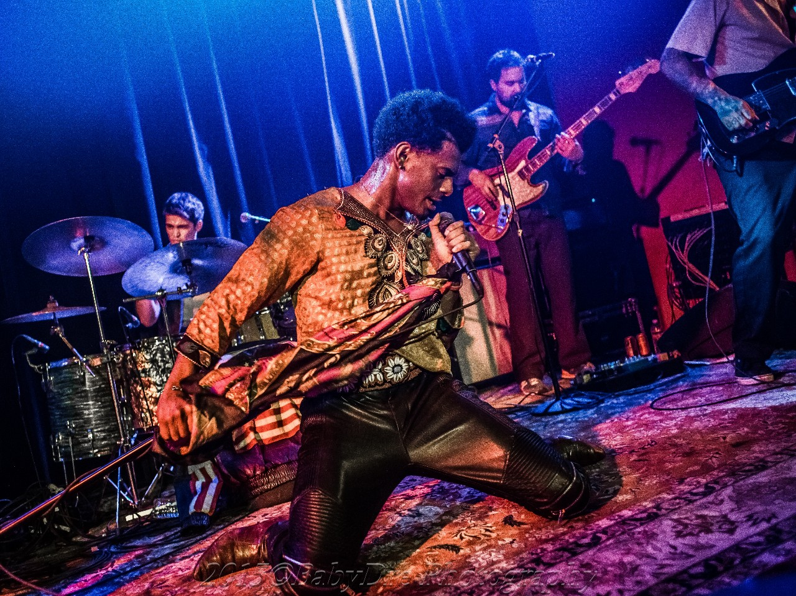

Con Brio is gevormd in 2013 en is het product van zeven muzikanten met gedeelde liefde voor de levendige Bay Area funk en de pshycedelic-soul sound wat ontwikkeld werd door bands als Sly & the Family Stone. Live is dit ook terug te zien. Met de draaiende heupen, splits en backflips van McCarter wordt hij vaak vergelijkt met een jonge Michael Jackson of James Brown.

In april in volle glorie te aanschouwen:  
– 25/04 Bitterzoet, Amsterdam  
– 26/04 Live I Live Festival, Den Haag  
– 27/04 Bosuil, Weert  
– 29/04 Rhythm&Blues Night

<iframe src="https://www.youtube-nocookie.com/embed/2OdauVfv4KA" title="Video" loading="lazy" allowfullscreen=""></iframe>

