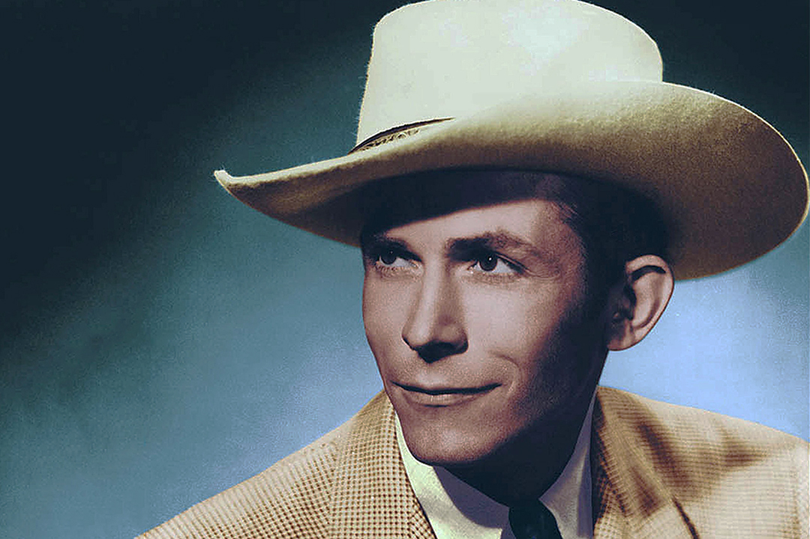

Een tijdje geleden kondigden we op onze Facebookpagina al aan dat er een mooie documentaireserie over countrymuziek aan zat te komen. Eenvoudigweg getiteld: Country Music, van de hand van Ken Burns. Deze Ken Burns maakte eerder ook de veelgeroemde serie The Vietnam War.  
De afgelopen dagen zijn de eerste delen (van de in totaal 8) van de serie op de Amerikaanse televisie vertoond. Elke aflevering duurt ongeveer twee uur. Met enige moeite (via een zogenoemde VPN-verbinding) keken wij ook de eerste vier delen, en wat een genoegen leverde dat op!  
Prachtige beelden, uitmuntende muziekkeuze; op uiterst aangename wijze wordt de geschiedenis van de countrymuziek inzichtelijk gemaakt.

De serie is chronologisch opgebouwd. Aflevering 1 beslaat de jaren tot 1933 en behandelt dus de geboorte van de countrymuziek. Belangrijkdaarbij is ene Ralph Peer die voor de Victor Talking Machine Company opnames gaat maken van zogenoemde hillbilly-muziek. Hij reist daarvoor naar Bristol, een plaatsje op de grens van Tennessee en Virginia. Jimmy Rodgers en The Carter Family zijn de meest invloedrijke artiesten die hij daar vastlegt. Ook laat Burns zien hoe groot het belang van Afro-Amerikaanse artiesten is geweest.

In de tweede aflevering behandelt Burns de jaren van 1933 tot het einde van de Tweede Wereldoorlog, de tijd van de zingende cowboys (Gene Autry, die uiteindelijk tot een de 400 rijkste Amerikanen zou uitgroeien), Western Swing (Bob Wills) en de opkomst van Roy Acuff. Ook wordt het de totstandkoming van het het invloedrijke, in Nashville gevestigde radiostation WSM en de Gran Ole Opry benadrukt.

Aflevering 3 is getiteld The Hillbilly Shakespeare en gaat natuurlijk over de korte maar heftige carriere van Hank Williams. Daarnaast komen Ernest Tubb, de opkomst van de bluegrass (Bill Monroe, The Stanley Brothers) en Little Jimmie Dickens aan bod.

De vierde aflevering behandelt de jaren 1953 tot 1963. Het gaat over Johnny Cash, Elvis, Brenda Lee, Mel Tillis, Loretta Lynne en de betreurde Patsy Cline. In die tijd komt ook de term country music op, als alternatief voor hillbilly. In deze aflevering laat Burns ook zien hoe de muziek die aanvankelijk vooral werd gemaakt met fiddles, banjo’s en gitaren aantrekkelijk voor het grote publiek wordt gemaakt door de toevoeging van strijkers en achtergrondzangers (oftewel The Nashville Sound).

Burns is zeven jaar bezig geweest met het maken van deze serie. Hij heeft geen gebruik gemaakt van eerdere, door anderen gemaakte, interviews omdat hij zelf uit de mond van de betrokkenen wilde horen hoe de zaken in elkaar staken. Bij die eerste jaren gaat het dan natuurlijk om nabestaanden, maar naarmate de serie vordert kom je steeds vaker dingen te weten van mensen die het zelf hebben meegemaakt. Ook krijg je unieke interviews van inmiddels overleden artiesten zoals Merle Haggard en eerder genoemde Mel Tillis en Little Jimmie Dickens.

Maar het belangrijkste dat Burns met deze serie voor elkaar krijgt is dat je nu beter gaat begrijpen hoe de muziekstroming tot stand is gekomen en vooral ook wat de rol van de diverse artiesten daarbij is geweest. Daardoor is Country Music voor de lezers van deze site nu al een “must see”.

Country Music is te bekijken via de website van [PBS](https://www.pbs.org/show/country-music/), maar alleen met gebruikmaking van een VPN. Anders krijg je te lezen dat het helaas niet te zien is on ons deel van de wereld.  
Overigens staat de bij de serie behorende soundtrack inmiddels op [Spotify](https://open.spotify.com/album/3ZAFnRYQRAiBplISQFj7nC?si=Zx0AuAWgQEmu564TlOg6Bw)
