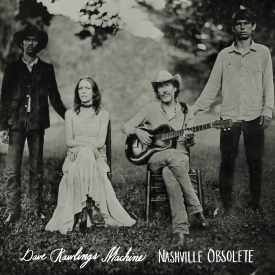

Nashville Obsolete is het langverwachte tweede album van Dave Rawlings Machine dat analoog opgenomen is inde Woodland Sound Studios in Nashville en 7 nieuwe nummers bevat die geschreven zijn door Dave Rawlings en Gillian Welch. waaronder de prachtig uitgesponnen songs Pilgrim (You Can’t Go Home) en The Trip. Nashville Obsolete toon het uitzonderlijke muzikale vakmanschap van Dave Rawlings en Gillian Welch (lead zang en gitaar), met hulp van Paul Kowert van de Punch Brothers ( bas), Wille Watson ( zang, gitaar) en gast optredens van Britanny Haas (viool) en Jordan Tice ( mandoline). Het is tevens het zevende album waarop Dave Rawlings en Gillian Welch samen werken in hun al 20 haar durende carriere. Dave en Gillian hebben onlangs de prestigieuze Lifetime Achievement Award for Songwrting van de Americana Music Association ontvangen die op 16 September zal worden uitgereikt tijdens de Honors & Awards Ceremony die gehouden zal worden in het Ryman Auditorium in Nashville.  
In 2011 kreeg Gillian Welch een grammy nominatie voor haar album The harrow and The Harvest, het vorige album van Dave Rawlings, A Friend Of A Friend u, werd in 2009 door MOJO uitgeroepen tot “Best Americana Debut Of The Year”.

“Rawlings is the most original guitar player of his generation”. THE NEW YORKER
