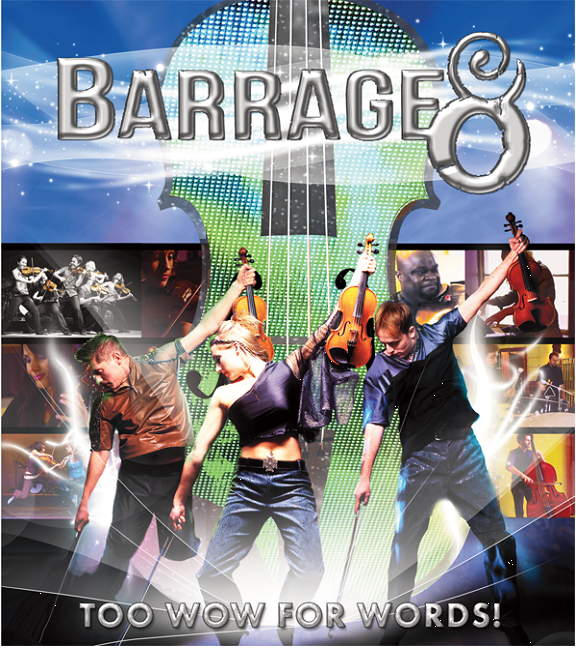

Na drie jaar theaterpauze is ‘Barrage’ back on stage! Van 6 tot en met 28 januari a.s. komt deze Canadese sensatie naar ons land voor een reeks shows. Het internationale strijkersensemble kreeg met zijn classic crossover interpretatie van bijna alle muziekstijlen ter wereld al miljoenen muziekliefhebbers aan zijn voeten. Barrage verzorgde 3000 zinderende optredens in 27 landen w.o. een aantal succesvolle tournees in Nederland. Na een creatieve restyling tot een oorspronkelijk strijkersoctet is de groep weer terug op het toneel met hun nieuwe show ‘Barrage 8’.

Of het nu Mendelssohn is of Metallica, folksongs, pop, bigband klassiekers of latin jazz; Barrage gaat geen enkele stijl uit de weg. Het stringensemble geeft er zijn eigen orkestrale swing aan met een ongekende energie en vitaliteit. Ondersteund door live drums, percussie en elektronische beats en krachtige videobeelden. Ravel’s ‘Bolero’ herleeft in een opzwepend nieuw jasje, net als Isaac Albeniz’ vermaarde ‘Asturias’. De shows van Barrage zijn ronduit aanstekelijk! Het speeltempo van barrage is ongeëvenaard, alsof de strijkinstrumenten gevoed worden door raketbrandstof. Het virtuoze instrumentale en vocale niveau, gecombineerd met gedurfde choreografie, excellente belichting en ondersteunende videobeelden, maakt een optreden van Barrage tot een adembenemende theaterervaring.

JANUARI 2015  
6/1 Orpheus – Apeldoorn, tel. 055 527 03 00; 7/1 Schouwburg Cuijck – Cuijck, tel. 0485 314344 ; 8/1 De Mythe – Goes, tel. 0900-3300033; 9/1Theater Sneek – Sneek, tel. 0515 430 580; 10/1 De Lampegiet – Veenendaal, tel. 0318 540 141; 12/1 De Voorveghter – Hardenberg, tel. 0523 28 03 30; 13/1 De Harmonie – Leeuwarden, tel. 058 233 0 233; 14/1 CC Achterolmen – Maaseijk (B), tel. +32-(0)89569956; 15/1 De Nieuwe Kolk – Assen, tel. 088 012 85 50; 16/1 CC Beringen – Beringen (B), tel. +32(0)11 45 03 10; 17/1 Theater de Stoep – Spijkenisse, tel. 0181 652222;  
19/1 Theater de Purmaryn – Purmerend, tel. 0299 432205; 20/1 Theater het Kruispunt – Barendrecht, tel. 0180 61 59 58; 21/1 Theater de Willem – Papendrecht, tel. 078 615 82 26 ; 22/1 CC ’t Perron – Ieper (B), tel. +32(0)57 23 94 80 ; 23/1 CC de Meent – Alsemberg (B), tel. +32(0)2359 16 00; 24/1 Theater de Vest – Alkmaar, tel. 072 5489999; 26/1 Stadstheater – Zoetermeer, tel. 079 342 75 65; 27/1 Theater Agora – Lelystad, tel. 0320 239 239; 28/1 De Blauwe Kei – Veghel, tel. 0413 34 25 55

