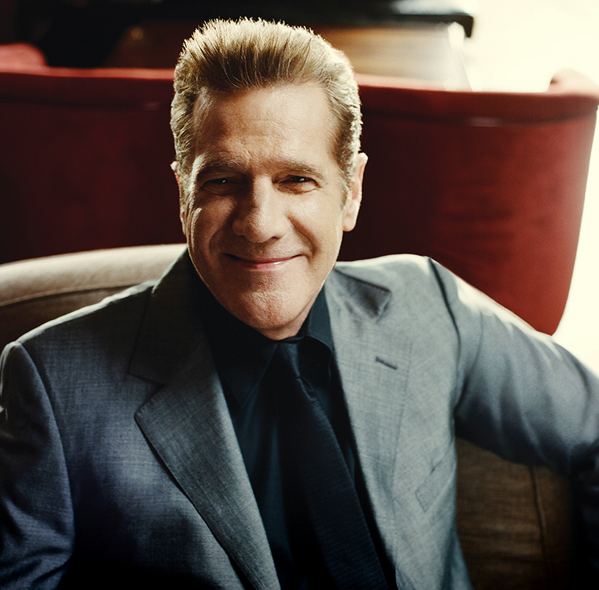

Kortgeleden overleed Eagles oprichter Glenn Frey. Hieronder een van de laatste interviews die hij in Nederland gaf. Samen met bassist/zanger Timothy B. Schmidt

De Eagles behoren met een slordige 120 miljoen weggezette platen tot de best verkopende groep aller tijden. Van hun verzamelalbum Their Greatest Hits 1971-1975 zijn inmiddels meer dan 28 miljoen exemplaren over de toonbank gegaan, terwijl van Hotel California de teller op dit moment op 16 miljoen staat. Dat album verscheen al in 1976, maar wordt bijna veertig jaar later nog steeds opmerkelijk goed verkocht. Daarnaast geldt Hell Freezes Over uit 1996 als de best verkochte muziekvideo/dvd aller tijden.

,,Het verbaast onszelf eerlijk gezegd ook wel eens dat we nog zo populair zijn,’’ bekent Schmidt. ,,Reken maar dat we stuk voor stuk dankbaar zijn dat we nog steeds aan de top mee mogen draaien.’’

,,Ik denk dat onze platen door de jaren heen zulke hoge verkoopcijfers halen omdat de liedjes gewoon goed zijn,’’ verklaart Glenn Frey. ,,Je kunt nog zo’n talentvol zanger of gitarist zijn, maar als je geen goede liedjes hebt, heeft je carrière geen lange adem. Want goede nummers zijn tijdloos en klinken over dertig jaar nog net zo actueel. Dar zie je ons geval met Hotel California en Tequilla Sunrise. Toen ik vroeger met een stelletje vrienden muziek aan het maken was, hadden we allemaal onze dromen. We wilden beroemd worden en succes hebben. En zo zijn er vandaag de dag nog steeds duizenden en duizenden muzikanten die diezelfde droom koesteren. Ik heb hem waar kunnen maken, maar dat is natuurlijk ook een grote dosis geluk geweest. Dat kun je niet alleen toeschrijven aan een paar goede nummers.’’

,,Het belangrijkste wat ik in dit leven heb ontdekt, is dat er voor een mens genoeg uitdagingen blijven bestaan, op wat voor niveau hij ook succes heeft,’’ filosofeert Frey. ,,Timothy, Don Henley, Joe Walsh en ik zijn als de Eagels een grote muziekmachine, bij wijze van spreken. Maar voor geen van ons allen is dat het echte leven. Als we met de groep op een podium staan, zijn we net een science fiction verhaal, een sprookje waar mensen in willen geloven. Maar in het leven van alledag zijn we geen Eagles, dan zijn we vier individuen. Ons echte leven speelt zich in de huiselijke sfeer af, want de meeste van ons zitten ondanks hun leeftijd nog midden in de kleine kinderen.’’ Scmidt: ,,Ik breng mijn jongste zoon elke dag naar school en ik ben er bij als mijn andere kinderen hun diploma krijgen uitgereikt En als er problemen in ons gezin zijn, dan lig ik daar wakker van. Daar kan al mijn geld en succes met de Eagels niets aan veranderen. En dat geldt ook voor de andere leden.’’

Overigens lopen de Eagles elkaar in dat gewone dagelijkse leven niet bepaald voor de voeten. Frey: ,,Daar hebben we teveel verschillende interesses voor en ook zijn we bezig met allerlei eigen projecten. Zelf schrijf ik op dit moment meer liedjes dan ooit.’’

Harry de Jong  

