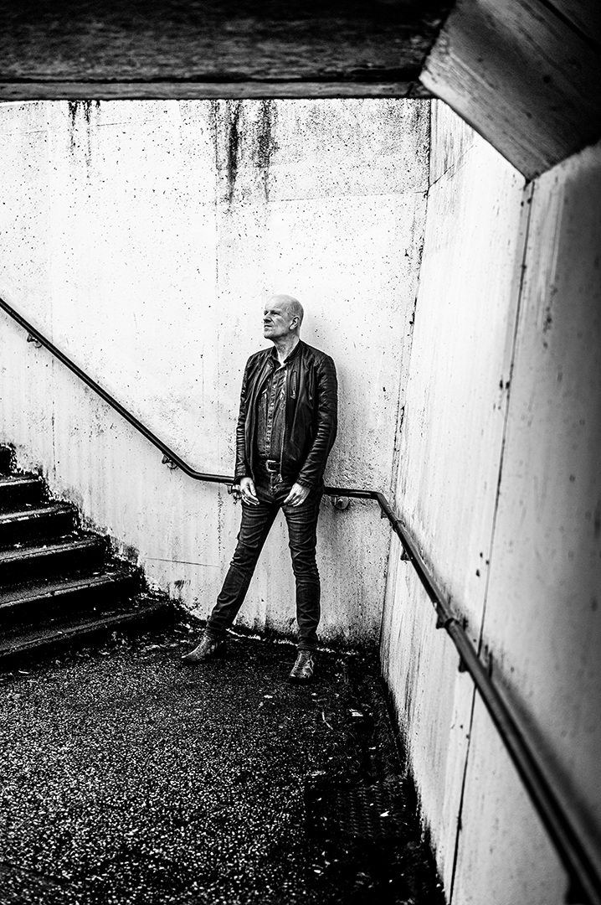

Door Harry de Jong

Na dik 20 jaar is Allard Jolles, alias Allard JJ, weer terug aan het muziekfront. Hij was de eerste drummer van Claw Boys Claw en in de jaren tachtig stond hij aan het roer van l’Attentat, één van de meest oorspronkelijke rockbandjes die ons land op dat moment telde. Grote kracht was de gemene en bijtende rock and roll stem van Jolles. Mede door zijn doeltreffende gitaarsolo’s groeide hij uit tot de Dave Edmunds van de Lage Landen. Het album Hell Or High Water uit 1989 is wat dat betreft een klassieker in zijn soort. Jolles is inmiddels de zes kruisjes gepasseerd, maar rockt nog als de neten. Dat bewijst de nieuwe plaat Uncovered, die op 180 grams vinyl is verschenen. Jolles’ stem heeft allerminst aan kracht ingeboet en klinkt nog net zo opstandig en tegendraads als twee decennia geleden. Voeg daarbij de strakke eigen composities, het geëxperimenteer met verschillende gitaartechnieken en je hebt een rock and rollplaat die menig jongere muzikant scheel van jaloezie zal doen zien.

Hoog tijd om bij te praten met Jolles. We spreken af op het parkeerterrein van Van der Valk langs de A7 op de rand van Wieringermeer. In de camper van fotograaf Henk Bleeker. Een noodoplossing, maar de horeca zit door de corona pandemie nog steeds op slot en het praat toch wat prettiger met een kopje koffie erbij.

,,Ik loop op dit moment weer over van ideeën voor nieuwe liedjes,’’ bekent Jolles, als hij zich heeft geïnstalleerd op de bank in de camper en de geur van koffie het vertrek vult. ,,Ik sta weer helemaal aan, bij wijze van spreken,’’ voegt hij er lachend aan toe. De inwoner van Zaandam is inmiddels 62, maar bruist weer van muzikale energie. Zij laatste wapenfeit met ‘l Attentat was het album Big Love Theme uit 1992. Jolles: ,,We hebben daarna nog een jaartje getourd en toen was het klaar. Ik had destijds al een baan op de afdeling stadsinrichting en architectuur bij de gemeente Amsterdam en daarin kon ik mijn creativiteit ook prima kwijt. Ik schreef veel onder dat onderwerp. De link met popmuziek was trouwens niet helemaal weg, want ik heb de afgelopen jaren ook nog meegewerkt aan een boek over popzalen in Nederland. Dat was een jaar of tien geleden, toen er ineens sprake was van een hausse aan nieuwe poppodia in ons land. Ik kon in dat boek mooi mijn ervaringen als muzikant kwijt. ’’

Ondanks zijn drukke baan is Jolles dus nooit echt gestopt met het volgen van muziek. ,,Want dat is altijd een passie gebleven,’’ bekent hij. ,,Sinds een jaar of zestien schrijf ik regelmatig artikelen over muziek voor de website van een vriend van mij. Maar het heeft tot vorig jaar geduurd voordat ik weer actief werd met liedjesschrijven, zingen en gitaarspelen.’’

*,,Heel opmerkelijk voor een man die op zijn platen klinkt als iemand die een verschrikkelijk rock and roll leven leidt.’’*

,,Ja, wat is een nou een rock and roll leven? Het is maar net wat je definitie daarvan is. Als ik het zelf mag invullen, zou ik zeggen: een leven in dienst van muziek. Bij mij staat muziek zeker op nummer één. Maar dan wel samen met mijn vrouw en kinderen. Ik vind dat je in je muziek dus best heel rock roll kunt klinken, zelfs al ben je planoloog van de gemeente Amsterdam. Niemand is maar één ding, zeg ik altijd. Als je er je creativiteit maar in kwijt kunt. En creativiteit betekent voor mij iets maken wat nog niet bestaat. In de jaren 80 en 90 kon ik alles kwijt in muziek. Tien jaar later schreef ik heel veel en kon ik daar mij ei in kwijt. Ik schreef 80 stukjes per jaar voor architectuurbladen. Daar kon ik op dat moment alles in zeggen wat ik eerder ook in muziek kwijt kon.’’

*,,Hoe heeft jouw muzikale smaak zich in de loop der jaren ontwikkeld?’’*

,,Mijn ouders draaiden thuis altijd klassieke muziek. Mijn vader was hoogleraar sociologie. Toen ik zeven was, kregen we een huishoudster die elke keer als ze aan het werk ging, Radio Veronica opzette. Ik wist niet wat ik hoorde. Ik veerde op, want de muziek vond ik geweldig. En sinds die dag zocht ik ook zelf die zender op. Ik ging in een stoel vlak voor de radio zitten en luisterde heel aandachtig. Na mijn zevende verjaardag stond Satisfaction van de Rolling Stones op nummer 1 en ik kan me herinneren dat ik dat liedje extra mooi vond. In mijn pubertijd bleef ik van muziek houden. Veel Glamrock, T-Rex, Mud, Slade, ik verslond het allemaal. Daarna kwam een periode dat ik me ging verdiepen in de muziek van Neil Young en JJ Cale. De laatste plaat die ik kocht voordat de punktijd begon, was Hotel California van de Eagles.’’

,,Zelf was ik in die tijd ook al aan het gitaarspelen. Ik ben begonnen met pianoles, maar daar had ik geen talent voor. Mijn vader wel. Die kon heel goed klassiek piano spelen en dan zong mijn moeder erbij. Ik was zestien toen ik mijn eerste gitaar kocht. Maar ik werd nog niet direct een rock and roll held. Ik ging architectuur studeren aan de Technische Universiteit in Delft.’’

,, De rock and roll kwam pas later. Met Bobbi Rossini en John Cameron richtte ik Claw Boys Claw op en in die groep zat ik achter de drums. Toen Peter te Bos erbij kwam, begonnen de zaken goed te lopen. In diezelfde tijd speelde ik ook al in l’Attentat en zo begon het balletje te rollen.’’

*Wat hebben die succesjaren in de muziek met jou gedaan? Hoe kijk je op die tijd terug?*

,,Ieder optreden was een feestje en dat is het nog steeds. Door Nederland rijden, soundchecken, na een optreden in Groningen de volgende ochtend vast staan in een file bij Almere, dat soort dingen. Maar wat dat met mij gedaan heeft? Moeilijke vraag. Want wie was ik geweest als ik dat soort dingen niet had gedaan? Ik weet het niet. Maar ik kan wel dit zeggen: ik heb ervan genoten en wil wel weer. Ik doe tegenwoordig aan karate en heb inmiddels bruine band. En bij karate doe je iets wat je bij optredens ook doet: je leeft alleen maar in het moment. Je bent iets aan het doen en je denkt verder nergens bij na. Je bent helemaal in het hier en nu. Je bent bij karate zo gefocust op de vuist van je tegenstander dat je nergens anders aan kunt denken. Bij optredens ben je misschien nog wel intenser bezig. Je denkt aan het licht, je let op het aftikken van de drummer, je luistert of de bassist wel goed gaat en je bent gelijktijdig bezig het publiek te vermaken. Dat is een hele intense hier en nu. Daarom ben je na een uur ook kapot. Maar het geeft nog altijd meer energie dan het kost. En dat geldt voor een uurtje karate ook, je komt herboren thuis.’’

*Heb je alle facetten van muziek altijd mooi gevonden?*

,,Jazeker. Het bezig zijn in een studio, het schrijven van teksten, het verfijnen van het tempo in de melodie, het mixen van een plaat, produceren, uitbrengen, promoten, ik vind het allemaal even geweldig. Al die dingen beleef ik nu weer met mijn nieuwe album. Als het financieel wat lucratiever zou zijn, had ik mijn hele leven niets anders gedaan, dat wil ik wel bekennen. Bij kantoorwerk zitten altijd zaken die minder leuk zijn, je creativiteit heb je geen acht uren per dag nodig. Bij muziek wel. Dan sta je continu aan, bij wijze van spreken. Dat heb ik weer ontdekt toen ik met deze nieuwe plaat bezig ging.’’

,,Ik heb in de teksten heel veel ervaringen uit mijn latere leven verwerkt. Ziekte, de dood van dierbaren en reizen die ik samen met mijn gezin heb gemaakt naar onder andere de States en China. Ja, door de jaren heen heb ik altijd een stabiel gezinsleven gehad. Ik heb twee geweldige zonen en een even geweldige echtgenote die ik al vanaf 1987 ken. Als je ouder wordt, maak je de balans op van je leven. Ik heb nergens spijt van, het leven heeft mij zoveel goede dingen gebracht. Maar op dit moment wil ik niets liever dan weer bezig zijn met muziek.’’

*Wil je na deze plaat nog eentje maken?*

,,Daar zeg ik volmondig ja op. Ik heb minstens 50 ideeën liggen voor nieuwe liedjes. Ik kan dus nog wel een tijdje vooruit. En ik heb heel veel zin om weer op te gaan treden. Een tourtje van 15 optredens door heel Nederland, dat lijkt me ideaal.’’

<iframe src="https://www.youtube-nocookie.com/embed/Tox7eA8-WSM" title="Video" loading="lazy" allowfullscreen=""></iframe>

Photos © Henk Bleeker
