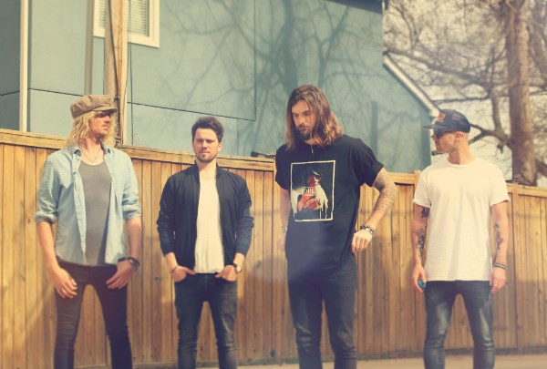

Sunset Sons brengt op 1 april het debuutalbum Very Rarely Say Die uit. Op 5 februari staat het viertal in het voorprogramma van Imagine Dragons in de Ziggo Dome en in april komt de groep terug voor twee clubshows: op 12 april speelt Sunset Sons in de Effenaar in Eindhoven, een dag daarna in de Melkweg in Amsterdam. Very Rarely Say Die is afwisselend opgenomen in Londen, Nashville en de geadopteerde thuishaven Hossegor met Jacquire King (Kings of Leon) en James Lewis (Arctic Monkeys).

Het Engels-Australische Sunset Sons heeft een ongelofelijke twaalf maanden achter de rug waarin ze op meer dan twintig zomerfestivals speelde, waaronder in ons land op het Best Kept Secret festival en daarvoor Eurosonic, werd opgepikt door de belangrijke Engelse radiostations, tourde met Imagine Dragons en een uitverkochte clubtour door Engeland deed. Niet slecht voor vier surfers die twee jaar eerder nog muziek maakten om de rekeningen te betalen.

Sunset Sons ontstond toen Rory, Pete, Jed en Rob elkaar tegen het lijf liepen in het slaperige Franse kuststadje Hossegor. Drummer Jed zag voorman Rory covers spelen op een barpiano die stond tussen de vuile pannen in de keuken van de bar La Surfing. Die bar bleek eigendom te zijn van de neef van de Australische bassist Pete. De naam Le Surfing werd uiteindelijk gebruikt voor de zelf gefinancierde en in eigen beheer uitgebrachte debuut EP die in slechts drie dagen werd opgenomen.

Tijdens haar Engelse tour deed Sunset Sons niet alleen de geijkte steden als Londen en Manchester aan, maar ook surfstadjes aan de kust zoals Scarborough en St Ives. Het is een natuurlijk onderdeel van en illustratief voor de down-to earth liefde voor surfen en de no-nonsense lifestyle. En dat is wat de vier leden aan de zee in Hossegor houdt. “That was part of the deal. We couldn’t write the songs we do living in, say, London”, aldus Rory. En daarom keerde de groep direct na het festivalseizoen terug naar Hossegor om de opnamen voor Very Rarely Say Die af te ronden.
