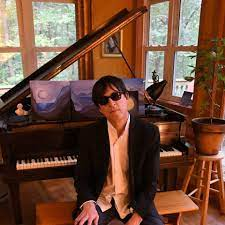
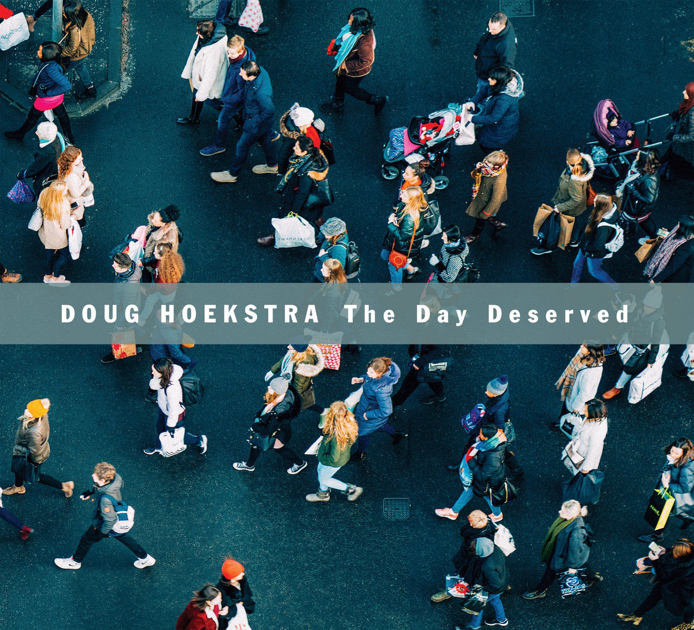

*Door Harry de Jong*

Een Amerikaanse singer/songwriter die Doug Hoekstra heet, dat kan niet missen: zo iemand moet iets met Friesland te maken hebben. En inderdaad, de man die onder die naam in de Verenigde Staten een aardige staat van dienst in de muziek heeft opgebouwd, heeft zijn wortels in Marrum, een dorp in het noorden van Friesland. Van daaruit waagde zijn grootvader zich ooit aan het grote avontuur om in Amerika een nieuw leven te beginnen.

Een artiest met de achternaam Hoekstra. Veel Amerikanen vinden het maar wat moeilijk om die uit spreken. Doug is er dan zo langzamerhand ook wel aan gewend dat hij ,Hookstra’ wordt genoemd. Moet kunnen. Vooral in de Zuidelijke staten, want daar komt die naam nauwelijks voor. Wel in Chicago en Michigan, want in die oorden zijn in de vorige eeuwen nogal wat Friezen neergestreken, weet Doug Hoekstra. ,,En veel mensen met die naam zijn ook nog eens in de muziek terecht gekomen, is dat toeval of niet?” Doug zelf debuteerde in platenland in 1994 met het album When The Tubes Begin To Glow, gevolgd door nog eens vier eigenzinnige albums. Daarna werd het tien jaar stil, maar ineens is hij er weer met een nieuwe plaat. Met zijn fluisterstem zingt hij tien uiterst poëtische liedjes met ronduit  literaire teksten, fraai omlijst door het twangy gitaarspel van Dave Coleman.  Dit is muziek waar je naar moet luisteren met de teksten binnen handbereik, want  Hoekstra is in de eerste plaats een dichter en dan pas een zanger.

**Gedichtenbundels**

Dat klopt aardig. De Amerikaan heeft inmiddels drie gedichtenbundels op zijn naam staan en is op dit moment bezig met een vierde bundel korte verhalen. Als artiest is hij dus allround, zou je kunnen zeggen. ,,Ja, en dan te bedenken dat ik de eerste in onze familie ben die in de muziek is gegaan,’’  glimlacht Hoekstra tijdens een zoom-interview vanuit zijn woning in Nashville. Een flesje water binnen handbereik. Naast hem zit een opstandige rode kater die voortdurend probeert de aandacht van zijn baasje te trekken.

Hoekstra  geeft het spinnende wolbaaltje een knuffel en zegt: ,,Volgens mijn vader was mijn opa boer in Friesland. Hij besloot op een dag huis een haard te verkopen en kwam als vrijgezel met de boot naar New York, samen met duizenden andere avonturiers. Later zou hij zich in Chicago vestigen. Hij begon daar een zaak in melkproducten, die hij ook aan huis afleverde. Grootvader was dus eigenlijk melkboer, een man die elke morgen melk en eieren bij de huizen langs bracht. Hij ontmoette later een meisje, trouwde en stichtte een gezin. En toen verscheen mijn vader ten tonele. Pa heeft z’n leven lang in de vleesverpakkingsindustrie in Chicago gewerkt. Hij is nooit van baan veranderd en dat kwam omdat hij in de jaren van de Grote Depressie opgroeide. Toen leerde hij dat als je werk had, je dat nooit zo weg moest smijten.”

**Tweede generatie**

En dus is Doug de tweede generatie Hoekstra die in Amerika werd geboren. Maar de eerste die muzikant werd. Doug heeft nog een broer die journalist was bij een dagblad in Chicago. ,,Hij werd schrijver en ik zanger. Omdat mijn broer een stuk ouder was dan ik, had hij al een hele platencollectie toen ik nog in de zandbak zat. Hij had elpees van The Beatles en die stimuleerden me enorm om ook iets met muziek te doen. Daarna ontdekte ik Bob Dylan. Wat mij in beiden zo fascineerde, was de liedjes die ze schreven. Als ik muzikant zou worden, dan zou ik in de eerste plaats een liedjesschrijver zijn, besloot ik. Ik hoefde niet op te vallen als een jongen die ontzettend snel gitaar kon spelen.”

**Countryrock**

Hoekstra speelde in eerste instantie in een countryrockband in Chicago, maar kwam er al snel achter dat hij beter tot zijn recht kwam als soloartiest. Een man met een gitaar op een klein podium. Op die manier kon hij zijn zelfgeschreven liedjes veel beter overbrengen. Hoekstra: ,,Vlak nadat mijn eerste album uitkwam, ben ik van Chicago naar Nashville verhuisd en toen kwam mijn carrière een beetje op gang. De muziek van die band waarin ik in Chicago zat, zou je het beste kunnen omschrijven als alternatieve country, waarin de nodige bluesinvloeden waren te bespeuren. We speelden bijvoorbeeld ook dingen van John Lee Hooker. Al die invloeden vind je in mijn latere solowerk terug. Maar daarnaast hoor je allerlei elementen uit de popwereld, want ik luister naar heel wat soorten muziek en pik overal wat van mee. In elk genre zit namelijk wel wat goeds.”

**The Day Deserved**

The Day Deserved is het eerste album dat Doug na ongeveer twaalf jaar heeft uitgebracht. ,,Ik had de muziek op een laag pitje gezet omdat ik het opgroeien van mijn zoon veel belangrijker vond,’’ bekent hij. ,,Hij is nu achttien en ik ben achteraf blij dat ik zijn jeugd van zo dichtbij heb meegemaakt, want die kans krijg je maar een keer. Ik ben ondertussen wel blijven schrijven en uiteindelijk had ik zoveel liedjes op de plank liggen dat ik er een album mee kon vullen. En die plaat heb ik dus nu gemaakt.’’

Hoekstra schreef de liedjes in een periode dat er heel wat gebeurde in de wereld. De opkomst en ondergang van Donald Trump, de coronapandemie… Hebben die zaken z’n weerslag gevonden op het werk  van de Amerikaan?  ,,Wel op een indirecte wijze,’’ geeft Hoekstra toe. ,,Maar The Day Deserved is geen politieke plaat geworden. Ik ben iemand die de wereld op een beschouwende manier bekijkt en dat hoor je ook terug in de  teksten van de liedjes.’’

**Podium**

Zit Hoekstra niet te popelen om weer het podium op te gaan nu er ook in Amerika steeds meer wordt versoepeld? Hij neemt nadenkend een slokje water. ,,Natuurlijk wil ik wel weer optreden, maar mijn leven hangt er niet van af,’’ zegt hij met zelfkennis.  ,,Ik schep net zoveel plezier in het schrijven van nummers en met het opnemen ervan. Ik ben geen muzikant die perse live met z’n publiek moet  communiceren om te bloeien. Ik had er trouwens niet aan moeten denken dat ik er nooit was geweest voor mijn zoon toen hij opgroeide omdat ik elke avond op moest treden. Als je een kind krijgt, gaat er een raam voor je open waardoor je de wereld op een nieuwe manier bekijkt, door de ogen van je kind. En dan zie je dingen die je daarvoor nog nooit gezien had. Dat is een onbetaalbare rijkdom.’’

