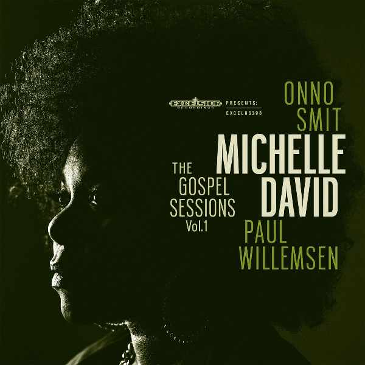

**“Wat zou er gebeuren als we de Gospel uit elkaar zouden halen?” Dat was de vraag die Onno Smit en Paul Willemsen zich stelden. Niet om afbreuk te doen aan het genre, maar om eens te proberen alle clichés te vermijden. Hoeveel liedjes blijven er dan over? Onno en Paul, door de wol geverfd met hun bands als Beans & Fatback en Lefties Soul Connection vonden in Michelle David de zangeres voor hun zoektocht naar de bakermat van de soul. Het resultaat: The Gospel Session – Vol. 1 verschijnt op 3 april op vinyl en digitaal.[Bekijk de mini-documentaire](http://excelsior-recordings.us3.list-manage1.com/track/click?u=c3a304a45ded577c1f667747a&id=f6e4c520fb&e=693338e0d7).**

De Amerikaanse Michelle David, geboren in North Carolina en opgegroeid in New York, zong al vanaf haar vierde in de kerk en een jaar later al bij haar eerste gospelgroep The Mission of Love. Maar Michelle was in eerste instantie niet gelijk enthousiast over The Gospel Sessions. Ze wilde juist afstand nemen van de Gospel en dat overlaten aan hen die gebrand waren zielen te redden.

Na enig aandringen en een paar proefsessies werd het concept voor de plaat haar duidelijker en stemde ze in met het maken van deze plaat. Terug naar de oorsprong en essentie waarom deze muziek zo aantrekkelijk is, maar dan met een nieuwe aanpak. Weggooien wat overbodig is en zien wat overblijft. Dus geen Hammondorgel waar je het zou verwachten, geen koor waar je het wel hoort en de handclaps tot een minimum berperken. Weg met de vele akkoorden; Eén gitaarrif zegt vaak meer dan een hele reeks akkoordwisselingen. De kracht zit hem in de herhaling.

Op twee nummers na, is The Gospel Sessions Vol.1 een basgitaar-loze plaat geworden. De nadruk is gelegd op de groove van de gitaren en de rudimentaire percussie ritmes van Toon Oomen. In deze stijl brengt de plaat je van de Caribbean (There’s A Light) naar New Orleans (I want To Know), door naar Mali in West-Afrika (Made It Over) en naar de Mississippi Delta Blues (Can’t no Grave).

The gospel Sessions Vol.1 is in een dag live ingespeeld en opgenomen in The Electric Monkey studios te Amsterdam met Kasper Frenkel achter de knoppen.

<iframe src="https://www.youtube-nocookie.com/embed/3UjRWQVV3lA" title="Video" loading="lazy" allowfullscreen=""></iframe>
