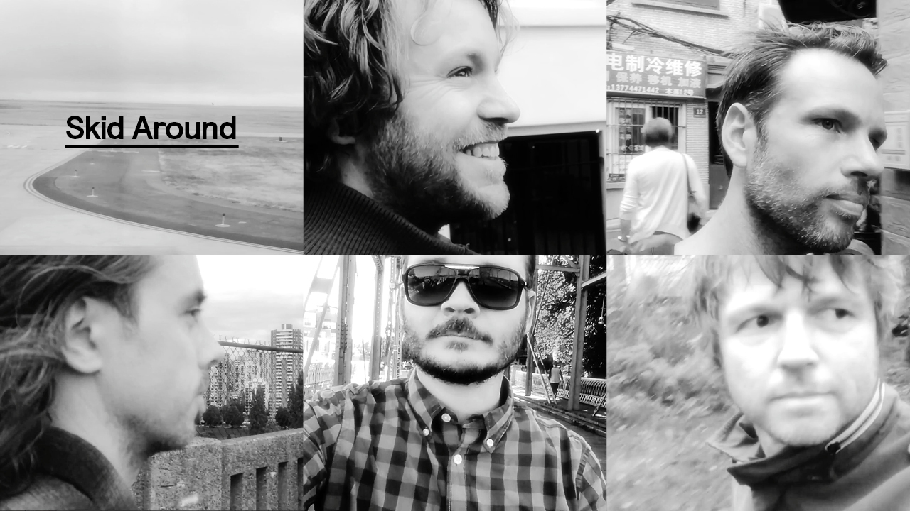

El Pino and the Volunteers komt zes jaar na de release van het album The Long-lost Art of Becoming Invisible terug met een nieuw album. Het is niet dat de band ruim de tijd nam voor het derde album, maar life got in the way; van baby’s tot Oscar-nominaties en andere muzikale paden die de band kruisten van Amsterdam tot Vancouver. Op 12 februari verschijnt ‘El Pino and The Volunteers’, zelf-getiteld of eigenlijk titelloos, maar vol contrasten.

Na The Long-lost Art of Becoming Invisible besloten we tijd te maken voor uitstapjes om tot nieuwe muzikale ideeën te komen. Job Roggeveen’s Happy Camper bijvoorbeeld, dat we live ten gehore brachten en dat zo goed in de smaak viel dat er niet alleen een mooie tour in Nederland en Indonesië op volgde, maar ook een Edison Award en een tweede Happy Camper plaat tot gevolg had. Intussen nam David Pino met Marien Dorleijn (Moss) in een koude Canadese blokhut een plaat op die onder de noemer TIKA verscheen, waar uiteraard ook mee getourd moest worden. Jeroen Kleijn toerde met Claw Boys Claw en Alex Roeka en er kwam een Daryll-Ann reünie.

David Pino: “Er werd getrouwd, er kwamen baby’s. Ap woont inmiddels de helft van het jaar in New York en de andere helft in Amsterdam, Tjirk ontwerpt en woont in Vancouver en Job vliegt met zijn animatiestudio Job, Joris en Marieke de wereld over en sleepte terloops een Oscarnominatie binnen. Waar we voorheen praktisch onder één dak woonden en we op ieder moment van de dag aan liedjes konden werken, wonen we nu een halve wereld van elkaar vandaan. Dat is lastig plannen, maar bracht ook nieuwe muzikale inspiratie die veel opleverde op de momenten dat we allemaal in het land waren en er aan de plaat kon worden gewerkt.”

De eerste opnamen zijn gelijk de eerste sessies in de nieuwe studio van Frans Hagenaars in Amsterdam Noord. De zang wordt grotendeels opgenomen in de Oude Kerk op de Wallen, waar de ontwerpstudio van David Pino is gehuisvest.

In grofweg vier sessies, verdeeld over drie en een half jaar, worden de nummers opgenomen en gemixt. Het instrumentarium beperkt zich tot bas, drums, een paar elektrische gitaren (nee, geen akoestische dit keer), een piano en een oude Casiotone. Rechttoe rechtaan, eerlijk en dichtbij, om tot een energieke plaat zonder opsmuk te komen.

Het derde album is er één zonder titel, maar vol contrasten. De nummers gaan over onbevangenheid en over het verlies daarvan. Over gelukte en mislukte liefde. Over kansen en gemiste kansen. Over nachten in de stad waar geen einde aan zou mogen komen en over lange wegen om diezelfde stad te ontvluchten. Over besneeuwde bergtoppen en over eilanden. Over een laatste kans en een nieuw begin. Over echte helden en mensen met alleen maar een grote bek. Over afscheid en over welkom.

De plaat ligt op 12 februari in de winkels. Een week later trapt de band een clubtour af in Bitterzoet Amsterdam.

Live shows

Feb 18: Bitterzoet, Amsterdam  
Feb 25: Vera, Groningen  
Mar 03: Luxor Live, Arnhem  
Mar 06: Ekko, Utrecht  
Mar 10: Rotown, Rotterdam
