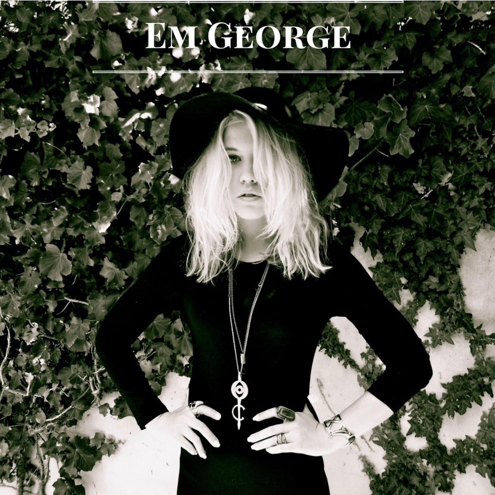

Em George – breekbare en krachtige Australische folk met ‘70s invloeden

Em George is zo’n typische singer/songwriter waarvan er tegenwoordig niet veel meer rondlopen. Ze schrijft over persoonlijke ervaringen, of over de absurditeiten en gebeurtenissen van het leven zelf. Haar nummers vertonen een introspectieve kwaliteit met een uniek geluid. De melodieën ondersteunen de ware betekenis van haar teksten, hiervoor puttend uit invloeden van alle muziekgenres.

Ze bracht in Australië eerder drie singles uit waarvan er eentje zelfs werd opgepikt door HBO en geremixed door Stephen Kozmeniuk (Madonna, Kayne West). De laatste single kreeg in de Verenigde Staten radio ondersteuning in New York, Texas en Californië. Ook haar live optredens maken indruk, er straalt zowel breekbaarheid als kracht vanuit.

Nu komt Em George haar gelijknamige debuut EP uit, waarop ook de eerder dit jaar in Nederland uitgebrachte single The Grind, een van elke franje ontdane productie, met rauwe vocalen en weemoedige tekst.

Voor fans van: Laura Marling, Leonard Cohen, Joni Mitchell

Nederlandse release datum: 18 juli 2016

Tracklist Em George – Em George (EP):

01\. Paper Hearts  
02\. The Grind  
03\. Judas  
04\. Blues Lady  
05\. Run
