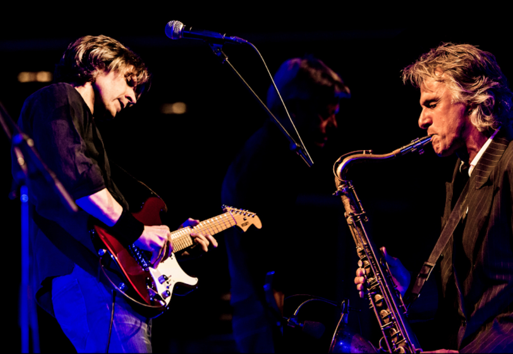

***,Het publiek wil de liedjes van Dire Straits altijd weer horen’***

Door Harry de Jong

Chris White heeft er zin in om naar Nederland af te reizen en het publiek te trakteren op een rondje pure Dire Straits muziek. Als saxofonist van de oorspronkelijke formatie rond Mark Knopfler heeft hij meermalen door de Lage Landen getourd en daar bewaart hij mooie herinneringen aan. ,,Nederland heeft altijd een warm plekje in mijn hart gehouden,’’ glimlacht hij.

De officiële versie van Dire Straits mag dan niet meer op tournee gaan, Chris White houdt  samen met zijn oude kompaan Chris Whitten de muziek van de groep springlevend. Onder de naam The Dire Straits Experience laten ze nummers als Sultans Of Swing, Money For Nothing, Private Investigations en Calling Elvis herleven. En dat doen ze samen met Terence Reis, Richard Cottle, Paddy Milner, Tim Walters en Michael Féat. Muzikanten die hun sporen in de popmuziek ruimschoots verdiend hebben. Zo tourden ze onder andere met Paul McCartney, Eric Clapton, David Bowie, Mick Jagger, Tina Turner en Mike Oldfield.

Hoe is het idee voor The Experience eigenlijk ontstaan? Chris: ,,Ik ben jaren geleden gevraagd om voor een liefdadigheidsinstelling een optreden met liedjes van Dire Straits te verzorgen. Dat was in the Royal Albert Hall. Mark Knopfler had geen tijd en ik dacht dat het dan ook een zinloze missie zou worden. Maar door een stom toeval liep ik Terence Reis tegen het lijf, een muzikant die het helemaal in zich heeft om Knopfler te vervangen. Toen durfde ik het wel aan en het optreden werd een succes. Ik dacht dat het daarbij zou blijven, maar de verzoeken om die show nog een keer te doen, bleven maar binnenkomen. We deden er dus nog een paar en vijf jaar later doen we er nog steeds een paar. Ja, het is een enorm succes geworden.’’

De kans is klein dat Mark Knopfler zelf nog eens aanschuift, want hij heeft op dit moment een succesvolle solocarrière en daarin passen de klassiekers van Dire Straits niet meer. Chris: ,,Maar het publiek wil ze toch altijd weer horen en ik vind dat ze daar recht op hebben.’’ De saxofonist maakte van 1985 tot 1995 deel uit van de Dire Straits tournees. Sindsdien zijn hij en Knopfler goede vrienden gebleven. ,,Ja, ik heb veel aan hem te danken, maar ik ben mijn hele leven eigenlijk een zondagskind in de muziek geweest,’’ zegt White terugkijkend op zijn leven. ,,Op mijn veertiende wist ik dat ik saxofonist wilde worden en sindsdien heb ik nooit om werk op dat gebied verlegen gezeten. Ik had de mazzel om onder andere bij Paul McCartney te mogen spelen. Op een dag kreeg ik een telefoontje van Mark Knopfler dat hij me wilde ontmoeten in zijn studio. Hij wilde dat ik hem hielp bij de soundtrack van de film Comfort And Joy. Hij was bijzonder tevreden over het resultaat en nodigde me uit om met Dire Straits op tournee te gaan. Maar het zou nog twee jaar duren voordat dat er van kwam. Een geweldige tijd, maar soms ook heel zwaar. We deden eens 36 optredens achtereen in 27 verschillende steden door heel Europa. Dat was uitputtend en de glitter en de glammer was voor mijn gevoel ver te zoeken. Bus in bus uit, vliegtuig in, vliegtuig uit, het ging maar door.’’

Nadat Dire Straits besloot niet meer op pad te gaan, kreeg White werk bij onder andere Joe Cocker. ,,Er kwam altijd wel weer wat bijzonders op mijn pad en dat is tot op de dag van vandaag zo gebleven. Dat houdt me fris. Ik heb van al die artiesten met wie ik werkte veel opgestoken. Van Mark leerde ik om op de details te letten. En ik leerde ook dat je je heel goed moet voorbereiden voordat je voor een publiek gaat staan. Voor the Brothers In Arms tour met Dire Straits repeteerden we tien weken achtereen voordat we een show gaven. Ik vond dat eerst te gek voor woorden en dacht dat een week ook wel genoeg was. Maar toen we uiteindelijk het podium opgingen, hadden we alles perfect voor elkaar. Mark had het goed gezien.’’

Is er een verschil tussen de werkwijze van Mark Knopfler en Paul McCartney? ,,Nee, niet zoveel,’’ zegt White achteraf. ,,Paul is ook een man met oog voor detail. Ik heb aan verschillende albums van hem meegewerkt en daardoor heb ik hem aardig leren kennen. Mannen van het kaliber van Paul en Mark zijn erg gefocust op waar ze mee bezig zijn. Ze weten precies wat ze willen en werken heel hard om dat voor elkaar te krijgen.’’

The Dire Straits Experience komt dit najaar naar Nederland en staat op 17 november in Martini Plaza in Groningen.
