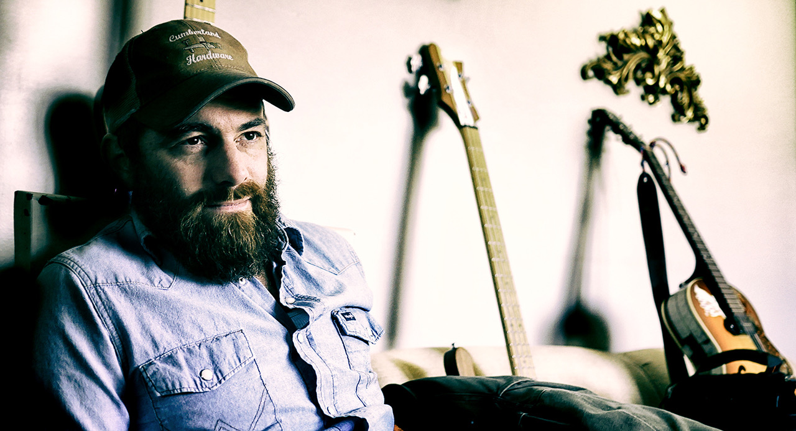

,Als je stront bakt in een oven, krijg je nog geen lekkere koekjes’

Door Harry de Jong

De Amerikaanse countryzanger Pat Reedy geeft op zondagmiddag 8 september om 16.00 uur een concert in Kultuurfabriek Kooi-Aap aan de Lijester Hegedyk 27B in Alde Leije. Reedy wordt begeleid door The Long Time Goners. De redactie van het online countrymagazine van de Kultuurfabriek had alvast een interview met hem.

Pat Reedy maakt hele oorspronkelijke countrymuziek en zijn ster is zowel in Amerika als Europa rijzende. Hij woonde het grootste deelvan zijn volwassen leven in New Orleans, waar hij werd geïnspireerd door de straatartiesten van de Franse wijk. Nu hij een deel van zijn tijd in Nashville woont, heeft zijn muziek zich ontwikkeld tot een mix van New Orleans r&b en de klassieke Nashville sound. Zijn laatste album ‘Highway Bound’ werd opgenomen met straatartiesten uit New Orleans in een studio in Nashville. Op deze manier werd het een mooi eerbetoon aan zijn tijd in The Big Easy.

*,,Waar ben je geboren en getogen?‘’*  
,,Dat zit nogal ingewikkeld in elkaar. Ik ben geboren in Meeker, Colorado. Mijn moeder was verpleegster en mijn vader vrachtwagenchauffeur. Ze gingen uit elkaar toen ik nog heel jong was. Ik ben verder opgevoed door mijn grootmoeder en die sleepte me het hele land door. Nog weer later nam mijn tante Sue de zorg voor mij op zich en toen streken we neer in Illinois. Die staat bestaat uit de stad Chicago en voor de rest uit niets anders dan korenvelden. Aangezien mijn tante niet in de stad woonde, valt er dus weinig over mijn tijd in die staat te vertellen.’’

*,,Waren je ouders en familie muzikaal?’’*  
,,Nee, er is niemand in mijn hele familie die muziek maakt. Ik snap dan ook niet waar mijn talent vandaan komt. Het is in ieder geval niet iets genetisch. Ik werd in mijn jeugd niet gestimuleerd om muziek te gaan maken. Ik heb alleen lagere school gehad en toen ben ik gaan werken. Maar dat was heel gebruikelijk in mijn omgeving. Ik had allerlei baantjes. Ik werkte in olievelden, ik was bouwvakker, mijnwerker en weet ik veel. Ik zwierf van plaats naar plaats en van baan naar baan. Ik was wat je noemt een hobo. Ik sprong in goederenwagons van vrachttreinen als ze een station uitreden en zo reisde ik gratis het land door. Dat was tamelijk link, want als je door de spoorwegpolitie werd gesnapt, kreeg je zo een pistool onder je neus geduwd. Jaren geleden werd je zelfs half dood geslagen met honkbalknuppels door spoorwegmedewerkers als ze je te pakken kregen. In het ergste geval schoten ze je zelfs dood. Maar dat was gelukkig voor mijn tijd. Ik ben ongeveer zeven jaar lang een hobo geweest en in die tijd heb ik meermalen in de gevangenis gezeten. Niet alleen voor zwartrijden met de trein, maar ook voor het vernielen van andermans bezit, het bezit van drugs, bedelarij, dat soort dingen. Ik heb ooit eens 30 dagen vastgezeten in de Orleans Parrish Prison voor wildplassen. Toen ik 28 was, ben ik gestopt met die ruige manier van leven, want ik wilde niet in de goot eindigen. Ik kreeg een baan als vrachtwagenchauffeur en vestigde me in New Orleans.’’

*En al die tijd liep countrymuziek als een rode draad door jouw leven?*  
,,Jazeker. Er was overal countrymuziek waar ik ging of stond. En gelukkig ben ik oud genoeg om nog te kunnen zeggen dat ik opgroeide met ,echte’ country. En dan heb ik het over mannen als Buck Owens en Merle Haggard. Maar ook Woody Guthrie was een inspiratiebron voor mij, net als later Billy Joe Shaver. En er zijn tegenwoordig nog zoveel inspiratiebronnen. Neem nou Luke Bell en Riley Downing. Dat zijn goede vrienden van mij die geweldige liedjes schrijven. En zo zijn er nog wel een paar…’’

*,,Wanneer kwam jouw carrière als countrymuzikant van de grond?’’*  
,,Toen ik nog een stuk jonger was, liftte ik naar New Orleans en begon daar in de Franse wijk met het spelen van liedjes op straat. Het was een cruciaal punt in mijn carrière toen ik voor het eerst naar die stad ging en daar al die goudeerlijke straatartiesten ontmoette. Ik kon in die tijd alleen een paar akkoorden op mijn gitaar spelen, maar plotseling werd dat instrument voor mij belangrijk. Ik heb dus eigenlijk gitaar leren spelen op de straathoeken van New Orleans. Mensen met namen als Troy, Washboard Lisa en Coydog zijn heel belangrijk geweest voor mijn ontwikkeling als muzikant. Op mijn nieuwste album Highway Bound spelen ze allemaal mee. Ja, New Orleans is een geweldige plek om muziek te leren maken. Ik heb er ook heel wat inspiratie opgedaan voor het schrijven van liedjes.’’

*,,Wat vind je van de muziek die tegenwoordig in Nashville wordt gemaakt?*  
..Ik vind het helemaal niks. Het is popmuziek wat uit Nashville komt en ik speel country. Ze kunnen in die stad wel een cowboyhoed opzetten, maar dat maakt hun muziek nog geen country. Je kunt een varken lipstick opdoen, maar het blijft een varken. En als je stront bakt in een oven, krijg je nog geen lekkere koekjes. Zo denk ik over moderne country uit Nashville.’’
