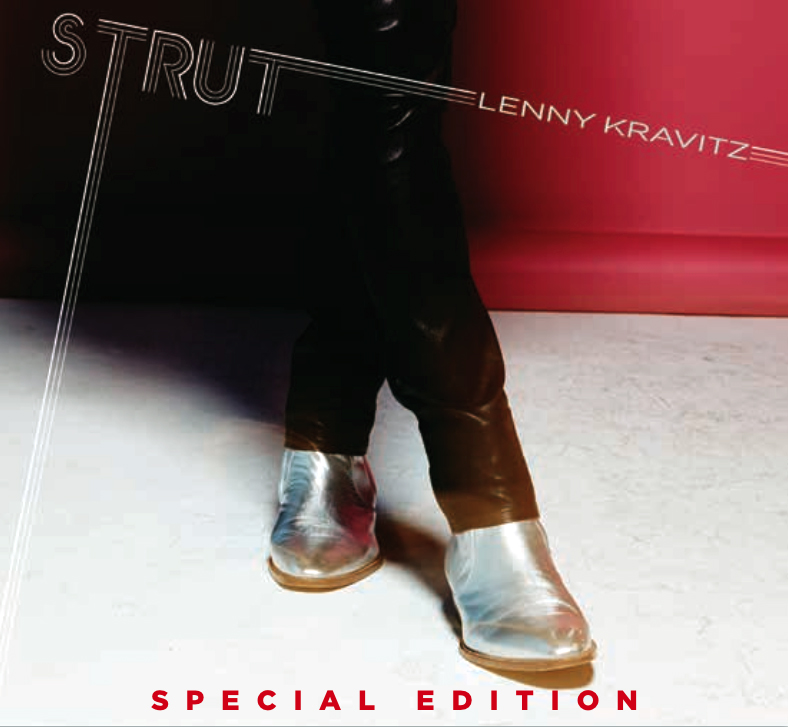
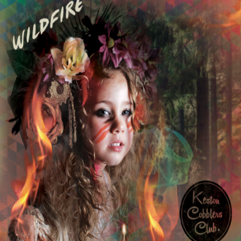
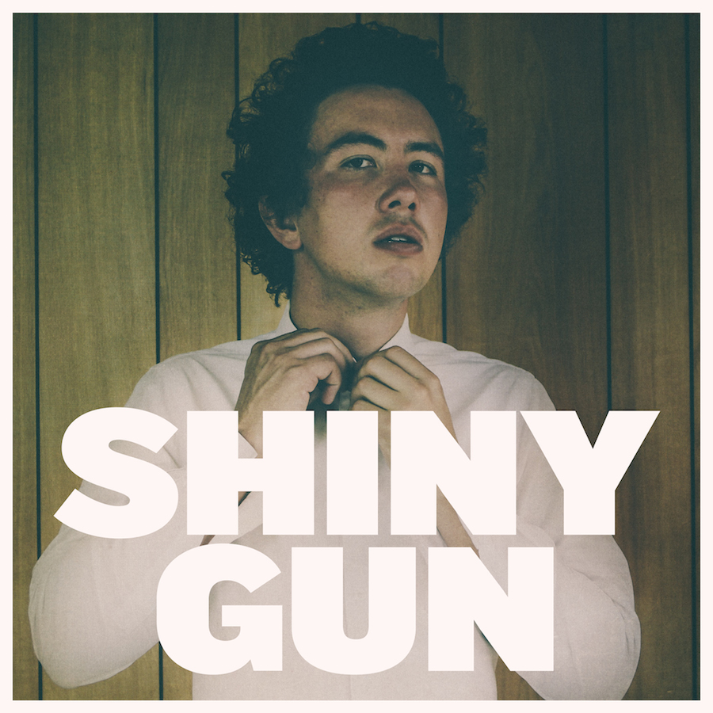
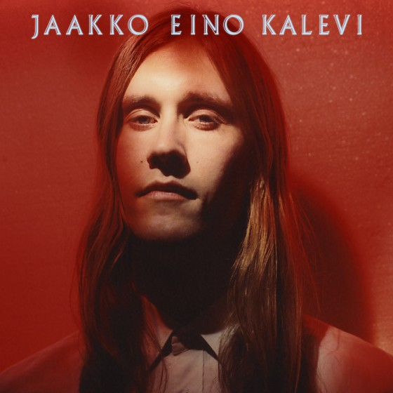
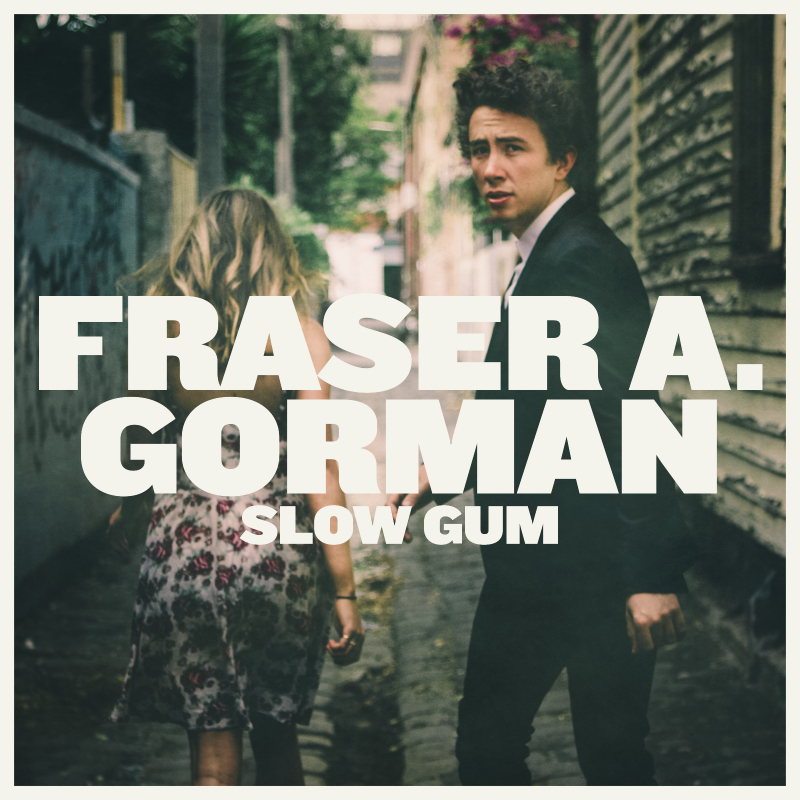
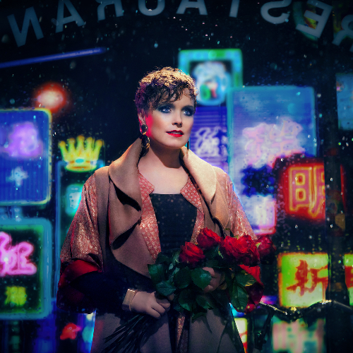

**Het festivalseizoen is al even geopend en nu de zon ook eindelijk door begint te breken is het de hoogste tijd om lekker buiten te spelen! Zo dacht ook Janne Schra, die afgelopen week haar festivalschema aankondigde. Deze zomer neemt Janne haar, in de woonkamer opgenomen, album Ponzo mee naar buiten en speelt ze onder andere op Oerol, Down The Rabbit Hole en Valkhof.**

## Nieuws

## Lenny Kravitz album Strut met bonustracks

Op 8 juni verschijnt een nieuwe editie van Strut, het tiende studioalbum van Lenny Kravitz dat in september 2014 verscheen. Deze versie bevat de vier bonustracks Sweet Gitchey Rose en Can’t Stop Thinkin’ ‘Bout You, die voorheen alleen via iTunes verkrijgbaar waren, Lift Me Out Of My Head en It Won’t Feel The Same die exclusief op de Amerikaanse uitgave van het album stonden. Op vrijdag 26 juni is Lenny Kravitz headliner op het Concert At Sea festival.

## Tweede album voor Keston Cobblers Club

Een van de best bewaarde geheimen van de Britse muziekscène is de vijfkoppige popfolk band Keston Cobblers Club. Met het debuutalbum One For Words maakte de groep direct indruk en met het op 22 juni te verschijnen Wildfire geeft ze daar een meer dan waardig vervolg aan. Nieuw zijn de invloeden uit de Britse power- en indiepop en jaren ’90 synths, gebleven zijn de sterke harmonieën, krachtige drums en pakkende melodieën. Hoe dat klinkt hoor je op de eerste singleWon’t Look Back.  
“Every song is an absolute killer…They’re terrific” – Dermot O’Leary, BBC Radio 2

## Courtney Barnett te zien in Gorman’s Shiny Gun

Op 29 juni brengt Fraser A. Gorman zijn debuut Slow Gum uit, een album met een collectie coole, grappige, oprechte en aanstekelijke nummers die muzikaal in de buurt liggen van folk iconen als Cass McCombs en zijn jeugdhelden The Flying Burrito Brothers, Bill Callahan, Townes Van Zandt, Willie Nelson en Hank Williams. Fraser A. Gorman maakt deel uit van het Milk! collectief van Courtney Barnett en dus is het niet zo verwonderlijk dat zij te zien is in de video van de eerste singleShiny Gun.

## Nieuw album Morgan Heritage

Morgan Heritage, de band die bestaat uit de vijf broers en zus Morgan, is al jaren een van de grootste namen in de internationale reggae scène. Op 15 juni komt het nieuwe album Strictly Roots uit op het eigen CTBC label dat dit jaar werd opgericht en in Europa wordt vertegenwoordigd door Heartbeat.  
Perform and Done is de eerste single van het album. Morgan Heritage had eerder grote successen met de albums Don’t Haffi Dread en Protect Us Jah. Dit najaar tourt de band door Europa met Alpha Blondy. Op 8 juni vindt er een persdag plaats in Amsterdam.

## Maite Hontelé brengt Colombia naar Nederland

Op 1 juni brengt Maite Hontelé naar nieuwe album Te Voy A Querer uit. Het album is geproduceerd door Merlin Producciones en net als voorganger Déjame Así opgenomen in Colombia, waar de van oorsprong Utrechtse trompettiste al jaren woont. De eerste twee weken van juni is Maite in Nederland om de nummers van Te Voy A Querer ten gehore te brengen tijdens haar clubtour. Deze begint op 4 juni in Paard van Troje, Den Haag. Onlangs verscheen de eerste single van het album, Me Da Igual. De zomerse, kleurrijke video bekijk je hier. Tijdens haar bezoek aan Nederland is Maite beschikbaar voor interviews.

## Nieuw album Lifehouse in juni

Het op 22 juni te verschijnen Out Of The Wasteland is een optelsom van de albums die Lifehouse de afgelopen veertien jaar heeft uitgebracht en een nieuw hoofdstuk in de carrière van de groep. De chemie op persoonlijk en muzikaal vlak is terug en en dus horen we op Out Of The Wasteland een herboren band die de vrijheid heeft gevonden na een periode van transitie en regeneratie. Het tedere Central Park of nummers als Yesterday’s Son, Hurt This Way en de eerste single Hurricane zijn daar goede voorbeelden van. In september komt Lifehouse naar Nederland voor drie concerten. Op dinsdag 15 september staat de groep in de Melkweg, Amsterdam, op 16 september in de Oosterpoort in Groningen en op donderdag 17 september in Tivoli/Vredenburg in Utrecht.

## Concerten

**30/05** The Black Marble Selection | Woodlum Festival, Utrecht  
**30/05** The Elementary Penguins | Soccerrocker, Amsterdam  
**31/05** The Black Marble Selection | Snipperdag, Breda  
**06/06** Emil Landman | Naked Song Festival, Eindhoven  
**06/06** Janne Schra | Rietveld Theater, Delft  
**06/06** The Elementary Penguins | Den Dill Jubileum 2015, Ridderkerk  
**12/06** Janne Schra | Oerol, Terschelling  
**13/06** John Coffey | Pinkpop, Landgraaf  
**13/06** Blaudzun | Wantijpop, Dordrecht  
**13/06** Mister and Mississippi | Tivoli/Vredenburg Festival, Utrecht  
**13/06** The Elementary Penguins | Vondelpark Openluchttheater, Amsterdam  
**14/06** The Deaf | Pinkpop, Landgraaf  
**15/06** Marilyn Manson | Paradiso, Amsterdam

## Aankomende releases

## Jaakko Eino Kalevi

Release: 15 juni

## Fraser A. Gorman – Slow Gum

Release: 29 juni

## Ane Brun – When I’m Free

Release: 4 september
