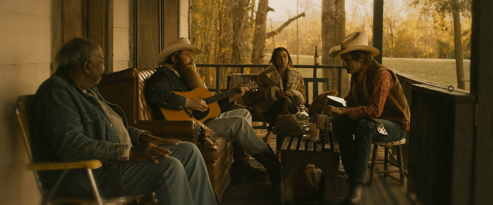

We zijn hier onder elkaar als kenners. Of in ieder geval als liefhebbers van americana en (alternatieve) country. Dus de meest van ons zullen wel van Blaze Foley gehoord hebben. Al is het maar omdat Lucinda Williams een prachtig nummer, *Drunken Angel*, over hem heeft opgenomen. Of omdat Townes van Zandt *Blaze Blues* over hem schreef. Maar zeg eens eerlijk: wie kent het werk van Blaze Foley werkelijk? Wie kende hem b.v. bij zijn leven al? Dat zullen er niet veel zijn. Blaze Foley, die dertig jaar geleden tragisch overleed, bleef voor velen van ons een mysterie. Daar komt deze week, met het in roulatie gaan van de film **Blaze**, verandering in.

**Schamele boomhut**  
Blaze vertelt het verhaal van Mike Fuller, zoals de werkelijke naam van Foley luidt, niet in een van wieg tot graf-volgorde. In feite valt de film uiteen in drie delen. Een deel gaat over de ontmoeting van Foley met zijn grote liefde, actrice Sybil Rosen, op wiens boek het scenario gebaseerd is. Grappig is trouwens dat Sybil Rosen in deze film een kleine bijrol als haar eigen moeder heeft. Er wordt een prachtig beeld geschept van hun ontluikende liefde en hoe zij in het begin van hun leven samen in een schamele boomhut wonen. In een ander deel zie je hoe twee vrienden van Foley, ene Zee en Townes van Zandt, gespeeld door gitarist Charlie Sexton, een radio-interview geven over Foley. Het laatste deel betreft het laatste optreden van Foley in een half verlaten bar in Austin, waarbij de opnames gemaakt worden voor het album Live At The Austin Outhouse. Die laatste delen geven de makers van de film de gelegenheid om in allerlei flashbacks een kaleidoscopisch portret van Foley te schetsen. Een werkwijze die wonderwel goed uitpakt en misschien wel passend is voor Foley voor wie het latere leven ook bestond uit door alcohol en drugs beheerste periodes vol overdenkingen en anekdotes. Ik vertel hier overigens geen geheim als ik aangeef dat Foley de dood vindt als hij wordt neergeschoten door de zoon van een vriend.**Prachtige hoofdrollen**  
De hoofdrol wordt prachtig gespeeld door muzikant Ben Dickey. Ook het feit dat hij de nummers van Foley uitstekend vertolkt dwingt bewondering af. Door hun beider partners raakte Dickey bevriend met acteur/regisseur Ethan Hawke. Later ontdekten zij dat zij beide een grote bewondering hadden voor Foley die ook de bijnaam droeg van The Duct Tape Messiah (omdat hij zijn schoenen, maar ook zijn jas bijeenhield met duct tape). Toen Hawke op het idee kwam van een film over Foley dacht hij gelijk aan Dickey voor de hoofdrol, voor wie dit een eerste acteerervaring is. Wat een schot in de roos! Ook actrice Alia Shawkat schittert als een aandoenlijke Sybil Rosen, die uiteindelijk steeds meer op afstand van Foley komt te staan. Mooie bijrolletjes zijn er nog voor Kris Kristofferson (als de vader van Foley), Alynda Segarra (van Hooray For The Rif Raf, als de zuster van Foley) en regisseur Richard Linklater (als een van drie oliebaronnen die Foley een platencontract aanbieden). Ethan Hawke speelt, grappig genoeg, zelf trouwens de onwetende radio-DJ aan wie Van Zandt het verhaal vertelt van Foley.

**Ook voor niet-americanisten**  
*Blaze* is, niet het minst om de prachtige muziek, voor de lezers van deze site een must see. Het is moeilijk te voorspellen of ook het grote publiek deze film gaat waarderen omdat hij natuurlijk erg hangt op het personage van Foley. Andere muziekfilms als A Star is Born of Bohemian Rhapsody hadden een acteur of een onderwerp dat publiek naar de bioscopen trok. Aan de andere kant; een film als Inside Llewelyn Davis, waarmee dit Blaze wel te vergelijken is, trok ook een grote schare toeschouwers. Ik zou het zekere voor het onzekere nemen en toch niet te lang wachten met een bezoek aan het filmtheater.

<iframe src="https://www.youtube-nocookie.com/embed/VbtYo8UEjao" title="Video" loading="lazy" allowfullscreen=""></iframe>

**Auteur: Hugo Vogel**
