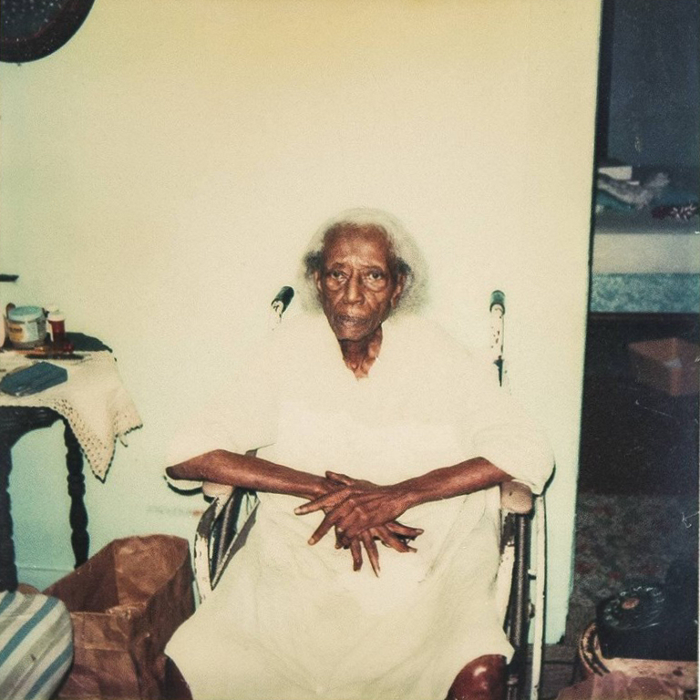
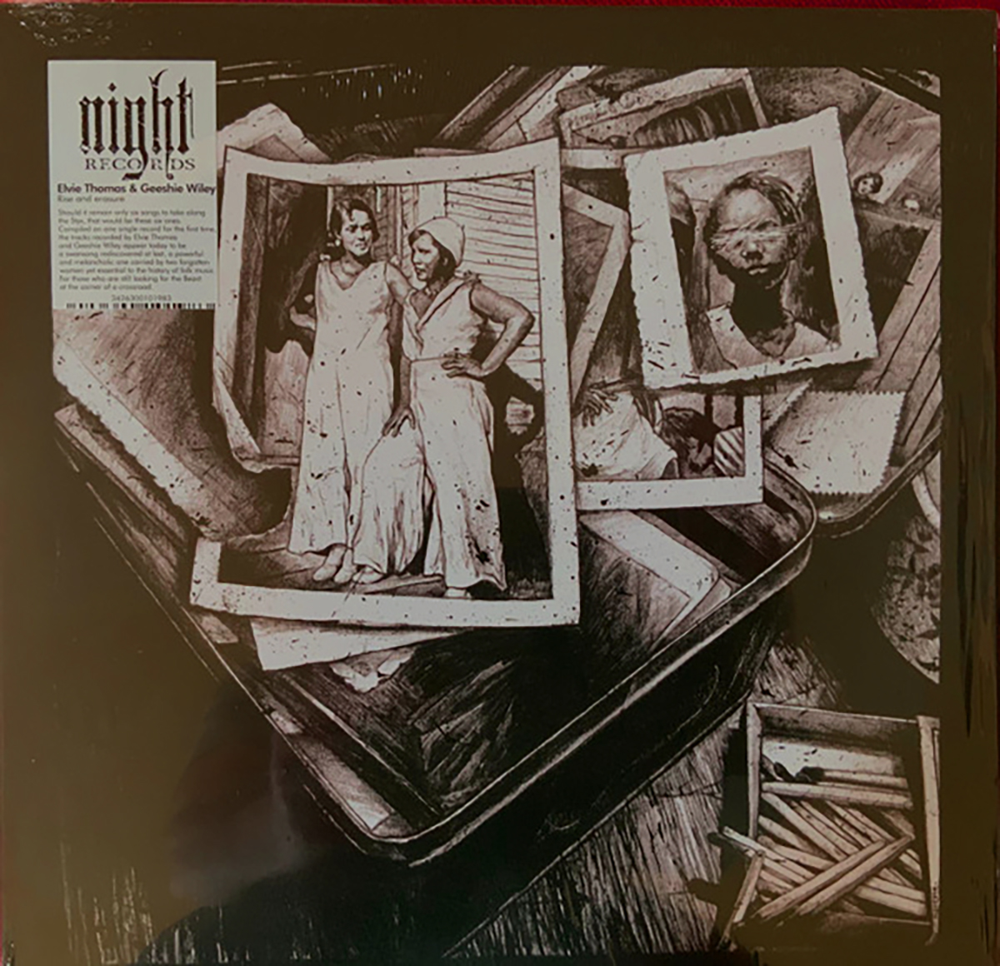

<iframe src="https://www.youtube-nocookie.com/embed/FmwYD1F01M4" title="Video" loading="lazy" allowfullscreen=""></iframe>

Door Herman van der Horst

Wie waren Geeshie Wiley en Elvie Thomas? Fantoom vrouwen die  een paar van de grootste meesterwerken uit de Amerikaanse muziekhistorie hebben gemaakt en daarop spoorloos verdwenen. Recentelijk zijn we iets meer over hen te weten gekomen, al roepen die nieuwe feiten alleen maar meer vragen op.

‘Well hello there, Geeshie.’

‘Hello there, Slack.’

‘What are you doin’ down here?’

‘Well, I’m just down here tryin’ to give these boys a little hot robin.’

‘Let me hear it then…’

Deze woordenwisseling, waarschijnlijk deel van hun podiumact, de introduktie van hun opname van *Pick Poor Robin Clean*, is het enige prozaïsche in het verhaal van Geeshie Wiley en Elvie Thomas. In zekere zin ook de enige bevestiging dat ze echt bestaan hebben. Ze zijn dus geboren en naar alle waarschijnlijkheid inmiddels overleden. De rest van het verhaal kan samengevat worden als – zoals Robert Crumb het ooit uitdrukte – ‘de verbinding met de eeuwigheid, of hoe je het ook wilt noemen.’

In de wereld van de vroeg 20ste eeuwse Afro-Amerikaanse muziek bestaan er geen geesten zo mysterieus als twee vrouwen, geïdentificeerd op drie ultra-zeldzame 78-toerenplaten uit 1930 en 1931 als Geeshie Wiley (zang, gitaar) en Elvie Thomas (zang, gitaar). Er bestaan muzikanten die net zo obscuur zijn en zelfs muzikanten die bijna net zo geweldig zijn. Maar in geen enkel geval overlapt het Venn diagram van grootheid en verlorenheid elkaar op zo’n verbijsterende manier. In de lente van 1930, in een vochtige en duistere studio in een klein Wisconsin dorp op de westoever van Lake Michigan, nam het duo een partij songs op die al meer dan een halve eeuw lang gerekend worden tot de onbetwiste meesterwerken uit de Amerikaanse muziekhistorie. Met name twee, Elvie’s *Motherless Child Blues* en Geeshie’s *Last Kind Words Blues*, de Twin Peaks in hun minuscule oeuvre, inspireren beschouwingen, romans, films, cover versies, een klassiek arrangement. 

Niettemin, ondanks meer dan 50 jaar onderzoek naar wie deze twee vrouwen waren of waar zij vandaan kwamen, bleven we zelfs verstookt van hun echte namen. De vage herinneringen van een of twee oude Mississippi muzikanten, vele decennia geleden opgetekend, leken naar de zuidelijke helft van die staat te wijzen. Maar dat leverde niets concreets op. Sommige mensen meenden sporen te horen van Louisiana of Texas in de gitaarstijl of de uitspraak van een tekst. We weten dat het woord ‘Geechee’ kan verwijzen naar een persoon die geboren is in de sterk Afrikaans doordrenkte Gullah cultuur op de eilanden voor de kust van Georgia en de Carolinas. Maar ook daar werd geen spoor gevonden. Of waar dan ook. Geen graf, geen foto. Vergeet het maar – geen anekdotes. Dit is wat Geeshie en Elvie onderscheidt van de rest van het illustere groepje fantoom genieën uit de jaren twintig en dertig. Hun mythe was dat er helemaal niets bestond waar je een mythe aan op kon hangen. 

De objecten zelf – totaal niet meer dan 10 bewaard gebleven exemplaren van hun drie Paramount releases, een handvol zware, bekraste schellak platen, allen in private handen – zijn het enige concrete wat we hebben. En zelfs deze hadden op een haar na verdwenen kunnen zijn. Afhankelijk van de beslissing van, pakweg, een vrouw die haar ouders’ zolder opruimt om tegen het advies de doos met oude platen weg te kieperen, te kijken wat de rommelwinkel ervoor geeft. Als ze anders beslist, als de winkel niet op weg naar huis ligt, daar gaat de muziek, daar gaan de zielen, asresten door de schoorsteen, wegzwevend met de Edison cylinder van Buddy Bolden’s band en de opname van Lincoln’s stem.

*Last Kind Words Blues* hoorde ik voor het eerst in Terry Zwigoff’s documentaire *Crumb* uit 1995, over het leven van de cartoonist Robert Crumb. In de film staat de verbitterde misantroop die je intussen hebt leren kennen en niet bepaald tot genoegen, in een kleine kamer; een muur wordt in beslag genomen door planken vol met 78-toeren platen. Crumb pakt een exemplaar, legt het op de draaitafel en gaat op een bed liggen als de muziek begint. Terwijl Wiley zingt en speelt, spreekt Crumb in een voice-over: ‘Als ik naar oude muziek luister, is dat een van de weinige momenten waarop ik een soort van liefde voor de mensheid ervaar.’ Op dit punt in de film weet je al dat dit het enige moment is; bewijzen voor andere momenten zijn er niet. ‘Je hoort het beste in de ziel van gewone mensen, *you know*…hun verbinding met de eeuwigheid’, zegt Crumb. Maar terwijl de song verder speelt, ben je er al in verloren. Wiley sleept je genadeloos mee naar een andere plek. De volgende dag stond ik voor de platenwinkel te wachten tot de zaak open ging.

Behalve de haast onbeschrijfelijke schoonheid van de songs zelf, zit er een ander aspect aan wat ze nog fascinerender maakt. Het zijn tijd capsules. Uit de tekst van *Last Kind Words* valt af te leiden dat het nummer uit de Eerste Wereldoorlog dateert. Maar wat het oproept, lijkt dichter bij de Peloponnesische oorlog te staan, of duizend jaar aan anonieme veldslagen die eraan vooraf gingen. De song klinkt even oud als de aarde. Strict genomen is het ook geen blues, een woord dat platenmijen indertijd standaard aan iedere ‘zwarte’ muziektitel toevoegden, om de doelgroep te bereiken. Het is een soort pre-blues of nog-net-geen blues uit een duistere periode ver voor het gitaar-tijdperk. ‘*If I get killed*’, zingt Geeshie, ‘*if I get killed, please don’t bury my soul. I cried: Just leave me out. Let the buzzards eat me whole*.’

Generaties aan spirituals, field hollers en worksongs stromen door *Motherless Child*, de enige van de zes waarop Elvie lead zingt. In de overige songs dekt ze Geeshie in de rug, met een ‘bas’ stijl die ze zo karakteristiek maakt. Het spel is van een bedriegelijke eenvoud en tegelijk uiterst verfijnt. Elvie’s noten zweven. Ze zendt ze uit als kleine zeilscheepjes over een vijver. De fameuze Joe Bussard (uitgesproken als *buzzard*), een van s’werelds meest vooraanstaande verzamelaars van vooroorlogse 78-toerenplaten, vond halverwege de jaren zestig het enige bestaande exemplaar van *Motherless Child* in een antiekwinkel in Baltimore. Het verhaal wil dat Bussard mensen in zijn huis uitnodigde om ze de eerste noot van *Motherless Child* te laten horen, alleen de eerste paar seconden, telkens opnieuw. Het klinkt als niets en dan, na een paar keer luisteren, als niets anders. ‘*Baby, now she’s dead, she’s six feet in the ground*’, zingt ze. ‘ *And I’m a child and I am drifting around*.’

Van oudsher werden bluesteksten, net als folk-lyriek, overgeleverd. In de 19-de eeuwse folktraditie migreerden versregels, refreinen of hele coupletten van de ene song naar de andere, van zwarte muzikanten naar blanke en weer terug. Wat daaruit ontstond was auteurloos en dus kon iedere zanger elk woord claimen als het zijne of het hare. Iedereen kon stukjes en beetjes aan elkaar rijgen tot het statement van een individu. Hoewel het dezelfde vorm heeft, lijkt die folk traditie nauwelijks van toepassing op *Last Kind Words*. Wiley’s woorden en gitaarspel zijn zo uniek en persoonlijk dat niemand het lef zou hebben om ze daarna als de hunne te claimen. De song is even mysterieus als Wiley zelf. ‘*The last kind words, I heard my daddy say’,* zo begint ze het verhaal. En ze geeft ons die woorden: ‘*If I die. If I die in the German war, I want you to send my body. Send it to my mother-in-law*.’ Spoedig neemt de song een bocht die leidt naar zijn onheilspellende ontknoping. Nadat ze andere vrouwen aan het woord laat, in gesprek met het universum, terwijl ze geconfronteert worden met hun sterfelijkheid, zijn Wiley’s bijna laatste woorden in de song verbazingwekkend en alles bepalend. Ze ontstijgen het verhaal en tonen een aangrijpend zinnebeeld dat het hart vormt van deze hypnotiserende performance:

The Mississippi River

You know it’s deep and wide,

I can stand right here,

See my face from the other side.

Geeshie Wiley staat op de oever van de Mississippi rivier en kan haar eigen gezicht vanaf de andere kant zien. Wat betekent dat? Welnu, schrijver en criticus Greil Marcus meent het te weten; hij geeft bevlogen lezingen over de lucide waarheid van Wiley’s song. Het betekent dat ze op twee plekken tegelijk is, legt Marcus uit in zijn boek *Three Songs, Three Singers, Three Nations*. ‘Of ze is nergens: wanneer je iets ziet vanaf de andere kant, dan zie je het vanuit het punt van de dood.’ 

Je kunt ook zeggen: ze ziet haar gezicht aan de overkant, omdat haar gezicht het enige is wat er te zien valt. Alles en iedereen waarvan ze heeft gehouden, is dood. Er is in de song geen spoor van een maatschappij, een samenleving, een stad of een gemeenschap te bekennen. Het land dat het schildert is een woestenij. 

Die woestenij is de geweldadige wereld met zijn racistische Jim Crow-wetten waarin deze Afro-Amerikaanse vrouwen moeten overleven. In deze en andere songs sluiten Wiley en haar partner Thomas een geheim verbond om samen een muzikaal pad te banen uit hun tweederangs burgerschap naar een nieuw niveau van autonomie en zelfbeschikking. Het is de praktijk van iedere bluesvrouw op weg naar vrijheid; een praktijk die wijsheid en strategie heeft opgelevert vanaf de raciale terreur uit de jaren dertig tot op de huidige dag.

Daarbij is Wiley’s voordracht zo direct, dat je haast niet anders kunt dan haar woorden letterlijk te nemen. Ze verschuilt zich niet achter archetypen, zoals in de folktraditie gebruikelijk is, en evenmin achter ironie, zoals in de blues. De songs van Wiley en Thomas wekken de indruk puur autobiografisch te zijn, op een wijze die pas veel later in de 20ste eeuw, met de opkomst van de singer-songwriter, gemeengoed zal worden.

Recentelijk zijn we iets meer te weten gekomen over Geeshie en Elvie. Vooral dankzij het onderzoek van schrijver John Jeremiah Sullivan, zoals vastgelegd in zijn coververhaal van het New York Times Magazine. Maar inplaats van het mysterie op te lossen, roepen die nieuwe feiten nog meer vragen op. In het artikel is het Elvie Thomas die het duidelijkst uit de mist van de historie rijst. Ze werd geboren in 1891 en haar echte voornaam luidde L.V. Waarschijnlijk heeft een Paramount producer dat verandert in Elvie, om de platenkopers duidelijk te maken dat het om twee gitaarspelende vrouwen ging. Ongewoon. Als tiener heeft ze in de gevangenis gezeten; waarvoor en hoelang, is onbekend. Ergens eind jaren twintig in Texas ontmoette ze Wiley, wiens echtgenoot ze niet mocht. Niet lang na hun plaatopnamen in 1930 verdween Wiley met de westenwind richting Oklahoma. Thomas richtte zich op het geloof en manifesteerde zich als een onafhankelijke en lesbische vrouw. Tegen de tijd dat ze stierf in 1979, werd ze herinnerd als een streng gelovige, ketting rokende kluizenaar met de mooiste stem van de Mount Pleasant Church in Houston, Texas.

Ze had alle banden met haar bluesverleden afgesneden. Geholpen door – in Sullivan’s woorden – ‘het lange, onzichtbare zwaard tussen de twee bestemmingen van Elvie, een zangeres die nergens leefde, en L.V. een vrouw in haar huis in Houston.’ En wel zodanig dat zelfs haar familie stomverbaasd reageerde, toen Sullivan ze confronteerde met haar unieke blueserfenis

Geeshie Wiley blijft grotendeels in de mist. Ze werd omstreeks 1908 geboren als Lillie Mae Scott, misschien in Louisiana. Thomas noemde haar Geeshie (of Geechie of Geetchie, al naar gelang de bron je raadpleegt), een term voor een Zuidelijk persoon wiens accent moeilijk te verstaan is. Sullivan’s assistente Caitlin Love diepte een overlijdens akte uit 1931 op. Niet van Geeshie maar van haar man Thornton Wiley, waarvan ze intussen gescheiden leefde. Onder het kopje onderzoek stond vermeld: ‘doodslag.’ Bij letsel: ‘steekwond tussen het sleutelbeen en de nek.’ En tot slot de doodsoorzaak: ‘een meswond toegebracht door Lillie Mae Scott.’

Of ze voor deze moord is gearresteerd, of heeft weten te vluchten – er is allemaal niets van terug te vinden. Niet lang daarvoor zong ze in die studio in Grafton, Wisconsin *Skinny Leg Blues*:

I’m gonna cut your throat, baby

Gonna look down in your face

I’m gonna let some lonesome graveyard

Be your resting place

Wanneer we hun teksten letterlijk moeten nemen, dan zijn deze woorden al schokkend genoeg. Maar in het licht van hun tijd worden ze nog ongewoner. Als dit autobiografisch is dan is het met voorbedachte rade. Waren Geeshie en Elvie geliefden? Was dat de reden waarom ze Thornton moest vermoorden, had hij ze samen ontdekt? En zo ja, wist of vermoedde hij dat hij zich op het verkeerde moment op de verkeerde plek bevond? Voelde L.V. zich heimelijk medeschuldig aan zijn moord, en was dat de reden waarom ze zich tot de kerk wendde en nooit meer terug keek? Maar misschien zijn die vragen niet opportuun. Misschien zeggen ze meer over onze post-moderne en post-feministische tijd, dan over die van deze bluesvrouwen. Muzikanten die hun tijd vooruit zijn geweest. Zeker is alleen dat Lillie Mae (Geeshie) Wiley een geest blijft. Verbonden met de eeuwigheid en slechts zo moeilijk te begrijpen als het leven zelf. Nog steeds staat ze aan de oever van een rivier en ziet haar gezicht vanaf de andere kant.

Het complete oeuvre van Geeshie Wiley en Elvie Thomas – *Last Kind Words Blues, Skinny Leg Blues, Motherless Child Blues, Over To My House, Pick Poor Robin Clean, Eagles on a Half* – staat op de dubbel-cd *American Primitive, Vol 2: Phantoms of the ‘20s and ‘30s* (Revenant). Helaas momenteel tijdelijk *out of print*. De voor de rest ook zeer aanbevolen Yazoo-compilaties *Mississippi Masters* (men ging er toen nog vanuit dat ze uit Mississippi kwamen) en *I Can’t Be Satisfied, Vol. 2 – country* bevatten vijf songs (minus *Over To My House*)
