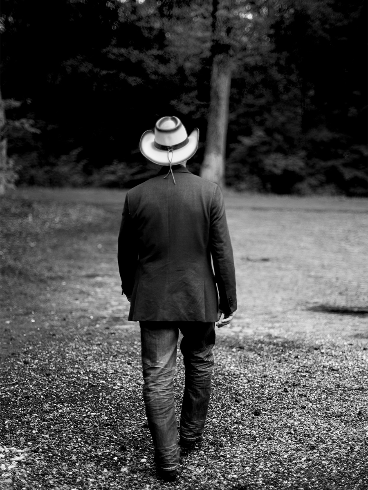

,Ik ben een heel emotioneel mannetje’

Zestien jaar zit hij alweer in het vak. In die tijd heeft Patrick Koers uit Zwolle een aardige naam voor zichzelf opgebouwd als countryzanger. Dat wil niet zeggen dat hij kan bestaan van muziek. In het dagelijks leven is de man met de onafscheidelijke cowboyhoed vrachtwagenchauffeur en dendert hij met een 25 meter lange truck over ‘s Heren wegen. Een beroep dat precies past bij zijn muziek. Want het leven van een trucker is immers een dankbaar onderwerp in countrymuziek. Als Patrick achter het stuur van zijn grote truck de wereld overziet en ver boven de meeste van zijn medeweggebruikers uittorent, schieten hem maar wat vaak de mooiste teksten te binnen.

En daarmee heeft hij in de loop der jaren een trouwe schare fans opgebouwd die hem volgt van optreden naar optreden. Patrick Koers is ook een emotioneel man. Een goed liedje kan hem tot tranen toe ontroeren. ,,Ik houd van ballads,’’ bekent hij. ,,Ik houd ervan om gevoel in muziek te leggen. Ik ben dan ook voortdurend op zoek naar dat soort repertoire in de countrymuziek. Maar de laatste tijd schrijf ik ook steeds meer dingen zelf.’’

De liefde voor Amerikaanse countrymuziek heeft Patrick meegekregen van zijn vader. Die reed met een grote Amerikaanse truck over de Duitse Autobahn toen zijn zoon nog in de luiers lag. ,,Ik ben geboren en getogen in Den Bosch. Toen ik groter werd en wel eens met mijn vader meeging, draaide hij onderweg allemaal cassettebandjes met countrymuziek. Hij was gek op Waylon Jennings en Willie Nelson. Die doorleefde stemmen, echte truckers muziek. Dat raakte me destijds diep. Daar is voor mij allemaal mee begonnen.’’

,, Als kind zong ik al Six Days On The Road van Dave Dudley en daar maakte ik dan mijn eigen versie van,’’ vervolgt Patrick. ,,Mijn vader en moeder hadden thuis een piraten radiostation met de naam Radio Vrij Brabant. Pa draaide countryplaten en ma draaide Nederlandstalige liedjes. Ja, het was een vrolijke boel bij ons thuis. We hebben ooit zelfs een 24-uurs marathon uitzending gedaan vanuit onze verbouwde schuur. Mijn vader is in 1992 overleden en op zijn crematie hebben we Seven Spanish Angels van Willie Nelson en Ray Charles gedraaid. Dat was een liedje dat ik als kind ook al helemaal kon meezingen en het staat nog steeds op mijn repertoire. Het is zo’n emotioneel nummer. ‘’

,,Maar ik ben dan ook een heel emotioneel mannetje,’’ bekent Patrick. ,,Als ik een liedje hoor wat mij raakt, schiet ik zomaar vol tranen. She Used To Love Me A Lot van David Allen Coe, bijvoorbeeld. Dat nummer heb ik zelf ook opgenomen. Een pedal steel gitaar kan de emotie in een countryliedje heel erg versterken. Daar moet je geen accordeon aan toevoegen, vind ik. Dat doen Nederlandse countryartiesten naar mijn mening veel te vaak.‘’

Patrick heeft tegenwoordig over optredens niet te klagen. Maar op een podium staan is voor hem geen levensbehoefte. Als hij z’n liedjes alleen al voor zijn vriendin kan zingen, is hij net zo gelukkig. ,,Zij komt uit Amerika en houdt al haar hele leven van countrymuziek. Als ze tranen in haar ogen krijgt van een nummer van mij, dan weet ik dat het liedje goed is en ben ik een gelukkig mens.’’

Harry de Jong

Photo © Henk Bleeker
