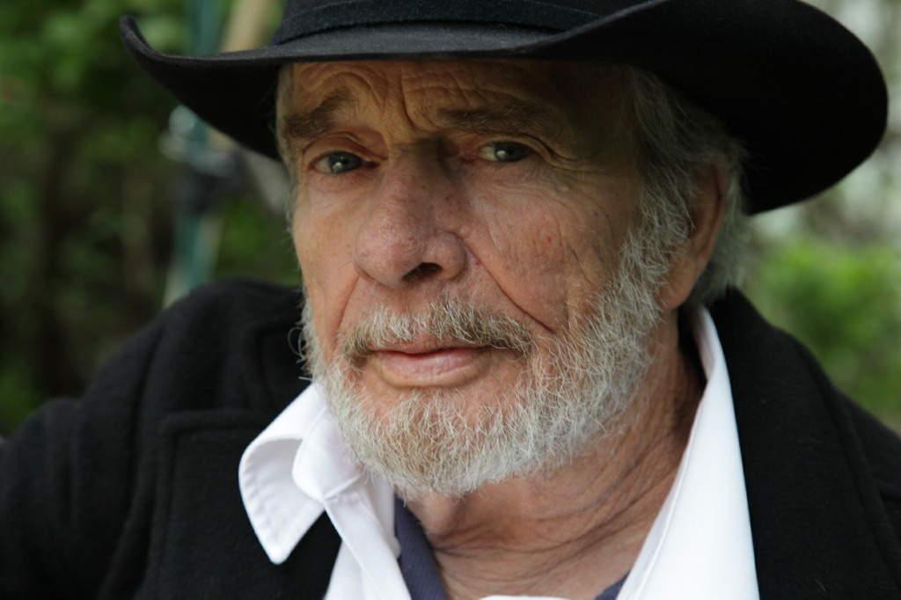

Countryster Merle Haggard overleed kortgeleden aan longkanker. Harry de Jong had twee gedenkwaardige ontmoetingen met hem die zijn opgetekend in het boek De Bezem Door Nashville. Hieronder enkele fragmenten.

**April 1988**

Countryster Merle Haggard verblijft in het Hilton Hotel in Rotterdam. Een mooie gelegenheid om hem eens aan de tand te voelen over zijn muziek. Als rechtgeaarde fan heb ik natuurlijk zijn biografie Sing Me Back Home op zak. Daar kan Haggard strak mooi een handtekening in zetten. De zanger is naar Rotterdam gekomen om het countryfestival in de Ahoy op te luisteren, waar hij samen met Willie Nelson de grote jongen is. Klokslag drie uur ’s middags meld ik me opgewonden bij de receptie van het Hilton. Platenmaatschappij CBS heeft laten weten dat de countryzanger dan wel even tijd heeft voor een babbel. In de hal van het hotel lopen alle nationaliteiten door elkaar. Cowboyhoeden en laarzen verraden meteen wie met het countrygezelschap uit Amerika is meegekomen. Van Merle Haggard echter geen spoor.

CBS-promotieman Jos Lauwers komt naar de balie. De uitdrukking op zijn gezicht verraadt dat de zaken niet helemaal naar wens gaan. ,,Ik heb drie uren gereden om mijn grote held te ontmoeten,’’ zeg ik nog opgewekt. Lauwers ondermijnt meteen mijn montere stemming. ,,Het spijt me verschrikkelijk, maar Haggard is niet aanspreekbaar. Hij heeft wat te veel gedronken en ligt uitgeteld in bed. Ik heb gehoord dat hij niet eerder dan vijf uur in staat is om interviews te doen.’’ Dat betekent dus wachten. Lauwers stelt elk half uur een onderzoek in naar de conditie van de zanger, maar hij komt steeds terug met slecht nieuws. ,,Merle wil met niemand praten. Hij heeft de stekker van de telefoon zelfs uit de muur getrokken.’’ Ik laat me niet uit het veld slaan. De mensen van CBS laten versnaperingen aanrukken. Een jongen en een meisje uit het gevolg van Haggard lopen door de hal met een fototoestel. Ze kieken iedereen die hun kant uitkijkt.

Nu ik toch zo lang moet wachten, kan ik misschien even wat feiten over Merle Haggard doorgeven. Hij werd 51 jaar geleden geboren in Bakersfield, Californie. Hoewel afkomstig uit een milieu van godvrezende boeren, raakt de jonge Merle al snel op het verkeerde pad. Zijn vader heeft handen als kolenschoppen en weet zijn zoon aanvankelijk nog te sturen, maar na diens dood gaat het goed mis met Merle. Hij loopt steevast weg van huis. Ten einde raad besluit zijn moeder de jongen naar een opvoedingsgesticht te sturen. Maar ook daar loopt Merle weer weg. Hij belandt in randcriminele milieus en begint zich schuldig te maken aan autodiefstallen. Dat levert hem meermalen korte gevangenisstraffen op.

Wanneer hij samen met een vriend een verstandelijk gehandicapte jongen in elkaar slaat, komt Merle Haggard in de beruchte San Quentin gevangenis terecht. Hij krijgt van tijd tot tijd eenzame opsluiting en dat betekent een keerpunt in zijn leven. Merle besluit het rechte pad op te gaan. Met z’n gitaar en zelfgeschreven liedjes heeft hij inmiddels flinke indruk op z’n omgeving weten te maken. Als Haggard vrijkomt uit San Quentin, is er niemand die op hem wacht. Zijn vrouw blijkt een kind van iemand anders te hebben. Toch vervalt hij niet weer in zijn oude leven. Met de hulp van enkele goede vrienden begint hij een carrière in de countrymuziek. Songs als Sing Me Back Home en I’m A Lonesome Fugitive zijn geïnspireerd op zijn gevangenisleven, maar betekenen tevens de definitieve doorbraak naar de status van superster. Die weg naar het grote succes was in 1960 ingezet met de opname van Sing A Sad Song voor het obscure label Tally Records.

In de loop der jaren manifesteert Merle Haggard zich als spreekbuis van rechts en conservatief Amerika. Met Okie From Muskogee en The Fighting Side Of Me neemt hij in de jaren zestig stelling tegen het flower power-tijdperk, dat vanuit San Francisco de Amerikaanse jeugd in z’n ban krijgt. Haggard is anti-drugs, anti-langharigen en anti-Vietnam-dienstweigeraars. Deze opstelling kost hem de goodwill van progressief Amerika. De antwoorden op eerder genoemde songs zijn legio. Up Against The Wall Redneck Mother zong Ray Wiley Hubbard en Rusty Adams schreef Hippie From Mississippi.

Merle Haggard is het image van de rechtse en kortzichtige Amerikaan nooit helemaal kwijtgeraakt. Al wendde de jeugd zich van hem af, zijn platen bleven garant voor een miljoenenverkoop. Haggards huwelijksleven voltrok zich minder succesvol. Hij trouwde drie keer en scheidde even zo vele malen. Bonnie Owens, Merle’s tweede vrouw, heeft zijn carrière echter vanaf het begin gesteund en is nog steeds achtergrondzangeres in zijn begeleidingsgroep The Strangers. Toen Merle haar verliet en hertrouwde met Leona Williams, liet Bonnie zich zelfs overhalen om bruidsmeisje te zijn bij dat huwelijk.

Bonnie Owens zou waarschijnlijk gelukkiger zijn geweest als ze Merle nooit gekend had. De laatste jaren worden de spanningen tijdens live-optredens steeds groter. Merle is een onberekenbaar heerschap geworden. Hij drinkt meer dan goed voor hem is en lapt elke etiquette aan zijn laars. Doordat hij meestal aangeschoten op het podium staat, is het voor zijn begeleidingsgroep iedere keer weer een verrassing hoe de show zich zal ontwikkelen. Die verloedering is de laatste tien jaar ingezet. In 1974 zie ik Merle Haggard optreden in Nashville en hij heeft de zaken dan nog aardig op een rijtje. Hij is keurig gekleed en dominant aanwezig op het podium. Het is een correcte show. Daarna zet het verval in. Vier jaar later zie ik Merle Haggard terug. Alleen zijn band steekt dan nog in het pak. De zanger zelf verschijnt veel te laat. Ongeschoren, een sigaret in de mond en gekleed in een versleten spijkerbroek. Hij stinkt een uur in de wind naar drank. Bonnie Owens blijft uit zijn buurt. Ze kan een grauw, een snauw of zelfs een (ogenschijnlijk speelse) tik verwachten.

Maar ondertussen zit ik nog steeds te wachten in de lobby van het Hilton Hotel in Rotterdam. Om vijf uur komt CBS met het bericht dat Merle Haggard spoorloos is. Hij is niet meer op z’n kamer. Niemand weet waar hij uithangt. Een haastig ingezette zoekactie levert niets op. Merle had even tevoren onder de douche gestaan en tegen zijn manager gezegd dat hij naar beneden zou komen. Om zes uur wordt het zoeken gestaakt. Ik heb dan inmiddels bijna een halve werkdag gewacht. Saxofonist Don Markham uit zijn begeleidingsband staat samen met Bonnie Owens in de hal te overleggen. Het wordt zo langzamerhand tijd om naar de Ahoy te gaan. Er zitten immers vierduizend fans te wachten. Om zeven uur is iedereen uit het gevolg van Haggard richting Ahoy vertrokken. Alleen van de baas ontbreekt elk spoor .

Ik posteer me op de gang van de etage waarop Merle’s kamer ligt. Zo kan ik alles en iedereen in de gaten houden. Tegen half acht komt Haggard in een zwart leren jasje en met een Indiana Jones hoed op z’n hoofd uit de kamer van Wille Nelson, de andere grote vedette van het festival. ,,Waar is die verslaggever?’’ roept hij met dubbele tong. ,,Ik heb nog wel even een kwartiertje.’’ Maar na vier-en-een-half uur  
wachten heb ik eigenlijk niets meer te vragen.

**1997**

Negen jaar later tref ik de zanger weer. In datzelfde Hilton Hotel in Rotterdam. Hij is daar een dagje neergestreken om promotie te doen voor zijn album If I Could Only Fly. De status van superster is hij dan allang kwijt. Want de man is inmiddels 63 en op die leeftijd tel je in Nashville niet meer mee. In die stad hebben jongeren het immers voor het zeggen. Gewoon door het simpele feit dat een jeugdige kop op een cd-boekje beter verkoopt. Maar Merle maalt er niet om dat hij tegenwoordig met minder genoegen moet nemen. Het heeft zelfs zijn voordelen, vindt hij. ,,Ik zit nu bij een kleine platen¬maatschappij en heb totale vrijheid van handelen. Ik kan opnemen wat ik wil. De grote labels in Nashville zijn in handen van verzekeringsmaatschappijen en die willen alleen maar geld zien. Dus moet een artiest per se commercieel klinken.”

Merle’s nieuwe album If I Could Only Fly is een mooi staaltje van eigenzinnigheid. Met een half versleten stem zingt de countrylegende liedjes die de luisteraar een openhartig kijkje in zijn ziel gunnen. En die nummers klinken zo traditioneel, dat een grote platenbaas er alleen maar zijn neus voor op zou halen. Zoiets verkoopt immers voor geen meter. ,,Daarom moet ik niks van dat soort lui hebben,” zegt Merle onomwonden. ,,Want de liedjes die ik schrijf betekenen alles voor mij. Ze zijn de reden waarom ik leef.”

**Drank**

Het is duidelijk dat Merle Haggard de zaken momenteel weer goed op een rijtje heeft en zich helemaal aan de muziek wijdt. De tijd dat de drank een veel belangrijkere rol in zijn leven speelde dan zijn gitaar, lijkt definitief voorbij. Net toen iedereen dacht dat-ie er onderdoor zou gaan, was Haggard plotseling weer helemaal nuchter. En daarbij komen alweer die verzekeringsmaatschappijen om de hoek kijken. Merle: ,,Als een Amerikaan ouder wordt, gaat z’n verzekeringsmaatschappij scherp op hem letten en hem bijna letterlijk voorschrijven hoe hij moet leven. Anders dreigt hij z’n levensverzekering kwijt te raken. Ze spelen dus als het ware doktertje op een hele vervelende manier. In feite is het een stelletje dictators. Maar helaas hebben die maatschappijen een hele grote vinger in de pap van de Amerikaanse samenleving.”

Merle Haggard heeft geen hoge pet op van de nieuwe lichting countryartiesten als Alan Jackson, Garth Brooks en Shania Twain. ,,Daar luister ik allang niet meer naar. Ik zet liever een plaat op van Eric Clapton of Jewel. Als het om country gaat denk ik aan mensen als Bob Wills en Hank Williams.” Al is-ie 63, Merle Haggard heeft nog altijd een uitgesproken mening. En dat is geen wonder voor een man wiens leven zich laat lezen als een spannend en onthut¬send boek. Maar hij heeft natuurlijk wel recht van spreken, want met de Sing Me Back Home en I’m A Lonesome Fugitive heeft hij toch ooit een niet onbelangrijk stukje countrygeschiedenis geschreven. ,,De radiostations in Amerika draaien die oude num¬mers nog steeds,” vertelt Haggard. ,,Ze zien die nummers als een deel van de Amerikaanse muziektraditie waar ze niet omheen kunnen. Met die oude songs heb ik me dus onsterfelijk gemaakt. Ik had liever dat ze eens nieuw werk van mij draaiden. Maar dat doen ze niet. Ik moet trouwens zeggen dat Lonesome Fugitive en Sing Me Back Home hele persoonlijke nummers zijn. Ze grijpen namelijk terug op mijn tijd in de gevangenis. Een zwarte bladzijde, waar ik soms nog nachtmerries van krijg. Ik heb in San Quentin zelfs een paar dagen op Death Row gezeten, het gedeelte van de gevangenis waar de ter dood veroordeelden zaten. Niet dat ik zelf de doodstraf had, maar ik mocht bij wijze van therapie met de mannen praten die wel dat vonnis hadden gekregen. Een ervaring die ik nooit zal vergeten. Een paar keer per jaar droom ik dat ik weer vastzit en nooit uit de gevangenis zal komen. Dat is mijn grootste angst in dit leven: Dat ik ooit weer mijn vrijheid kwijt zal raken. Ik ben door allerlei omstandigheden op het slechte pad geraakt. Toen mijn vader stierf ging mijn moeder weer werken en ik beland¬de op straat. Ik kwam in contact met slechte vrienden en van het een kwam het ander. Maar ik ben man genoeg om mijn misstappen onder ogen te zien. Nou ja, ik heb ervoor geboet. Toen ik in de muziek terecht kwam veranderde mijn leven. Ik heb mijn fouten niet verborgen, maar ze als een open boek aan de wereld laten zien door er liedjes over te schrijven.”

**Spreekbuis**

Minder trots is hij op de liedjes Okie From Muskogee en The Fighting Side Of Me, waarmee hij in de jaren zestig links en hip Amerika tegen de haren instreek. ,,Okie From Muskogee is het stomste liedje dat ik ooit heb geschreven,” zegt Haggard nu. ,,Ik zong dat marihuana slecht was, maar ik ben er wel achter dat het veel beter is dan drank. In Amerika proberen ze de mensen nog steeds wijs te maken dat marihuana een duivelse schep¬ping is. We maken ons tegenover de rest van de wereld belachelijk met dat idee. Ik ben echt teleurgesteld in Amerika als het om het softdrugsbeleid gaat. Maar misschien komen ze er ooit nog eens achter. Ik durf in ieder geval ruiterlijk toe te geven dat ik met een liedje als Okie From Muskogee een fout heb gemaakt. Ik was jong en onbezonnen toen ik dat schreef. Maar ik ben nu een oude man die het een en ander geleerd heeft.”

Ook over vrouwen? Want hoe gaat het op dit moment met Bonnie Owens? Haggard behandelde haar bij onze vorige ,,ontmoeting’’ als een voetveeg. De zanger grinnikt. ,,Bonnie is me tot op de dag van vandaag trouw gebleven als zangeres. En daar ben ik haar dankbaar voor. Maar ook de andere muzikanten uit mijn band zijn nooit weggelopen. Neem steelgitarist Norman Hamlet. Ik trek al vanaf het begin van mijn carrière met hem op. Zulke mensen koester ik.” Om nog eens extra te onderstrepen hoe hij veranderd is, wijst hij me aan het eind van dit interview nog eens op de gevaren van drank. ,,Ik weet nu hoe grondig alcohol je leven kapot kan maken,’’ preekt hij. Om het vervolgens allemaal weer te relativeren: ,,Nee, geef me dan maar een joint,daar word je alleen maar relaxed van.” Helemaal ,clean’ zal Merle Haggard dus nooit worden. Maar dat past ook niet bij een country-legende.

Harry de Jong

**De ultieme 5 van Merle Haggard**

1) Swinging Doors And The Bottle Let Me Down (Koch 1966)  
2) Branded Man (Captitol 1967)  
3) I’m A Lonesome Fugitive (Caitol 1967)  
4) Sing Me Back Home (Capitol 1968)  
5) Same Train, Different Time (Capitol 1969)
