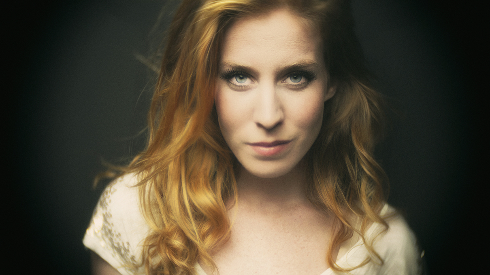

**HEERENVEEN** – Velvet Soldier heet het nieuwe album van Elske DeWall en je mag het rustig haar beste tot nu toe noemen.

Nog niet eerder stelde de Friese zangeres zo open en eerlijk op in haar liedjes. Velvet Soldier is ontdaan van iedere pretentie en in alle opzichten een persoonlijke popplaat van een zangeres die wat te vertellen heeft. De grote kracht is de intieme sfeer die de nummers oproepen. .

Hoog tijd om even bij te kletsen in het Heerenveense Grandcafe Het Gerecht. Even eerder heeft de zangeres op de Overkluizing in het centrum van het Friese Haagje samen met Syb van der Ploeg een akoestische set verzorgd. Dit in het kader van een promotieactie van de provincie Fryslan voor het openbaar vervoer. ,,Leuk om te doen,’’ vindt de zangeres terwijl ze aan de bar haar handen warmt aan een kopje groene thee.

De Overkluizing, het theater. Het maakt Elske in feite niet uit waar ze staat met haar gitaar. Als ze maar een publiek heeft. Velvet Soldier is haar derde album. Haar twee eerdere platen verschenen bij Universal, maar na een reorganisatie bij deze platenreus werd ze ,gedropt’ zoals dat zo mooi heet en was ze weer op zichzelf aangewezen. ,,Ja, dat was wel even een klap,’’ bekent ze. ,,Dat kwam ook nog op een moment dat een goede vriendin van mij aan een hartstilstand overleed. Ze was nog maar 29. Ik was op dat moment stuurloos en begon aan mezelf te twijfelen. Zo van: zou ik ooit nog wel een plaat uit kunnen brengen en zitten de mensen nog wel op mij te wachten? Maar op een gegeven moment dacht ik: waar maak ik me druk over, ik doe het gewoon zelf. Ik ben een muzikant en dat kan niemand van mij afpakken. En dus ben ik gewoon begonnen met opnemen van nieuwe liedjes. Toen ik ze klaar had, diende ze zich een label aan dat het wilde licenseren.’’

**Dik tevreden**

Elske is zelf ook dik tevreden over Velvet Soldier. ,,Ik heb de liedjes allemaal thuis geschreven, het waren verhalen die ik vertellen moest. Ze zijn ontstaan in de periode vlak nadat ik bij Universal weg was. Ik moest het wiel opnieuw uitvinden. En dat is gelukt, al voelde ik me soms wel verloren. De teksten gaan over mijn wereld, de vrouw die ik ben. Ik heb de plaat ook zelf geproduceerd, dus Velvet Soldier is helemaal van mijzelf.’’

Elske is inmiddels moeder van een zoon en ook dat heeft haar leven natuurlijk beïnvloed. ,,Toen hij geboren werd, was mijn vader erg depressief. Hij was bij de politie, maar is nu met pensioen. Toen Herre geboren werd, was dat een moment van grote vreugde. Er was nieuw leven in onze hechte familie gekomen. Mijn vader was heel blij met de komst van zijn kleinzoon, maar hij zat ook heel erg met zichzelf. Daar heb ik het liedje Hercules over geschreven. Het is een brief aan mijn vader van mijn zoon. Hij zegt: ik ben maar een heel klein wezen, maar wel zo sterk om jou, mijn opa’ het licht te brengen. Een heel persoonlijk verhaal, maar ik denk dat veel mensen het ook op zichzelf kunnen betrekken. Dat ze kunnen zeggen: ik zal jouw Hercules zijn, ik al voor jou strijden. Mijn vader wist niet dat ik dat liedje had geschreven, maar hij was er erg blij mee. Het raakte hem emotioneel ook. Gelukkig gaat het nu weer goed met hem.’’

**Hit**  
,,Ik heb nooit een hit gehad, maar dat vind ik ook niet zo belangrijk,’’ bekent Elske. ,,Zolang ik maar op kan treden. Dat is mijn leven. En de geboorte van onze zoon heeft mij wel geleerd wat echt belangrijk is in het leven. Mijn kind is de basis van mijn leven geworden en dat geeft een enorme rust. Mijn bestaan is door de muziek heel onrustig, ik ben altijd onderweg. En overal waar ik kom, krijg ik applaus. Maar als ik vroeger thuis kwam, was er niemand die applaudisseerde. Maar als ik thuis kom, is er een leuke peuter die op mij wacht en kan ik alles van mij afgooien. De volgende ochtend ga ik op de fiets boodschappen doen, met Herre in het zitje voor mij. We kijken uit over de weilanden met z’n koeien en dan voel ik dat mijn leven vervuld is.’’

Harry de Jong

Photo © Henk Bleeker
