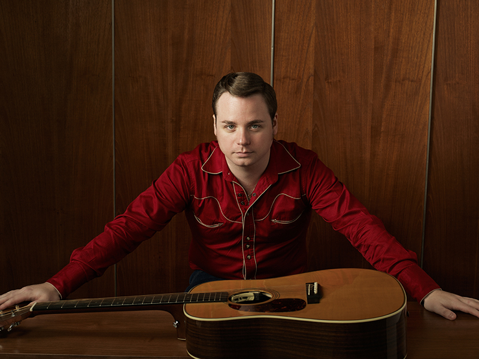

Vanuit alle hoeken en kieren van het land van Uncle Sam blijven ze maar oprukken, de jonge muzikanten die de roots van countrymuziek hebben herontdekt. Jason James komt uit Texas City (er is echt een stadje dat zo heet) en past helemaal in deze nieuwe lichting. Hij is gepokt en gemazeld in punk en metal, maar nadat hij het hartverscheurende Alone And Forsaken van Hank Williams hoorde, bekeerde hij zich onmiddellijk tot hard core country. En daar kunnen we alleen maar blij om zijn, want James heeft dit door pedal steel en fiddle aangedreven genre gewoon in de genen zitten. In het nummer World Of Make Believe weet hij George Jones op een bijna griezelige manier weer tot leven tot te wekken. Heel bijzonder, want James covert niet, hij schrijft alleen maar eigen materiaal. Maar je zou zweren af en toe naar klassiekers van Buck Owens, Hank Williams en genoemde Jones te luisteren. Liefhebbers van pure countrymuziek hebben de tijd van hun leven met al dit moois.

De Texaanse country singer-songwriter Jason James komt op zondagmiddag 11 juni naar Kultuurfabriek Kooi-aap in Oude Leije.  

