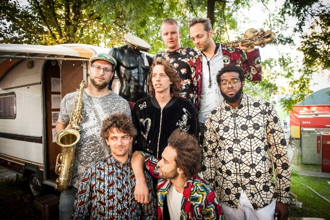

De Nederlandse afro-funkrockband KOFFIE staat bekend om haar virtuoze improvisaties en vermaarde afro-beat grooves. Sinds de release van twee albums in 2013 heeft de band hard gewerkt aan een ijzersterke livereputatie en hebben ze het dak eraf geblazen op onder meer North Sea Jazz Festival, Zwarte Cross, Polé Polé in België en Blue Balls Festival in Zwitserland. Op vrijdag 26 mei verschijnt het nieuwe album Huntu. De avond daarvoor presenteert KOFFIE Huntu voor het eerst live tijdens het Africadelic Festival in Paradiso Amsterdam.

Na drie jaar toeren was voor KOFFIE de tijd rijp om opnieuw de studio in te gaan. Voor het schrijven van dit derde album heeft de band de ronkende groove machine versterkt met twee extra bandleden. Floris van der Vlugt vormt nu samen met Itai Weissman de blazerssectie en Vernon Chatlein laat samen met Steven Brezet de percussiesectie nu nog beter klinken. De afro-funksectie vindt haar wortels in de Amsterdamse popscene en komt van de hand van gitarist Valentijn Banier, bassist Daniël Schotsborg en drummer Abe van der Woude. Toetsenist Niels Broos complementeert de creatieve blend die KOFFIE zo uniek maakt.

De muziek van KOFFIE laat zich niet makkelijk in een genre vangen. Moeiteloos varieert en combineert de band met afro-beat, pop, funk en jazz en creëert zo haar eigen karakteristieke sound. Met Huntu duiken de mannen nog dieper in de wereld van afro-grooves, mede geïnspireerd door hun grote voorbeeld Fela Kuti.

Beluister hier de eerste single Mama Deo:

<iframe src="https://www.youtube-nocookie.com/embed/NU93SWrV-1c" title="Video" loading="lazy" allowfullscreen=""></iframe>

KOFFIE kan niet wachten om het podium weer te kunnen bestormen met haar nieuwe songs en zal de komende maanden veelvoudig te zien zijn op diverse festivals, waaronder op meerdere locaties van Bevrijdingsfestival op vrijdag 5 mei. Houdt de website in de gaten voor meer live data.

Aanstaande zondag 26 maart is KOFFIE ook live te zien bij Vrije Geluiden op NPO 2.
