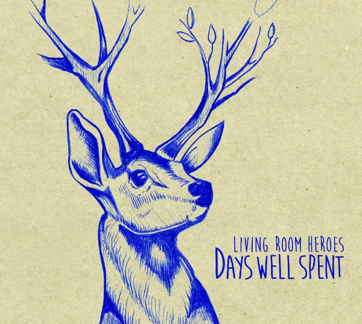

**Op vrijdag 23 september zullen de Living Room Heroes hun debuutalbum ‘Days Well Spent’ uitbrengen op Butler Records. De band met wortels in Nijmegen maar in het bezit van een onvervalst Amerikaans geluid viert diezelfde dag de release met een albumpresentatie in Merleyn, Nijmegen.**

‘Days Well Spent’ is het vervolg op twee eerder uitgebrachte EP’s, ‘Head Over Heels’ (2013) en ‘Fool To Believe’ (2014), waarop langzaam de transformatie van een singer-songwriter duo tot een Southern Soulband met ervaren muzikanten te horen is. Muzikanten die met groot gemak en vooral plezier tijdens hun live-shows hun enthousiasme en improvisaties laten zien en horen. Dit leidde al tot optredens op NPO Radio 2 en 3FM en voorprogramma’s voor o.a. Douwe Bob, Albert Lee & Robert Jon and The Wreck.

Geïnspireerd door hun muzikale helden zoals The Wood Brothers, Amos Lee en Ben Harper roept het warme, relaxte & soulvolle geluid herinneringen op aan mooie avonturen. Op pad gaan over de eindeloze vlaktes van het Amerikaanse continent. Verdriet achterlatend, mijmerend over een vrolijke toekomst. Hun teksten brengen je in een optimistische stemming. Je beleeft nieuwe avonturen op mooie dagen, dagen waarbij het leven je toelacht. Het zijn Days Well Spent.

De Living Room Heroes zijn de nieuwste aanwinst op Butler Records, het label waarop zowel internationale artiesten (Lamb, Felice Brothers, Lori Lieberman) als nationale artiesten (Anneke van Giersbergen, Donnerwetter, The Naked Sweat Drips) albums hebben uitgebracht.

**TOUR:**  
19-06 Hengelo, Cultuurpodium Houtmaat  
23-07 Oldeberkoop, Open Stal Kunstroute  
13-08 Silvolde, Huntenpop  
27-08 Gemert, Zebra Festival  
03-09 Hoogeveen, UITdagend Hoogeveen  
09-09 Doesburg, Theater Gasthuiskerk  
23-09 Nijmegen, Merleyn (albumpresentatie)  
24-09 Oss, Theater De Lievekamp  
30-09 Thorn, Café D’n Ingel  
07-10 Dordrecht, Jazzpodium DJS  
29-10 Helmond, Bluesroute  
30-10 Bergen, Taverne Bergen  
06-11 Hoogeveen, Theater De Tamboer  
10-11 Hengelo, Cafe De Cactus
