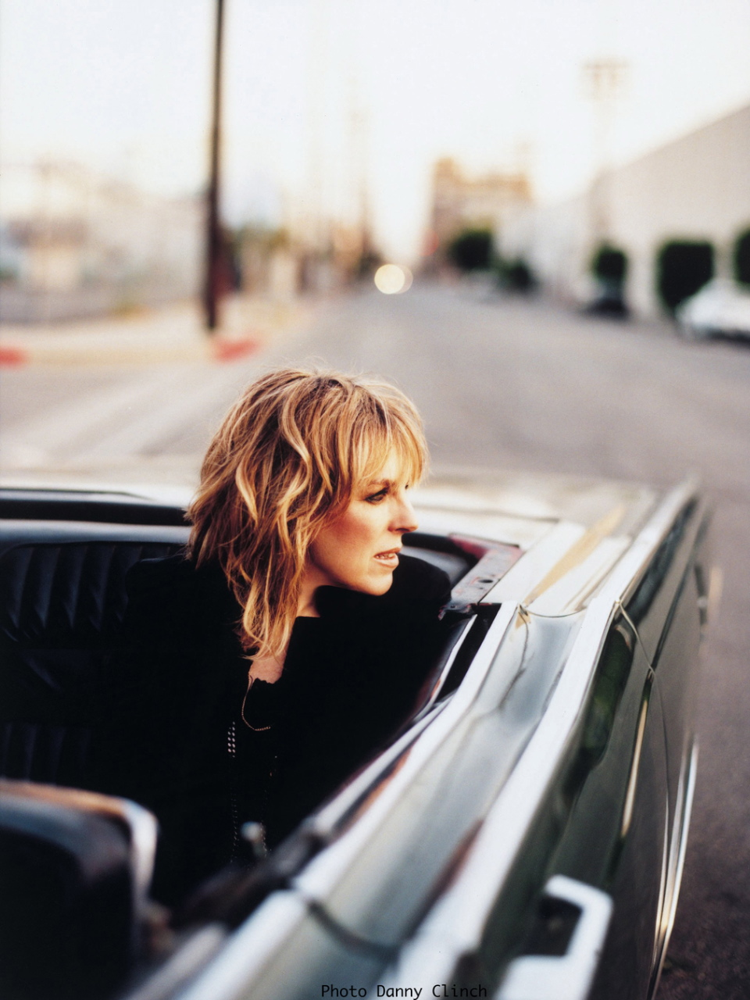

Door Harry de Jong

Lucinda Williams is een dolende ziel, maar op haar 62-ste lijkt ze eindelijk een beetje rust te hebben gevonden. Samen met haar nieuwe vlam en manager Tom Overby heeft ze een fraai stulpje aangeschaft in Los Angeles en daar krijgen ze haar voorlopig met geen stok meer uit, stelt ze resoluut. Terwijl de werklui haar nog voor de voeten lopen om hier en daar een laatste plankje vast te timmeren, knort Williams tevreden met haar slaperige stem: ,,Dit huis geeft me zo’n goed gevoel, ik heb eindelijk gevonden wat ik zocht. Ik ben de laatste jaren wel zes keer verhuisd, maar aan al dat rondzwerven is nu een einde gekomen. Ik blijf hier, punt uit.’’

,,Man, er wordt over mij heel wat af gefantaseerd in de pers,’’ zegt Williams even later. ,,Ik heb altijd een leven geleid dat bestaat uit hoge pieken en diepe dalen en dat is nog steeds niet anders. Als je goed naar de teksten van mijn liedjes luistert, kun je tussen de regels door mijn pijn en frustraties echt wel horen.’’

Nu ze toch op de praatstoel zit, wil Williams nog wel een ander misverstand uit de weg ruimen. ,,Laatst schreef iemand in een Engels muziekblad dat ik een countryzangeres ben. Hoe komt-ie erbij? Daarmee doet hij me toch echt tekort. Countrymuziek hoort bij mijn roots, maar ik heb me in de loop der jaren toch wel iets breder ontwikkeld, dacht ik zo. En trouwens, ik moet niets hebben van wat er vandaag de dag uit Nashville komt. Daar heb ik helemaal niets mee. Countrymuziek houdt voor mij op bij Loretta Lynn, Tammy Wynette, George Jones en Hank Williams. Vooral met die laatste voel ik me verwant. Hank maakte van zijn hart geen moordkuil en zong vrijmoedig over alles wat hem kwelde op dit ondermaanse. Ach, als een mens maar diep genoeg graaft in zijn ziel, komen er vanzelf wel allerlei donkere zaken naar boven. Dat graafwerk deed Hank Williams regelmatig en dat doe ik ook. Weet je dat mijn vader Hank ooit in levende lijve heeft ontmoet? Hij heeft er jaren over gepraat, zo trots was hij erop. Pa trof hem in een bar in Louisiana, lang voordat ik geboren werd. Hij was op dat moment net afgestudeerd als professor in de literatuur en schreef gedichten. Pa raakte met Hank Williams aan de praat en op een gegeven moment bood die hem iets te drinken aan. ,Geef mij maar een Schotse whisky’, zei m’n vader. Hank keek mijn pa eens aan en zei: ,Williams, jij moet geen whisky drinken, maar bier. Want jij hebt de ziel van een bierdrinker.’ En dat was een schot in de roos, want mijn vader mocht met zijn pijp in de mond de schijn ophouden van een poëzie schrijvende intellectueel, in zijn hart was hij nog steeds een doodgewone boerenjongen uit Arkansas. En dat had Hank Williams meteen door. Ja, die man was echt de Shakespeare van de countrymuziek.’’

,,Ik moet er niet aan denken dat ik tot aan mijn dood op tournee ben,’’ zegt Lucinda even later. ,,Ik ben de komende twee maanden vrij en die tijd ga ik echt koesteren. Lekker niks doen, wat uit eten gaan, bij vrienden op bezoek, heerlijk. Zo kan ik wel duizend jaar worden. Maar uiteindelijk zal ik toch weer op pad moeten, want de kachel moet wel blijven branden. En met deze crisis valt dat niet mee. Er worden lang niet meer zoveel concertkaartjes verkocht als een paar jaar geleden, maar gelukkig mag ik nog niet klagen. Ik heb kennelijk trouwe fans die in ieder geval niet op mij willen bezuinigen.’’

Car Wheels On A Gravel Road betekende in 1998 de Europese doorbraak voor Lucinda Williams en was oorspronkelijk geproduceerd door Gurf Morlix, maar hij had er naar haar idee een veel te duidelijke ,country touch’ aan gegeven. Morrend nam ze er daarom afstand van en Morlix’ versie van Car Wheels zou nooit officieel het licht zien. ,,Ik kon Gurf niet ompraten mijn plaat opnieuw te mixen en dus zijn we uit elkaar gegaan. Voorgoed. We hebben elkaar sinds die tijd niet meer gesproken en dat vind ik heel erg. Ik heb Gurf nooit voor het hoofd willen stoten, maar ik wilde zo graag een goeie plaat maken. Hè, was er nou verdomme niet over begonnen, nu heb ik weer een rotgevoel.’’
