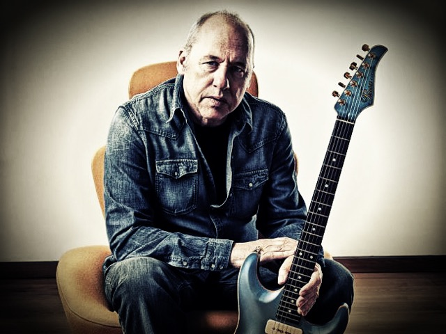

,Ik ben soms net een oud wijf’

,,Ik heb nooit haast. Zeg maar gerust dat ik lui ben.’’ Meester-gitarist Mark Knopfler komt even overeind om een kop koffie in te schenken. In de hotelkamer heerst een serene middagrust. ,,Ik ben soms net een oud wijf,’’ babbelt Knopfler luchtigjes verder. ,,Ik kan ’s morgens wel uren met een paar gelijkgestemde mislukkelingen door het park wandelen, terwijl we niets anders doen dan kleppen over onbenulligheden. Ik houd van die levenswijze. Alles op z’n tijd. Veel mensen denken dat ik een workaholic ben die de hele dag met z’n muziek bezig is. Onzin, het woord workaholic staat niet eens in mijn vocabulaire. Ik kan echt hele dagen bezig zijn met dingen die nergens over gaan.’’

Knopfler is neergestreken in een Amsterdams hotel om te praten over zijn nieuwe album Cracker. Elk liedje op die plaat is een anekdote-in-zakformaat. Geschreven met de zeggingskracht van een echte dichter. Voordat ik mijn opnameapparaat in kan schakelen, zegt Knopfler vertrouwelijk: ,,Dit is gewoon even tussen ons tweeën, maar ik zit soms avonden achtereen gedichten te schrijven. Dat hoef je niet in de krant te zetten, want ik ben niet van plan ze ooit te publiceren. Ik schrijf ze gewoon voor mezelf. Vroeger deed ik dat met pen en papier. Als ik aan die tijd terugdenk, zie ik een man die niets anders doet dan volgeschreven vellen verfrommelen en in de prullenbak gooien. Want er kwam zelden iets uit waar ik tevreden over was. Tegenwoordig tik ik mijn gedichten op een laptop. Grappig genoeg heb ik het gevoel dat het resultaat daardoor beter wordt, ik delete veel minder dan ik vroeger aan papier verscheurde. Maar nogmaals, ik heb helemaal geen pretenties met mijn poëzie, daarvoor heb ik te weinig vertrouwen in mezelf. Ik laat dat werk liever aan de echte dichters over. Ik ben in de eerste plaats een liedjesschrijver.’’

En die liedjes moeten wèl gehoord worden, vindt Knopfler. ,,Ja, want liedjesschrijven is mijn levensmissie,’’ zegt hij met overtuiging. ,,Dat is waarvoor ik geboren ben. Maar eigenlijk heb ik er helemaal geen zeggenschap over, want ik kan de inspiratie niet oproepen. De liedjes kloppen uit zichzelf bij mij aan. Ik hoef alleen maar open te doen en ze binnen te laten. God, wat houd ik van de momenten waarop dat gebeurt. Dan besef ik waarom ik leef. Ik zit er momenteel door mijn muziek warmpjes bij en dat is een voorrecht, maar ook al had ik er nooit een cent mee verdiend, dan zou ik vandaag nog precies hetzelfde doen. Ik had het allemaal ook gratis gedaan, want ik ben nooit de muziek ingegaan om er rijk van te worden. Het is altijd mijn passie geweest.’’

Mooi voor Knopfler dat hij met zijn muziek toch een paar grijpstuivers opzij heeft kunnen leggen, want daardoor heeft hij nu niet alleen de beschikking over een privévliegtuig, maar in Londen heeft hij in een riant pand ook een eigen studio kunnen openen. ,,Maar ik zal nooit een zakenman worden, ik houd van heel andere dingen dan geld,’’ bekent de muzikant. ,,Mijn gitaren en versterkers, bijvoorbeeld. Er is niets wat die spullen kan vervangen. Soms loop ik alleen maar even m’n studio binnen om mijn handen op al die dierbare spullen te leggen. Dan geniet ik in stilte. Ik ben nu eindelijk oud genoeg geworden om te weten wat voor mij belangrijk is en wat niet. En ik ben ook oud genoeg geworden om te weten hoe ik van het leven moet genieten. Al is dat een kunst die eigenlijk in je genen moet zitten. Mijn vader had dat wel in zich, voor hem was het glas altijd half vol en nooit half leeg. Ik zou hem een keer moeten bedanken op een van mijn volgende platen, want die man is altijd een lichtend voorbeeld voor mij geweest.’’

,,Ik ben me pas echt gelukkig gaan voelen toen ik helemaal onafhankelijk werd,’’ bekent Knopfler. ,,Vanaf het moment dat ik mijn leven in mijn eigen tempo kon leven.’’ Hij  onderbreekt zichzelf en zegt: ,,wacht even, er klopt een liedje aan. Even binnenlaten.’’ In een paar seconden heeft hij de langs fladderende woorden in zijn hoofd opgeslagen en vervolgt: ,,Waar was ik ook alweer gebleven? Nou ja, doet er niet toe. Weet je dat ik niet eens in staat ben om op de orthodoxe manier gitaar te leren spelen? Wat ik kan op de zes snaren heb ik mezelf op het gehoor aangeleerd. Ik heb gejat, geleend en herschept bij het leven. En dat werkte altijd omdat ik mijn hele ziel en zaligheid er in leg. Maar ik kom steeds weer op een punt dat ik het niet genoeg vind en dan begin ik me weer af te vragen of ik niet eens wat meer aandacht moet geven aan de technische kant.’’

,,Als ik ooit nog eens wat meer technische bagage heb, zal dat mijn muziek echt niet veranderen,’’ voorspelt Knopfler. ,,Want de liedjes zullen altijd op dezelfde manier mijn hoofd binnen komen waaien. En ze zullen altijd eenvoudig blijven, net als folk en country.’’

Harry de Jong
