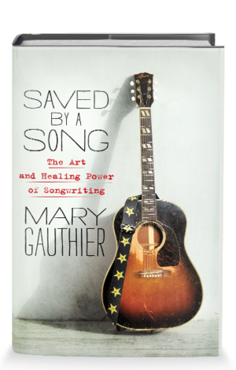

Van singer-songwriter Mary Gauthier verschijnt begin juli een bijzonder boek. Het heeft als titel Saved by a Song: The Art and Healing Power of Songwriting en geeft een onthullend kijkje in de wereld van deze zangeres en liedjesschrijfster.

Mary Gauthier is de vrouwelijke Kris Kristofferson. Het niveau van haar door het leven getekende liedjes is namelijk onveranderd hoog en de afgelopen jaren heeft Gauthier dubbel en dwars bewezen dat ze een oorspronkelijk talent is dat wel degelijk iets aan het edel ambacht van liedjessmid weet toe te voegen. Net als bij Kristofferson kunnen de verworpenen der aarde zich helemaal herkennen in haar liedjes. Ze geven een stem aan de mannen en vrouwen die aan de zelfkant van de maatschappij vertoeven. Wie aandachtig naar haar teksten luistert, krijgt zowaar het gevoel een boek van John Steinbeck te lezen. Maar dat zal Gauthier wel teveel eer vinden.

Uit je liedjes spreekt een enorme maatschappelijke betrokkenheid. Ben je dat ook in de praktijk?

,,Jazeker. Ik ga heel vaak naar gevangenissen. Niet om er op te treden, maar om met de gevangenen te praten over de gevaren van alcohol en drugs. Ik geef er als het ware workshops. Dat doe ik niet voor één of andere organisatie, maar puur als Mary Gauthier die zelf ook een leven van drankmisbruik achter de rug heeft. Amerikaanse gevangenissen zijn plaatsen waar geleden wordt, veel mannen en vrouwen hebben het gevoel dat iedereen hen vergeten is en daarom wil ik er voor hen zijn. Ik wil dat omdat ik zelf ook achter de tralies heb gezeten en omdat de gevangenen mij eraan herinneren hoe mijn leven op dit moment zou zijn geweest als ik niet tijdig mijn rug had gerecht. Ik wil die mensen hoop geven, hoop dat het allemaal nog best goed kan komen. Als ik daar ook maar een beetje in slaag, doe ik heel  belangrijk werk.’’

,,Ik heb al meer dan 30 jaar geen druppel alcohol gedronken. Maar dat is nog geen garantie voor de toekomst. Mensen als ik zijn één borrel verwijderd van de dood. Als ik ook maar één keer inschenk, is het allemaal voorbij. Dan drink ik net zoveel tot ik erbij neerval. Dat wil ik bij God niet meemaken en daarom blijf ik tegen de verleiding knokken. Je kunt alcoholisme nooit verslaan, er bestaat geen genezing voor. Je kunt maar één ding doen en dat is proberen de rest van je leven droog te staan. Maar dat betekent wel dat je tot je dood een alcoholist bent.’’

In haar nieuwe boek praat Mary openhartig over haar verslaving en het spoor van ellende dat de alcohol door haar leven trok. Maar muziek werd uiteindelijk haar redding. En dan met name het schrijven van liedjes.

Mary: ,,Voor mij is het schrijven liedjes een roeping. Het is een vast onderdeel van mijn leven geworden. Het speelt zelfs een rol bij alle beslissingen die ik in dit leven neem. Ik hoorde de stem van die roeping voor het eerst toen ik een tiener was. Ik kocht een gitaar, een boekje met akkoorden en leerde mezelf spelen. Maar in mijn omgeving was niemand die mij inspireerde om ermee door te gaan en ik had daarnaast ook geen enkel zelfvertrouwen. Dus dat werd niets. Ik deed de drang om liedjes te schrijven af als kinderachtig gedoe. Ik stopte mijn gitaar terug in de koffer en bande liedjesschrijven uit mijn leven.’’

,,Ik ging verder met mijn leven en dat slokte al mijn energie op. Ik vocht tegen mijn alcoholverslaving en opende met behulp van investeerders zowaar een paar restaurants. Ik kreeg het verschrikkelijk druk en mijn ware roeping werd diep begraven in mijn onderbewustzijn.’’

,Tot ik nuchter werd. Als ik zonder het waas van drank naar mijn leven keek, dacht ik: ,wil ik dit echt? Een leven van jachten en jagen waarin ik geen enkel rustpunt heb?’ Als ik ’s avonds in mijn eentje over een lange en lege snelweg naar huis reed en naar de liedjes op de radio luisterde, dacht ik: is dit alles wat er is? Dat gevoel had ik ook als ik op winteravonden bij de haard de laatste bladzijde had gelezen van een goed boek en uit het raam keek naar de sneeuw die gestaag omlaag viel.’’

,,Toen ik eenmaal mijn verslaving onder controle had, zag ik eindelijk onder ogen dat ik niet gelukkig was als eigenaresse van restaurants. Ik was een slaaf van mijn werk geworden. Mijn leven veranderde toen ik op een avond naar een club ging waar liedjesschrijvers beurtelings van zich mochten laten horen. Toen ik naar al die mensen keek en luisterde die de moed hadden hun ziel en zaligheid in een liedje bloot te leggen, wist ik hoe ik verder moest met mijn leven. Ik wilde alleen nog maar liedjesschrijven en die aan andere laten horen. Een paar maanden later was ik zover.’’

,,Ik was toen al halverwege de dertig, maar het is nooit te laat om gehoor te geven aan de stem van je hart die zegt wat je moet doen. Tien jaar later, op mijn 40-ste, verhuisde ik naar Nashville om te worden wat ik nog steeds ben: een liedjesschrijfster.’’

Tekst: Harry de Jong

Foto: Henk Bleeker

