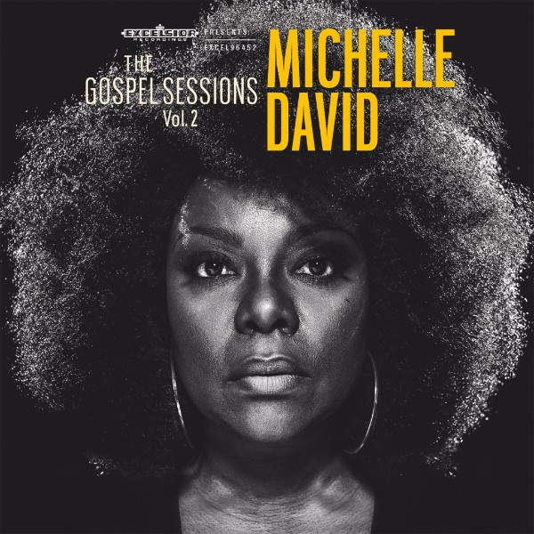

Een titel als ‘The Gospel Sessions Volume 1’ heeft de belofte van een Volume 2 in zich. En hoera, die is er nu. ‘We zijn een paar decennia opgeschoven in de tijd’, zegt Onno Smit, Wat muzikaal betekent dat er meer percussie, strijkers en een orgel zijn toegevoegd. Was het debuut ook een ode aan pioniers als Sister Rosette Tharpe, nu staat The Gospel Sessions op de schouders van bijvoorbeeld Sam Cooke & The Soul Stirrers en de Womack Brothers.

De openingstrack van de plaat, My Praise, is vanaf vandaag te horen. Het album ‘The Gospel Sessions Vol. 2’ verschijnt op 25 maart op Excelsior Recordings en gaat in premiere op het Paaspop festival. Op 6 en 7 april presenteert Michelle David het album in samenwerking met Paradiso in de Schellingwouderkerk in Amsterdam Noord. Alle tourdata onderaan deze mail.

‘Wat zou er gebeuren als we de gospel zouden strippen van alle franje’, vroegen gitaristen Paul Willemsen en Onno Smit (bekend van Lefties Soul Connection en Beans & Fatback) zich twee jaar geleden af. Het antwoord was ‘The Gospel Sessions Volume 1’, een plaat die ze in 2014 met zangeres Michelle David maakten en waarmee ze de essentie van de soul raakten.

Het gejuich en gerinkel wat op dat album ontbrak, keerde terug in de glimmende recensies en de extatische reacties van het soms uitzinnige publiek in de zalen, kerken en op de festivals waar ze speelden. ‘Grandioos’, oordeelde Oor. ‘Het Woord is Rock ’n Roll geworden’, jubelde de Leeuwarder Courant. ‘Album van het jaar’, vonden de luisteraars van NPO Radio 6.

Volume 2 is behalve muzikaal rijker, ook nog meer de plaat geworden van Michelle David. Er staan nummers op die bij haar leven horen, zoals de bewerkte traditional ‘Tradewinds’. ‘Mijn eerste solo in de kerk’, herinnert de in North Carolina geboren, en in New York opgegroeide David zich. ‘Ik was vijf jaar oud. Het kwam ineens weer omhoog tijdens de opnamesessie van de tweede plaat. Ik had er jaren niet meer aan gedacht, maar ik zong het zo weer.’  
Het ingetogen ‘There’s a Place’, een original, is een ode aan de tante die haar opvoedde. ‘Ik hoorde de melodie en begon te improviseren. De woorden kwamen vanzelf, ik heb ’t in een paar minuten geschreven.’ Het live opgenomen, vanuit de tenen gezongen ‘Baptized’ is het verslag van Michelle’s doop in de Atlantische oceaan.

En zo waren er meer nummers die zo rijp waren, dat ze enkel nog geplukt hoefden te worden. ‘Ik weet niet wat Onno en Paul met me doen, maar bij de sessies die we doen is het alsof ze via een luikje in mijn hoofd kunnen kijken, het is magisch.’

Evangeliseren is niet het doel van The Gospel Sessions, ‘maar het mooiste compliment wat ik ooit kreeg na een show was van iemand die zei: Je maakt het lastig voor me om een atheist te zijn’, grinnikt Michelle.

Gospel is krachtige muziek, in veel opzichten. Het is muziek die kan optillen, kan inslaan. ‘Een vraag die me mijn hele carriere heeft bezig gehouden is: ben ik wel goed genoeg? Voor het eerst kan ik dat loslaten, omdat het nu persoonlijk is geworden wat ik doe’.

En ja. Volume 3 zit al in de knop.

**Voorlopige tourdata:**

zo 27 mrt: Schijndel – Paaspop  
wo 06 apr: Amsterdam – Paradiso @ Schellingwouderkerk (A’dam Noord)  
do 07 apr: Amsterdam – Paradiso @ Schellingwouderkerk (A’dam Noord)  
wo 13 apr: Hoorn – Het Huis Verloren  
zo 01 mei: Sneek – Noorderkerk  
zo 08 mei: Vlieland – Here Comes The Summer
