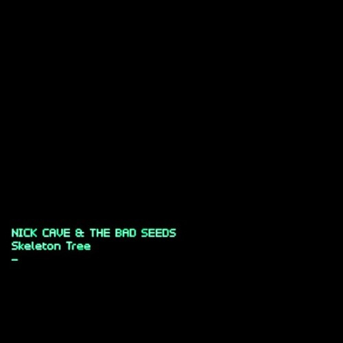

Nick Cave & The Bad Seeds brengen op 9 september het nieuwe album Skeleton Tree uit. Het is het zestiende album en de opvolger van het in 2013 verschenen Push Away The Sky. Skeleton Tree begon eind 2014 aan haar reis in de Retreat Studios in Brighton en vervolgde haar weg in de herfst van 2015 in de La Frette Studios in Frankrijk. De reis kwam begin van dit jaar ten einde in de AIR Studios in Londen waar het album werd gemixt.

De eerste kans om de nummers van Skeleton Tree te horen is via de film One More Time With Feeling die is geregisseerd door Andrew Dominik (Chopper, The Assassination of Jesse James by the Coward Robert Ford, Killing Them Softly). One More Time With Feeling is op donderdag 8 september eenmalig te zien in zeshonderdvijftig bioscopen wereldwijd, de dag erna verschijnt Skeleton Tree. In Nederland gaat de film draaien in Pathé City in Amsterdam, Pathé Buitenhof in Den Haag, Pathé Schouwburgplein in Rotterdam, Pathé Eindhoven, Pathé Maastricht, Pathé Arnhem, Pathé Amersfoort en Pathé Groningen.

Oorspronkelijk bedoelt als performance concept, evolueerde One More Time With Feeling in iets veel significanter naarmate Dominik zich meer verdiepte in de tragische achtergrond waartegen het schrijf- en opnameproces van het album zich afspeelde. Door een optreden van de Bad Seeds, die het nieuwe album in zijn geheel spelen, zijn interviews en beelden verweven die door Dominik zijn geschoten en worden begeleid door Cave’s periodieke vertellingen en geïmproviseerde bespiegelingen en overpeinzingen.

One More Time With Feeling is gefilmd in zwart-wit en kleur in zowel 2D als 3D. Het resultaat is puur, kwetsbaar en rauw. Een oprechte ode aan een artiest die zijn weg probeert te vinden door de duisternis.
