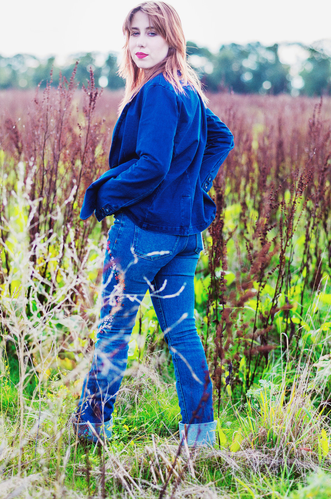

**Door Herman van der Horst  
**

**Photo Henk Bleeker  
**Eind 2021 was ze er opeens, zomaar uit het niets, zo leek het, Nienke Dingemans. Op haar debuut EP Devil On My Shoulder stonden zes zelfgecomponeerde songs, bezield laverend tussen blues, country en americana. Onlangs verscheen haar eerste volwaardige langspeler Ain’t No Hollywood Girl, waarmee ze een forse stap voorwaards maakt. ‘Ik ben altijd anders geweest, dus ik weet niet beter.’

Ze groeit op in Ossendrecht, volgens haar een typisch West-Brabants/Vlaams dorpje. Toch komt ze niet uit een muzikal nest. Die Amerikaanse rootsmuziek heeft ze helemaal in haar uppie ontdekt en zich eigen gemaakt. Aanvankelijk via Spotify, waarmee de zojuist 20 jaar geworden Dingemans immers is opgegroeid. Later via concerten en jamsessies. Zo ontdekt ze een van haar heldinnen, Susan Tedeschi, de kruideniersdochter uit Boston die met haar echtgenoot Derek Trucks de Tedeschi-Trucksband vormt. Alsmede Larkin Poe, de rootsband rond de jonge zussen Rebecca en Megan Lowel. En vandaar naar Bonnie Raitt en nog veel meer. Een zoektocht die al op haar twaalfde is begonnen en nooit zal stoppen. Ze bekwaamd zich achtereenvolgens op piano, lapsteel en slidegitaar en begint al vrij vroeg haar eigen songs te schrijven. ‘Mijn eerste liedje schreef ik in twee weken. Daarna werd het een week en toen ging het steeds sneller. Nu schrijf ik een liedje binnen een uur. Hoe meer je schrijft, hoe makkelijker het gaat. ‘  
In opvallend veel van die liedjes figureren outlaws. ‘Zodra je muziek gaat maken, weet je dat je een outsider bent’, legt ze uit. ‘Ik heb nooit naar de muziek willen luisteren waar mijn schoolvriendinnen van hielden. Ik heb me altijd aangetrokken gevoeld tot mensen die uniek zijn. Heb altijd een eigen identiteit willen hebben. Ik vond het juist leuk om het allemaal zelf te ontdekken en uit te vissen. Zelf een eigen smaak op te bouwen. Ik ben nu eenmaal geen dertien in een dozijn uit de supermarkt. Ik ben altijd anders geweest, dus ik weet niet beter.’  
Omdat ze al even vroeg beseft dat deze muziek de enige weg naar haar toekomt is, besluit ze te gaan studeren aan het conservatorium in Rotterdam. Daar volgt ze de prestigieuze en internationale Codarts opleiding, waar alle leerlingen minimaal drie zangleraren hebben. Dat haar muziekstijlen doorgaans zijn ontstaan in de kerk of in de kroeg, of beter nog in allebei en epaald niet in een conservatorium, dat beseft ze maar al te goed. Maar ze verdedigd haar keus met de constatering dat die opleiding haar een intensieve begeleiding biedt, waar ze veel aan heeft. ‘Ze laten je daar heel vrij. Op het conservatorium vertelt niemand me hoe ik de blues moet zingen.’

Op haar debuut EP staat een liedje getiteld Tennessee River. In een afgelegen vallei in het noord-westen van Alabama liggen vier dorpjes aan weerszijden van de Tennessee River, die bekent staan als Muscle Shouls. Daar is een man genaamd Tom Hendrix al ruim een kwart eeuw bezig met zijn levenswerk: het verslepen en opstapelen van vier miljoen kilo stenen ter ere van een vrouw die hij nooit gekent heeft. Die stenen haalt hij uit de omgeving of worden gebracht door bezoekers van over de hele wereld, waaronder priesters, Tibetaanse monikken en aboriginals uit Australië.  
De muur die hij ermee bouwt is inmiddels zo’n anderhalve mijl lang. Hendrix groeide op met de verhalen die zijn indiaanse grootmoeder hem vertelde over zijn over-overgrootmoeder, Tee-lah-nay, wat de Vrouw met de Dansende Ogen betekent. Haar Yuchi-volk geloofde dat er een vrouw in de Tennessee River woonde die hen toezong. Daarom noemden ze de stroom ‘nahniehsae’ , de Zingende Rivier. Samen met haar zus maakte Tee-lay-nay deel uit van de Trail of Tears, een gedwongen indianen deportatie, volgens de Indian Removal Act uit 1830, naar reservaten in Oklahoma. Daar luisterde ze naar iedere rivier en beek, maar die bleven alle stil. Daarom besloot ze terug te keren naar de Zingende Rivier in noord-west Alabama. Haar voettocht duurde vijf jaar. ‘Theoretisch ligt hier een steen voor iedere stap zie ze gemaakt heeft’, verklaarde Hendrix. De muur – anderhalve meter hoog en twee tot vier meter breed – is een monument voor de Vouw met de Dansende Ogen en alle Native Americans.  
Afgaande op haar liedje, stel ik me voor dat Nienke Dingemans oog in oog heeft gestaan met de Magische Muur. Kalm hoort ze mijn verhaal over de Zingende Rivier aan, maar dan blijkt de waarheid toch iets nuchtiger te zijn. ‘Ik had een paar plaatjes van de Tennessee River op Google gezien. Die vond ik mooi en toen heb ik dus dat liedje geschreven. Heel stom eigenlijk..’  
Hoewel het in haar muziek wemelt van Amerikaanse verwijzingen en plaatsnamen, blijkt ze nog nooit in Amerika te zijn geweest. Het is er tot op heden simpelweg nog nooit van gekomen, legt ze veronschuldigend uit. Uiteraard is ze wel benieuwd naar de plekken waar haar muziek vandaan komt. Vooralsnog gebruikt ze die plekken als metaforen. ‘Als ik in m’n liedjes Bergen op Zoom of Rotterdam zou noemen – dat bekt gewoon niet. Dus daar verzin je dan Amerikaanse plaatsnamen voor die er iets van weg hebben.’  
Zo blijkt een van de hoogtepunten van Ain’t No Hollywood Girl de ballad Last Train To Brooklyn te gaan over het gegeven dat zij vanuit een klein dorp dagelijks vier uur heen en terug per trein naar de grote stad moet reizen. En dat het conservatorium in een deel van Rotterdam staat dat in haar verbeelding op Brooklyn moet lijken. Vooralsnog zal een ieder die haar songs, haar bezielde voordracht en brandende lapsteel en slidespel hoort, slechts tot één conclusie kunnen komen. Namelijk dat Nienke Dingemans een oude ziel in een jong lichaam moet zijn. ‘Ik vind het niet persé vervelend als mensen dat zeggen’, besluit ze. Temeer omdat het klopt. Ik ben gewoon en oude ziel en daar voel ik me fijn bij. Het is iets om trots op te zijn, om niet hetzelfde te zijn als iedereen. En die trots hoop ik ook over te brengen in mijn muziek.
