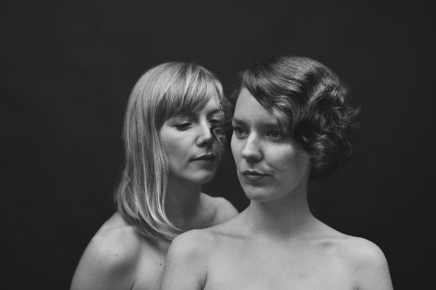

Op 15 april verschijnt Big Bad Good, het derde studioalbum van het Scandinavische folkduo My Bubba bestaande uit My Larsdotter en Guðbjörg Tómasdóttir. Na een ontmoeting op het Air Waves festival in IJsland in 2014, nodigde producer Shahzad Ismaily (bekend door zijn werk met o.a. Will Oldham, Jolie Holland) de dames uit om een album op te nemen in zijn nieuwe Figure 8 Recording studio in Brooklyn. Het besluit om op deze uitnodiging in te gaan, namen ze puur op gevoel. De nummers werden daar geschreven en ter plekke opgenomen waardoor Big Bad Good een intiem en rauw album is geworden dat intuïtief en onbevangen klinkt.

Larsdotter (Zweden) en Tómasdottír (IJsland) ontmoetten elkaar in 2008 in Denemarken. De muzikale en persoonlijke klik was direct daar en in 2010 verscheen het debuutalbum How Its Done In Italy. Vier jaar later kwam My Bubba met het door Noah Georgeson (Joanna Newsom, Devendra Banhart) geproduceerde vervolg Goes Abroader en verzorgde dat jaar het voorprogramma van Damien Rice tijdens zijn wereldtournee, waarbij ze ook Carré in Amsterdam en Cirque Royal in Brussel aandeden, en schreven mee aan Love Is Deep van Matthew E. White. Dat nummer verscheen in 2015 op White’s album Fresh Blood.

Beluister hier de titletrack en eerste single van het album:

<iframe src="https://www.youtube-nocookie.com/embed/LfHKadIc2v8" title="Video" loading="lazy" allowfullscreen=""></iframe>

