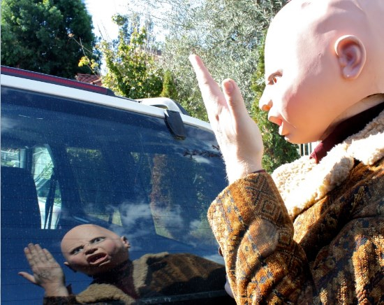

Op vrijdag 22 januari 2016 brengt Ty Segall zijn nieuwe album Emotional Mugger uit. De onbetwiste koning van de garagerock koos voor een unieke manier om de komst van dit album aan te kondigen. Hij stuurde een gebruikte VHS tape van de film My Life naar het Amerikaanse online muziek platform Pitchfork met daarop de elf nummers van Emotional Mugger gevolgd door het laatste deel uit de film.

Ruim een jaar geleden bracht veel doener Ty Segall onder zijn eigen naam het album Manipulator uit. Het album ontving wereldwijd lovende kritieken, eindigde hoog in de eindejaarslijsten en zette de underground cultheld definitief op de kaart. Zijn uitverkochte show in Paradiso ligt bij de bezoekers nog vers in het geheugen. Tussen het uitbrengen van Manipulator en het maken van Emotional Mugger heeft Ty Segall niet stilgezeten. Zo was hij betrokken bij vele projecten met onder meer Mikal Cronin, White Fence en WAND, bracht in oktober van dit jaar samen met Fuzz het album II uit en speelde met hen op Lowlands.

Wat er verwacht kan worden van Emotional Mugger is op dit moment alleen nog bekend bij de ontvangers van de VHS tape. Maar gezien Segall op zijn vorige albums de gruizige twee minuten punk pop voor semi akoestische ballads heeft ingeruild en zijn psychedelische grooves voor glamrock, is het zeer waarschijnlijk dat we ook op dit album weer iets totaal anders en vernieuwends kunnen verwachten.

Bekijk hier de video waarin Ty Segall verkleed als professor uitlegt wat Emotional Mugging is:

<iframe src="https://www.youtube-nocookie.com/embed/z3aklEgwjF8" title="Video" loading="lazy" allowfullscreen=""></iframe>

