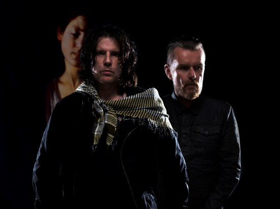

Op 5 februari 2016 brengt The Cult het nieuwe album Hidden City uit, dat heeft de band vandaag wereldkundig gemaakt. Hidden City is het tiende studioalbum van The Cult en het laatste deel uit een trilogie die in 2007 begon met het album Born Into This en in 2012 een vervolg kreeg met Choice of Weapon. Hidden City is een strak geweven geheel van ervaringen en visies met verlossing en wedergeboorte als onderliggende thema´s. Thema’s die als een rode draad door de muziek van The Cult lopen. Ian Astbury’s karakteristieke bariton en doorleefde teksten in combinatie met de smeulende en gestructureerde gitaartonen van Billy Duffy creëren een muzikaal landschap dat onverschrokken en ongeëvenaard is. Direct na de sonische aanval van openingstrack Dark Energy duikt Hidden City diep in de donkere onderbuik van haar onderwerp.

Afstammend van de Spaanse zin ‘La Ciudad Oculta´ oftewel ´Hidden City´ is het album door haar toon en complexiteit een muzikale weerspiegeling van het bewustzijn dat ontwaakt. Astbury licht toe: “Hidden City is a metaphor for our spiritual lives our intimate interior lives. I find today’s gurus are trying to peddle some cure, product or insight as if it’s a new phenomenon. My place is to respond, not react, to observe, participate and share through words and music. There is no higher authority than the heart”.

Hidden City is geproduceerd door Bob Rock en geschreven door Ian Astbury en Billy Duffy. Het resultaat is een even brutaal als wonderschoon album. De carrière van The Cult is constant in beweging. Van het iconische album Love, dat bol stond van het idealisme, via de fictie van het in 2001 verschenen Beyond Good & Evil naar Hidden City. The Cult leeft en ademt haar kunst. Voor de band breekt weer een nieuw hoofdstuk aan en terwijl de toekomst zich verder ontvouwt blijft The Cult reageren.
