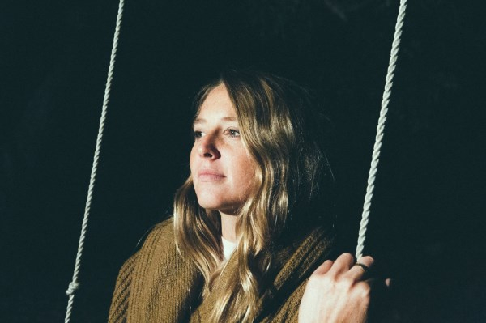

My Wild West opent met een ouverture, een introductie tot iets substantieels. Lissie’s derde album, haar meest persoonlijke tot nu toe en een passende ode aan haar leven in Californië. Toen was ze een jonge singer-songwriter, nu is ze verhuisd naar het middenwesten, wijzer en zelfverzekerder. Met als centrale nummers Hollywood en Ojai komen op My Wild West twee extremen uit het afgelopen decennium naar voren: de hoop en het hartzeer van de eerste stad en het stabiele, de vreugde en rust van de laatste. My Wild West vertegenwoordigt zowel een nieuw begin als een terugkeer naar haar wortels.

My Wild West is opgenomen in Nashville met Bill Reynolds, Lissie’s band uit Ojai en producer Curt Schneider in zijn Studio City. Terwijl het album zich ontvouwt horen we een zelfbewuste en krachtige Lissie. “I want my 40 acres in the sun”, zingt ze in Hero, een nummer dat ze schreef voordat ze besloot Californië te verlaten. Het verhaalt over haar strijd met het leven aan de westkust en de innerlijke kracht die ze kreeg toen ze haar problemen overwon door haar eigen pad te plaveien: “I could have been a hero, I could have been a zero, I could have been all of these things”.

Lissie’s verhaal van triomf en zelfgekozen avontuur werd geïnspireerd door sterke vrouwen in haar nabije omgeving, maar ook ver van huis. Lissie’s tante die overleed aan ALS vormde de inspiratie voor Sun Keeps Risin’, terwijl Daughters een pro-feministische oproep is gevoed door de Liberiaanse vredesactivist en Nobel Prijs winnaar Leymah Gbowee. De droevige klaagzang Shroud en het uptempo Go for a Walk laten licht schijnen op de yin-en-yang natuur van Lissie’s karakter. De eerste als een meditatie van depressie en isolatie, de laatste een bevestiging van de kracht van de natuur als het gaat over vernieuwing. Stay en Together or Apart gaan in op het plezier en de pijn van relaties, terwijl Don’t You Give Up On Me een spirituele peptalk is waarmee ze de mensen om haar heen aanmoedigd, ‘don’t you give up on me/As I dive into the dark/And slip into the endless sea.

Met een carrière waarin ze het voorprogramma verzorgde van Lenny Kravitz (fan van het eerste uur) en Tom Petty en gevraagd werd op te treden op de bruiloft van Ashton Kutcher en Demi Moore, heeft Lissie een schat aan geweldige ervaringen opgedaan die haar de doelgerichte artiest hebben gemaakt die ze tegenwoordig is. “I have a loyal, passionate fan base that every day is growing through its own power, not just an aggressive marketing campaign. I want to be an artist with longevity, which is an exciting prospect for me. I feel I’m in a really good place. In fact, I’m already planning a follow-up album, My Mild Midwest.”
