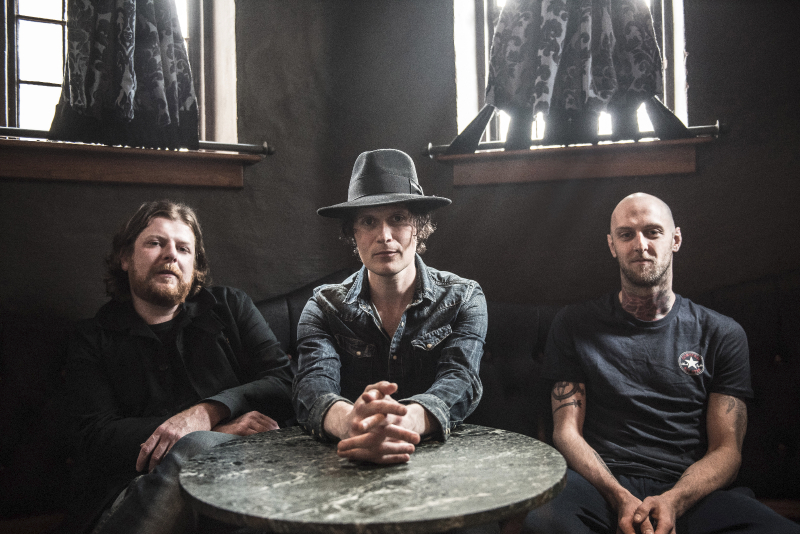

Er wordt gezegd dat hoogtevrees niet de angst voor het vallen is, maar de angst om te springen. Jon Fratelli kent die angst niet. Met Eyes Wide, Tongue Tied, het nieuwe album van The Fratellis dat op 21 augustus uitkomt, is hij met zijn band van grote hoogte gesprongen. Een hoogte die ze bereikten met drie albums, talloze awards en uitverkochte shows overal ter wereld. Jon heeft deze vrije val volledig omarmd, zijn bagage op de top laten staan en geniet meer dan ooit van alles. En dat wordt met Eyes Wide, Tongue Tied heel erg duidelijk. Het is het geluid van een bevrijde band met een nieuw album waar het vertrouwen, de passie en het pure speelplezier van afspat. Op maandag 26 oktober staat The Fratellis in Paradiso, Amsterdam.

Na de release van We Need Medicine in 2013 tourde het drietal uit Glasgow, naast Jon bestaande uit bassist Barry Fratelli en drummer Mince Fratelli, een jaar lang de wereld over. Aan het einde van 2014 vertrokken ze naar Los Angeles om aan album nummer vier te beginnen met Tony Hoffer, o.a. The Kooks, Beck en Belle & Sebastian en muzikaal architect van het megasuccesvolle debuut Costello Music. De band wilde het album eerst zelf produceren en had al veel nummers klaar, maar de meesten werden overboord gegooid en met Hoffer aan het roer werd het album in slechts vier weken geschreven en opgenomen. De band is richtingen uitgegaan die ze zonder Hoffer nooit was uitgegaan en heeft de mogelijkheden die Hoffer ze bood optimaal benut.

Het zonovergoten Californische klimaat loopt als een rode draad door het album heen met in het episch centrum dezelfde humor en energie die zo kenmerkend was voor het debuut. Eyes Wide, Tongue Tied is een wonderbaarlijk en enerverend werk vol verhalen en karakters die de spirit van L.A. verwoorden. Met herkenbare knikjes naar jaren ’70 Cali-rock, rockabilly, vleugjes Americana en Country. Het is een album dat muzikaal geworteld is in zowel Los Angeles als Schotland.

Luister hier naar de eerste track Me And The Devil:

<iframe src="https://www.youtube-nocookie.com/embed/1yQ_grujECk" title="Video" loading="lazy" allowfullscreen=""></iframe>

