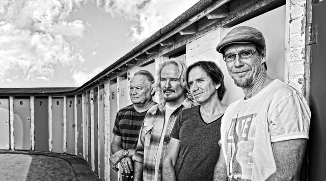

De Amerikaanse West Coast band VENICE komt eind april voor 9 concerten naar  
Nederland. In hun nieuwe ‘Brunch Buffet Tour’ delen ze aan de hand van een  
verzameling van hun favoriete covers hun muzikale herinneringen met het publiek.  
“We zijn door zoveel meer dan alleen West Coast muziek beïnvloed en deze tour is een  
mooie kans om de verhalen maar vooral de prachtige songs met ons publiek te  
delen”.

Aanleiding van deze tour is het nieuwe Venice album ‘Brunch Buffet – Tasty Covers’ dat dit voorjaar uitkomt. Het album is een eerbetoon van de band aan hun muzikale  
invloeden en bevat de band’s dierbaarste tracks van onder meer Neil Young,  
Jackson Brown, Stevie Wonder en Steely Dan in een speciale Venice uitvoering.  
“Een mooie manier om samen met het publiek stil te staan bij de muziek en de  
artiesten die ons hebben gemaakt tot wat we nu zijn”.

De Amerikaanse formatie Venice wordt wereldwijd geroemd om hun perfecte West Coast harmonies. De band bestaat uit twee sets broers, Michael en Mark Lennon &  
Kipp en Pat Lennon die zijn geboren en getogen in Venice Beach, Californië.  
Sinds de jaren 80 treden ze samen op en hebben, beinvloed door onder meer  
Crosby, Stills & Nash, Fleetwood Mac en The Eagles, een eigen folk/rock/soul  
sound ontwikkeld met als handelsmerk hun fenomenale vierstemmige  
zangpartijen.

De Lennons beschouwen Nederland als hun tweede vaderland. Sinds hun doorbraak  
hier eind 90er jaren hebben ze, samen met bassist Mark Harris, drummer  
Dann Gillen en sinds recent de inbreng van Nederlandse toetsenist Jasper  
Westerhof, een grote schare trouwe fans opgebouwd en werden ze beloond met onder  
meer een gouden album en een Edison voor Beste Internationale artiest. Hun  
zonnige ‘harmony-sound’, persoonlijke teksten en betrokken shows leveren Venice  
in Nederland iedere tour staande ovaties op.

Ook in de US behoort de band tot de vaste waarden van de music scene.  
Zo maakten ze in 2010 deel uit van de meer dan tweehonderd shows tellende stadion  
tour met Pink Floyd frontman Roger Waters en leverden de bandleden de afgelopen jaren bijdragen aan tribute albums van iconen als Crosby, Stills, Nash & Young,  
Bruce Springsteen, Don Henley en Jackson Brown.

Afgelopen zaterdag stond Venice samen met onder meer Bonnie Raitt op het podium van de Troubadour in Hollywood, in de ‘Tribute to Glenn Frey’ show. “Venice reading of “Desperado” soared thanks to the spot-on four-part harmonies by the band’s two  
pair of sibling singers” (L.A. Times).

**26 april:**  
Nijmegen, Stadsschouwburg

**28 april:**  
Hengelo, Rabotheater

**29 april**  
Heerlen, Parkstad Theaters Limburg

**30 april**  
Utrecht, Tivoli/Vredenburg

**2 mei**  
Rotterdam, De Doelen

**3 mei**  
Groningen, Oosterpoort

**5 mei**  
Eindhoven, Frits Philips

**6 mei**  
Zwolle, De Spiegel

**8 mei**  
Doetinchem, Amphion
