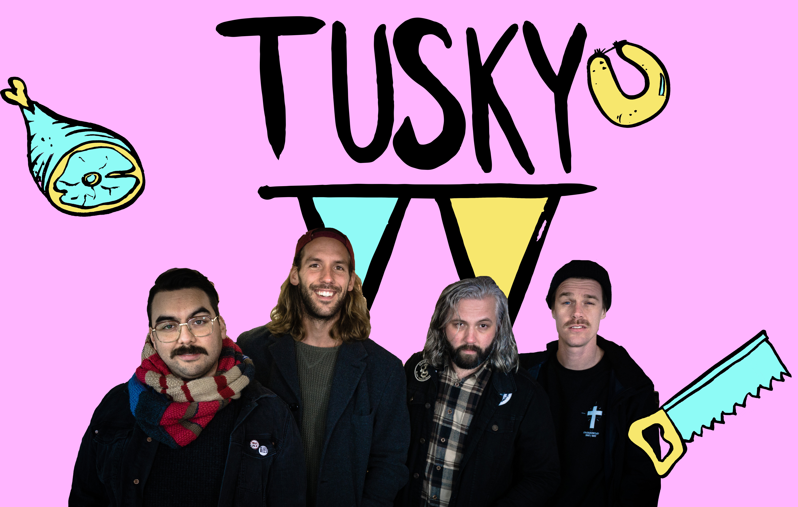

’Foo Fighters en The Offspring zijn getrouwd, gescheiden en het boze kind Tusky vraagt om aandacht. Of nou ja, ‘vraagt’, ze eisen aandacht!’. Was getekend 3VOOR12. De nieuwe Nederlandse punkrock band rondom voormalig John Coffey gitarist Alfred Luttikhuizen, John Coffey gitaar-tech Sjors van Reeuwijk, drummer Bas Allein Richir en bassist Justin Ghijsen is de leukste punkrock familie van Nederland en sluit zich per direct aan bij V2 Records. Check hier de laatste single You Will Not Regret This.

Als een van de absolute smaakmakers tijdens de Popronde van dit jaar brak Tusky al menig zaaltje af. Met hun snoeiharde gitaar riffs blaast de in Alblasserdam gevestigde band de trommelvliezen uit je kop, waarna ze vervolgens de zaal met de grond gelijk maken.

Ongecompliceerde punkrock-songs, zo simpel is het! Beetje moshen, hier en daar een ‘windmill kick’ of een goed geplaatste ‘head bang’. Allemaal te gek! Met invloeden van bands als Jimmy Eat World en Foo Fighters maakt Tusky de punk en rock van eind jaren 90 weer relevant.

**“De punk bands uit de jaren ’90 wisten hoe ze super catchy liedjes moesten schrijven en tegelijkertijd kneiterhard rocken. Dat is wat wij willen doen. Niets meer, niets minder. Een goed liedje, veel lol en samen met het publiek een feest maken.” – Tusky**

Op dit moment werkt Tusky hard aan het debuutalbum dat begin volgend jaar zal verschijnen. De releaseshow vindt op 2 maart plaats in Ekko, Utrecht, maar tot die tijd kun je de band nog op diverse andere podia live zien.

12.10 Kafé België, Utrecht  
04.11 Paatboef, Rotterdam  
04.11 Zondebok & ’t Zwarte Schaap, Rotterdam  
10.11 Podium Victorie, Alkmaar  
11.11 De Heks, Deventer  
17.11 De Pul, Uden  
21.12 Hall Of Fame, Tilburg  
22.12 De Zwarte Ruyter, Den Haag  
23.12 Effenaar, Eindhoven (w/ Call It Off)

<iframe src="https://www.youtube-nocookie.com/embed/1eVfwwJ13UA" title="Video" loading="lazy" allowfullscreen=""></iframe>
